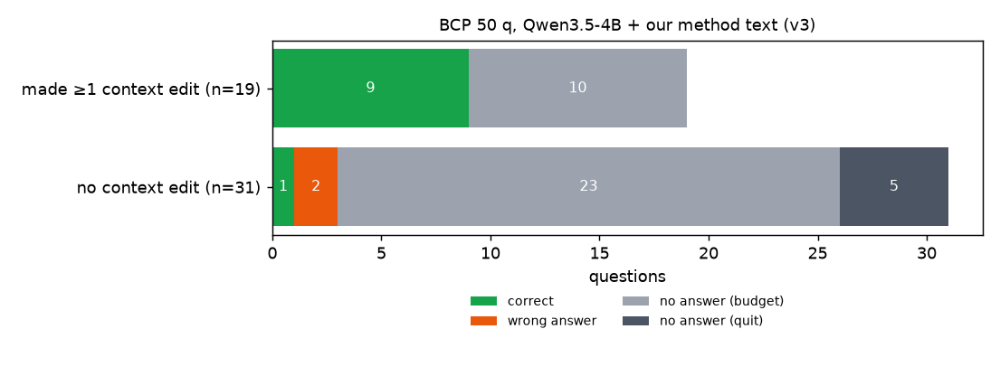

# BCP 50 questions: Qwen3.5-4B + our method text (v3)

Date: 2026-11-14, 19:02–19:37 UTC (35 min, 8 concurrent). Status: **done** (50/50).
Plan: [`../instruction-reimplementation.md`](../../instruction-reimplementation.md) (M4).
Raw trials: `runs/bcp50-v3/trials/` (gitignored). Per-question table: [`figs/bcp50-v3.md`](../figs/bcp50-v3.md).
Smoke and variant choice: [`bcp-smoke-results.md`](bcp-smoke-results.md).

## Setup (control unless marked)

- Model: Qwen3.5-4B BF16, vLLM 0.33.0 (shared with LogTriage / Needle runs).
- Agent: `ClmAgent` with `bcp.yaml` (max_steps 500, T=0.7, budget 28672 / reserve 2048,
  nudges 0.25/0.5/0.75 + persistent 0.9, finalize 3), `cost_metric=usd`.
- Questions: the fixed 50-question sample (`data/bcp/sample_seed0_n50.json`, seed 0).
- Retrieval: BM25, top-10, 512-token snippets, 8192-token reader (plan settings).
- **Deviation (ours, not the paper's):** v3 method text in the task instruction (offload each
  result block to disk with a one-line note; keep a provisional `/app/answer.md`), tool
  outputs wrapped in id'd blocks (`BCP_SKILL=bcp_search_ids BCP_TASKS=bcp_tasks_v3`).
- **Grading:** substring match of the gold answer in `Exact Answer:` (no LLM judge, user
  decision). All 10 graded correct were checked by hand: each is an exact match of the gold
  answer, so there are no false positives. False negatives are possible only among the 2
  answered-wrong (both checked: genuinely wrong).

## Results

**10 / 50 correct (20%)**, 12 answered, mean 5.3 min and 13.7 LM calls per question.

| outcome | made ≥ 1 context edit (n=19) | no context edit (n=31) | total |
|---|---|---|---|
| correct | **9** | 1 | 10 |
| wrong answer | 0 | 2 | 2 |
| no answer, budget exhausted (6/6 rollbacks) | 10 | 23 | 33 |
| no answer, quit within 2 calls | 0 | 5 | 5 |

Paper references (plan; judged, paper's own setup, no method text): Qwen3.5-9B 28.8%,
Qwen3.6-27B 59.4%. Not directly comparable: our 4B uses our method text and a substring
grader.

## Analysis

1. **Editing context is what separates success from failure.** Trials that made at least one
   real context edit got 9/19 right (47%); trials that never edited got 1/31 (3%). This is
   correlation, not proof (easier questions may both invite edits and be solvable), but it
   mirrors ContextBench, where edit-or-not decides the score.
2. **The method text is adopted only 38% of the time** (19/50 trials made any edit). When it
   is adopted it is used sparingly: 1–9 edits, median 3, often batching several blocks into one.
   On KV the same model edits once per batch, every batch.
3. **The "keep a provisional answer" instruction mostly fails.** 33 trials ran out of context
   without writing any answer, despite the instruction, 2–11 nudges each, and the final-turn notice.
   This is the largest loss bucket and the cheapest to fix (e.g. a harness-side finalize turn).
4. **Precision is high:** 10 of 12 answers are right; answers are written only when the
   model has found the evidence. Stated confidence is mostly 95–100%.
5. **Run-to-run variance is large:** 1204 failed in all three smoke variants but is correct
   here, while 69 and 624 (both correct in smoke v3, same setup) ran out of budget unanswered
   here. Smoke v3 on the same 5 questions: 2/5; here: 1/5. n=1 per question, so per-question
   claims are weak, and the 20% has a wide interval (Wilson 95%: ~11–33%).

## Utilization (19:02–19:42, 30 s samples)

GPU util 100% throughout, CPU mean 12% (max 18%) of 96 cores. GPU-bound, shared with
6–9 ContextBench trials at the same time, so wall-clock times include queueing in vLLM.

## Caveats

- Our method text is a deviation; the 20% is "4B + our BCP recipe", not the paper's condition.
- Substring grading; the planned 27B judge was not run.
- One seed per question.
