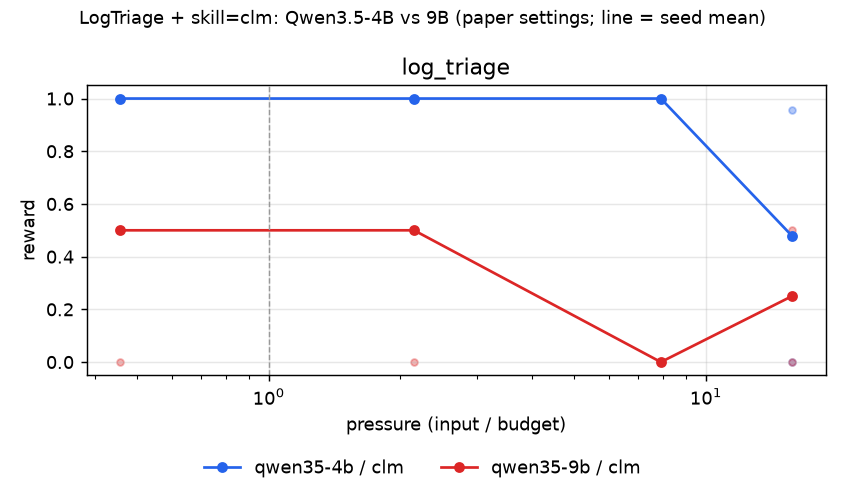

# M2b (9B): ContextBench LogTriage, Qwen3.5-9B + skill=clm, vs 4B

Date: 2026-11-14, 20:08–21:22 UTC. Status: **done** (8/8 trials).
Raw trials: `runs/m2b-logtriage-9b-clm/trials/` (gitignored). Per-trial table (both models):
[`figs/m2b-logtriage-4b-vs-9b.md`](../figs/m2b-logtriage-4b-vs-9b.md). 4B run: [`m2b-logtriage-results.md`](m2b-logtriage-results.md).

## Setup

Identical to the 4B LogTriage run (`skill=clm`, `CB_SETTINGS=paper`, levels L320 / L1600 /
L6400 / L12800, seeds 42 / 43, proot), except **vary: model = Qwen3.5-9B**.

## Results

| Level | Pressure | 9B s42 | 9B s43 | 4B s42 | 4B s43 | 9B failure |
|---|---|---|---|---|---|---|
| L320 | 0.51x | **1.000** | 0.000 | 1.000 | 1.000 | s43: wall at 33/47, dumped all request ids into context |
| L1600 | 2.2x | 0.000 | **1.000** | 1.000 | 1.000 | s42: wall at 95/139 |
| L6400 | 7.9x | 0.000 | 0.000 | 1.000 | 1.000 | s42: answers written as chat text, not printed (1/24 graded); s43: wall at 54/143, grepped the mirror file |
| L12800 | 15.8x | 0.000 | 0.500 | 0.000 | 0.958 | s42: wall at 99/262; s43: 2 of 238 batches never offloaded → all 12 counts off by a few |

Mean: 9B 0.31, 4B 0.87.

## Analysis

1. **The 9B is much worse than the 4B at LogTriage** (0.31 vs 0.87); the 4B was perfect up
   to 8x on both seeds, the 9B on 2 of 8 trials.
2. **Four distinct 9B failure modes, none of them retrieval:**
   - *Residue / dumping → budget wall* (4 trials): context fills from its own turns or from
     commands the recipe forbids (`grep` on the mirror file, listing every request id).
   - *Format* (L6400 s42): finished the stream with the right counts but wrote the ANSWER
     blocks as chat text instead of printing them from a command; ungraded.
   - *A few dropped offloads* (L12800 s43): 236 edits for 238 batches; the two missing batches
     make every count slightly low (283 vs 287, 1283 vs 1291, 564 vs 568), and exact-match
     grading zeroes all 12 counts while all 12 lookups are right.
3. **Same picture as KV:** the 9B improvises around the recipe (extra inspection commands,
   free-form answers) where the 4B executes it literally. On a repetitive, literal recipe that
   costs the 9B; on Needle's intricate recipe its fidelity wins ([`m2c-needle-9b-results.md`](m2c-needle-9b-results.md)).

## Caveats

- n = 2 seeds per level. Count diagnosis: expected counts recomputed from the task stream,
  model answers read from context snapshots (the sandbox itself is deleted after each trial).
- 9B trials shared the server with 9B KV, Needle and BCP runs (up to 23 concurrent).
