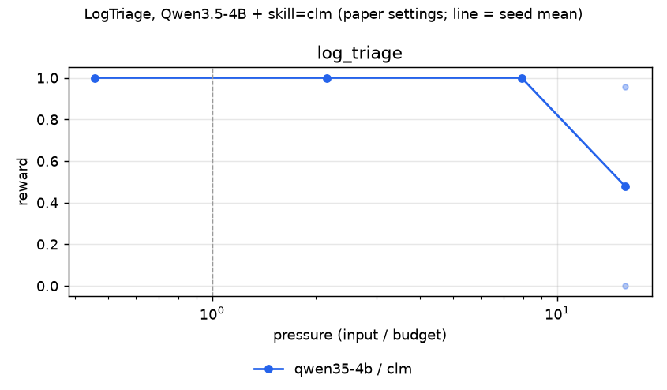

# M2b results: ContextBench LogTriage, Qwen3.5-4B + skill=clm

Date: 2026-11-14, 18:52–19:52 UTC. Status: **done** (8/8 trials).
Raw trials: `runs/m2b-logtriage-clm/trials/` (gitignored). Per-trial table: [`figs/m2b-logtriage.md`](../figs/m2b-logtriage.md).
Ran concurrently with Needle (M2c) and the BCP 50-question run on one vLLM server.

## Setup (control unless marked)

- Model: Qwen3.5-4B BF16, vLLM 0.33.0. Agent: `ClmStream`, `skill=clm` (paper's
  `log_triage.md` method text), `CB_SETTINGS=paper` (32768 / 2048, no step cap, no nudges).
- Task: log lines pushed in batches, then 24 questions (12 lookups of one request's line,
  12 counts); the model offloads batches to disk and answers with `grep`.
- **Vary:** level L320 (0.51x) / L1600 (2.2x) / L6400 (7.9x) / L12800 (15.8x, the highest
  paper rung); seed 42 / 43. Timeout 28800 s, proot sandbox.

## Results

| Level | Pressure | seed 42 | seed 43 | offload edits | peak ctx | wall time |
|---|---|---|---|---|---|---|
| L320 | 0.51x | **1.000** | **1.000** | 23 / 23 | 20.0k / 11.8k | 14 min |
| L1600 | 2.2x | **1.000** | **1.000** | 115 / 115 | 12.9k / 12.7k | 45 min |
| L6400 | 7.9x | **1.000** | **1.000** | 119 / 119 | 12.3k / 11.5k | 46 min |
| L12800 | 15.8x | 0.000 (budget wall, op 175/262) | **0.958** (23/24) | 170 / 238 | 26.5k / 13.5k | 54–60 min |

7 of 8 trials ≥ 0.96; mean 0.87.

## Analysis

1. **4B + clm solves LogTriage up to 8x, and up to 16x on one seed.** One offload edit per
   batch (23 / 115 / 119 / 238 = number of batches), context flat at 11–13k, answers via `grep`
   on the offloaded files. Without the skill the 4B hits the wall at 0.5x (smoke grid: 0.0).
2. **The one failure is a drift, not a misunderstanding.** L12800 seed 42 ran the recipe
   correctly for 166 turns (context ~6.9k, 6 messages). Then, around op 170, it stopped
   cutting its own previous turns: messages in context went 6 → 66 and tokens 6.9k → 26.5k in
   ~35 turns, and it hit the budget wall with 22 questions unanswered. Its 2 answers were wrong.
   Same model, same level, seed 43 never drifted (238 edits, 23/24).
3. **Long-horizon reliability is the 4B's limit here.** Error-free up to ~140 ops on every
   run; the only drift came after 166 consecutive correct edits. Compare Needle, where the
   failure is copying the recipe wrong from the start ([`m2c-needle-results.md`](m2c-needle-results.md)).
4. Cost is linear in batches: ~1.2 LM calls per op, ~45 min for ~140 ops at 8–12 concurrent trials.

## Utilization

GPU 100% throughout (shared run); CPU 10–18% of 96 cores. Wall times are inflated by
sharing the GPU with up to 16 other trials.

## Caveats

- n = 2 seeds per level. L12800 is 15.8x, the highest LogTriage rung in paper.yaml (no 24x).
- The drift diagnosis comes from snapshot token / message counts, not a turn-by-turn read.
