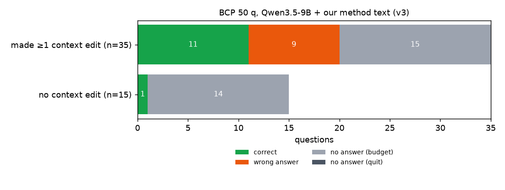

# BCP 50 questions: Qwen3.5-9B + our method text (v3), vs 4B

Date: 2026-11-14, 21:04–22:24 UTC (80 min, 10 concurrent). Status: **done** (50/50).
Raw trials: `runs/bcp50-v3-9b/trials/` (gitignored). Per-question table: [`figs/bcp50-v3-9b.md`](figs/bcp50-v3-9b.md).
4B run (same setup): [`bcp50-v3-results.md`](bcp50-v3-results.md).

## Setup

Identical to the 4B BCP-50 run (`bcp.yaml`, BM25 top-10 / 512 / 8192, same 50 questions,
our v3 method text in the instruction, substring grader, no judge), except
**vary: model = Qwen3.5-9B** (`MODEL=qwen35-9b`). Ran mostly alone on the 9B server
(the last 9B ContextBench trials finished during the first 20 min).

## Results

| | 4B | 9B |
|---|---|---|
| correct (substring, strict) | 10 / 50 | **12 / 50** |
| correct after hand check | 10 | **13** (+ 1 possible alias) |
| answered | 12 | 21 |
| wrong answers | 2 | 9 |
| no answer, budget exhausted | 33 | 29 |
| no answer, quit early | 5 | 0 |
| trials with ≥ 1 context edit | 19 (38%) | 35 (70%) |
| correct when edited / not | 9 / 19 vs 1 / 31 | 11 / 35 vs 1 / 15 |
| mean LM calls / minutes per question | 13.7 / 5.3 | 23.7 / 12.0 |

Hand check of the 9 "wrong" 9B answers: **1252** "2004 Athens Olympics (Aug 13-29, 2004)" vs gold
"August 13-August 29, 2004" is equivalent (substring false negative). **987** "Guillem Vilella
Falgueras" vs gold "Guille Milkyway" may be the same person under a stage name; not verifiable
offline, counted as wrong. The other 7 are wrong (e.g. 624: 66% vs 65%).

Paper reference (plan; paper's own setup, no method text, 27B judge): Qwen3.5-9B 28.8%.
Our 9B: 24–26%. Close, but not the same condition.

## Analysis

1. **9B ≥ 4B on BCP, unlike KV / LogTriage.** 12–13 vs 10 correct; the 9B adopts the
   method text far more (70% of trials edit vs 38%), never quits early, and answers 21
   questions vs 12.
2. **Editing still separates success from failure** for both models: 11/35 vs 1/15 (9B),
   9/19 vs 1/31 (4B). Correlational, as before.
3. **The 9B trades precision for coverage:** 12–13 of 21 answers right (≈ 60%) vs 10 of 12
   (83%) for the 4B; it commits to plausible wrong candidates (427, 576, 758).
4. **Budget exhaustion without an answer is still the biggest bucket** (29 / 50), despite
   the "keep a provisional answer" instruction, for both models.
5. **Cost:** the 9B takes ~1.7x the LM calls and ~2.3x the wall time per question.
6. **Little overlap between the models.** Correct for both: 5 (120, 505, 514, 771, 1266);
   4B only: 5 (581, 887, 978, 1155, 1204); 9B only: 7 (69, 235, 428, 821, 1023, 1115, 1260).
   17 distinct questions solved by at least one model; with n=1 per question, which
   questions get solved is largely run-to-run luck.

## Caveats

- Our method text is a deviation from the paper; substring grading plus a hand check, no judge.
- One run per question; the 20–26% values have wide intervals (Wilson 95% for 13/50: ~16–39%).
