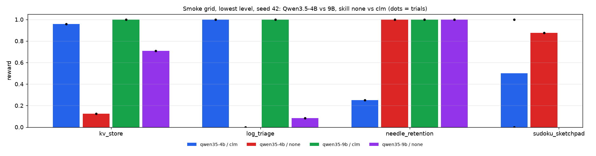
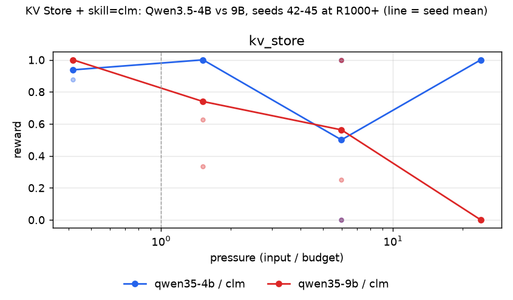
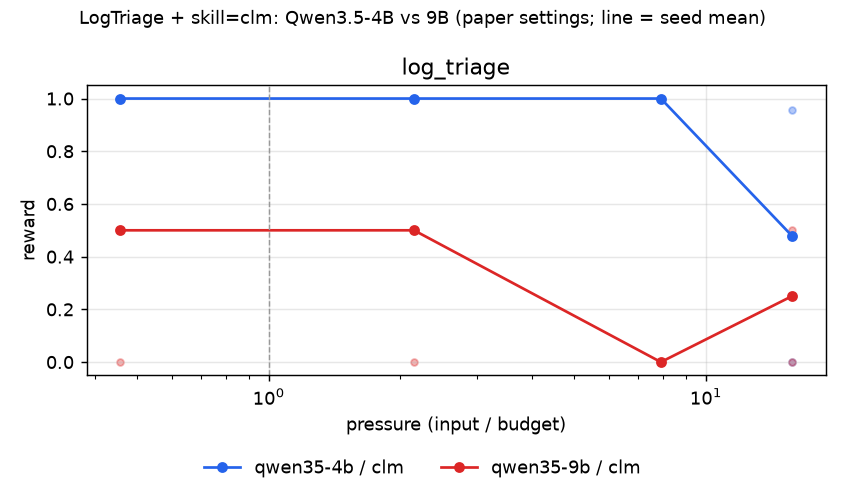
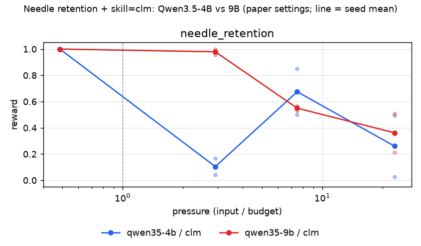
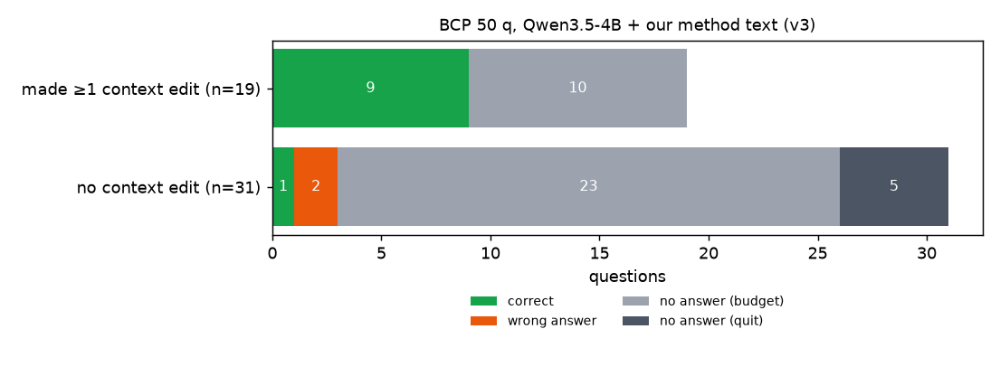
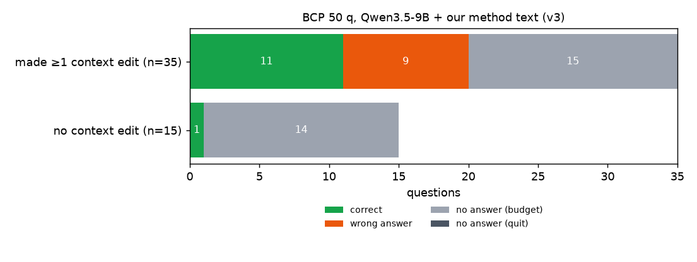

# M2 + BCP results: ContextBench and BrowseComp-Plus, Qwen3.5-4B vs 9B (combined)

Date: 2026-11-14, 18:23–22:49 UTC (BCP 18:23–22:24). Status: **done**. Sudoku: smoke only, then skipped this sprint
([`../decisions.md`](../decisions.md)).
Plan: [`../instruction-reimplementation.md`](../instruction-reimplementation.md) (M2, M4).
This file merges the per-run notes, now in [`archive/`](archive/) (listed at the end).
Raw trials live under `runs/` (gitignored); per-trial tables and plots are in `figs/`.

## ContextBench setup (control unless marked)

- Serving: vLLM 0.33.0, BF16, one A40, one model served at a time on :8000 (65k
  max-model-len, prefix caching, 0.9 memory fraction). Many trials run concurrently on it.
- Agent: `clm_contextbench:ClmStream`; `skill=clm` means the paper's per-family method text.
- `CB_SETTINGS=paper`: budget 32768 / reserve 2048, no step cap, no nudges, T=0.7,
  top_p 0.95, max_tokens 8192, thinking on. (M1 used App. F: 32000 / 4096 / 240 steps.)
- Sandbox: proot (no Docker on this host). Timeout 28800 s per trial.
- **Vary:** model (4B / 9B), skill (none / clm, smoke grid only), family, pressure level, seed.

| Family | Levels (pressure) | Seeds | Metric |
|---|---|---|---|
| KV Store | R260 (0.46x) / R1000 (1.57x) / R4000 (6.04x) / R16000 (23.9x) | 42, 43; plus 44, 45 at R1000+ | exact value accuracy over 24 GETs |
| LogTriage | L320 (0.51x) / L1600 (2.2x) / L6400 (7.9x) / L12800 (15.8x) | 42, 43 | 12 lookups + 12 counts, exact match |
| Needle | K4-C4 (0.52x) / K4-C24 (2.96x) / K8-C60 (7.54x) / K2-C192 (23.1x) | 42, 43 | needles verbatim in context at the end |

## Headline

| Family | 4B + clm | 9B + clm |
|---|---|---|
| KV, R1000 / R4000 / R16000 (4 seeds) | **1.00** / 0.50 / **1.00** | 0.74 / 0.56 / **0.00** |
| LogTriage, mean of 8 trials | **0.87** | 0.31 |
| Needle, mean of 8 trials | 0.51 | **0.72** |

**The two models fail CLM in complementary ways.** The 4B executes the literal "cut a block,
save it to disk" recipes (KV, LogTriage) for hundreds of turns, but often copies the more
intricate Needle recipe wrong. The 9B copies the intricate recipe correctly, but improvises on
long literal ones and lets its own residue build up until it hits the budget wall.
**Without the skill, neither model manages context:** both hit the wall at ~0.5x on KV and LogTriage.

On **BCP** (50 questions, with our own method text), the 9B is slightly ahead: 13 vs 10 correct
after a hand check. In both models, trials that edited their context were far more often correct.

## 1. Smoke grid: model × skill, lowest level, seed 42

| Family | 4B none | 4B clm | 9B none | 9B clm |
|---|---|---|---|---|
| KV R260 | 0.125 (wall op 7/27) | **0.958** | 0.708 (wall op 21/27) | **1.000** |
| LogTriage L320 | 0.000 (wall op 17/47) | **1.000** | 0.083 (wall op 27/47) | **1.000** |
| Needle K4-C4 | **1.000** (fits) | 0.250 (needles deleted) | **1.000** | **1.000** |
| Sudoku t8 | 0.875 | 0.000 (s42) / 1.000 (s43) | not run | not run |

- Where the stream does not fit as delivered, the skill decides everything: without it both
  models keep raw batches in context and hit the wall early (0–1 edits). The 9B lasts longer.
- Where everything fits (Needle K4-C4, Sudoku t8), the skill can hurt the 4B: one slip in an
  intricate recipe is fatal (Needle: dropped the slice that keeps the needles; Sudoku s42: lost
  one move, 255/256 cells right, 0/8 graded). That slip reproduced, so Sudoku was skipped.
- 9B KV `none` scored 0 in M1 (App. F settings) but 0.71 here; the ~2.5k extra tokens of
  headroom in the paper settings matter at this level.

## 2. KV Store + clm

| Level | 4B s42 / s43 / s44 / s45 | 4B mean | 9B s42 / s43 / s44 / s45 | 9B mean |
|---|---|---|---|---|
| R260 | 0.875 / 1 / – / – | 0.94 | 1 / 1 / – / – | **1.00** |
| R1000 | 1 / 1 / 1 / 1 | **1.00** | 0.63 / 0.33 / 1 / 1 | 0.74 |
| R4000 | 1 / 1 / **0 / 0** | 0.50 | 1 / 0.25 / 1 / 0 | 0.56 |
| R16000 | 1 / 1 / 1 / 1 | **1.00** | 0 / 0 / 0 / 0 | **0.00** |

- **4B:** one offload edit per SET batch (3 / 10 / 40 / 160), peak context 11–15k regardless of
  input size; 16,000 records (~775k value tokens) through a 32k window on all 4 seeds. The only
  losses are R260 s42 (answered from context instead of `grep`, 21/24) and R4000 s44 / s45, which
  both hit the wall (ops 34, 38 of 64) from residue build-up: s45's message count climbed
  60 → 78; s44 carried ~18.8k from early on and then missed one batch.
- **9B:** retrieval works (101 of 102 answered GETs correct), but it hit the wall in 8 of 12
  trials above 0.5x (4B: 2 of 12). It offloads batches but stops applying the recipe's `prev`
  cut, so its own commands and harness notes pile up; onset anywhere from turn 7 to 38. In
  R16000 it died at ops 32–43, before the GETs start at op 160. R4000 s43 also grepped the
  mirror file 10 times, which the recipe forbids.
- The R16000 gap (4/4 vs 0/4) is the clearest single result. R4000 shows that 2 seeds were not
  enough to call the 4B "solved".

## 3. LogTriage + clm

| Level | 4B s42 | 4B s43 | 9B s42 | 9B s43 | Failure |
|---|---|---|---|---|---|
| L320 | 1.000 | 1.000 | **1.000** | 0.000 | 9B s43: wall at 33/47, dumped all request ids into context |
| L1600 | 1.000 | 1.000 | 0.000 | **1.000** | 9B s42: wall at 95/139 |
| L6400 | 1.000 | 1.000 | 0.000 | 0.000 | 9B s42: answers written as chat text, not printed (1/24 graded); s43: wall at 54/143, grepped the mirror file |
| L12800 | 0.000 | 0.958 | 0.000 | 0.500 | 4B s42: drift after 166 good turns, wall at 175/262; 9B s42: wall at 99/262; 9B s43: 2 of 238 batches never offloaded, so all 12 counts off by a few |

- **4B (mean 0.87):** one edit per batch, context flat at 11–13k, perfect up to 8x on both seeds.
  Its one failure was a drift, not a misunderstanding: after 166 correct turns it stopped cutting
  its own previous turns (messages 6 → 66, tokens 6.9k → 26.5k in ~35 turns).
- **9B (mean 0.31):** four failure modes, none of them retrieval: residue / dumping into
  context (4 trials), answers as chat text, and a few dropped offloads (exact-match grading
  zeroes all 12 counts while all 12 lookups are right).

## 4. Needle Retention + clm

| Level | 4B s42 | 4B s43 | 9B s42 | 9B s43 | Ops reached (4B / 9B) |
|---|---|---|---|---|---|
| K4-C4 | 1.000 | 1.000 | **1.000** | **1.000** | all / all |
| K4-C24 | 0.042 | 0.167 | **0.958** | **1.000** | all / all |
| K8-C60 | 0.500 | **0.850** | 0.567 | 0.533 | 34, 52 / 34, 32 of 60 (all wall) |
| K2-C192 | 0.026 | 0.495 | 0.214 | **0.510** | 6, 101 / 41, 98 of 192 (all wall) |

- **4B (mean 0.51): wrong anchor.** The paper's recipe anchors on the chunk header
  (`h = '=== chunk N/'`) and keeps header + needles while cutting the filler. The 4B often
  anchors on the filler's START or END line instead, so each edit deletes that chunk's needles.
  Runs whose last edit kept the header score 0.85–1.0; runs that swapped it score 0.03–0.5.
- **9B (mean 0.72): faithful recipe, then the wall.** Every 9B trial keeps every needle it has
  seen; its score equals the fraction of the stream it got through. At K4-C24 (no wall for either
  model) the gap is 0.98 vs 0.10.
- **At ≥ 7.5x both hit the wall** at ~25–26k tokens, although retained needles are only ~10–12k:
  residue again.

## 5. BrowseComp-Plus (BCP), M4

### Setup (control unless marked)

- Agent: `ClmAgent` with `bcp.yaml` (max_steps 500, T=0.7, budget 28672 / reserve 2048, nudges
  0.25 / 0.5 / 0.75 + persistent 0.9, finalize 3). **Changed:** `cost_metric=usd` (bcp.yaml's
  FLOPs key is for 27B).
- Retrieval: BM25 server on :8100, top-10, 512-token snippets, 8192-token reader (plan settings);
  tools `search` / `get_document` reachable from proot.
- Questions: the fixed 50-question sample (`data/bcp/sample_seed0_n50.json`, seed 0); smoke used
  5 of them (624, 1204, 679, 69, 427). One run per question.
- Grading: substring match of the gold answer in `Exact Answer:`, plus a hand check. **No LLM
  judge** (user decision); answers are kept in `/app/answer.md` for later judging.
- **Deviation (ours, not the paper's):** the paper's BCP runs give no method text. We added one,
  modelled on the KV recipe: tool outputs come in id'd blocks (`<<<R0007 BEGIN … R0007 END>>>`);
  offload each block to disk with a one-line note; keep a provisional `/app/answer.md`.

### Smoke: where to put the method text (4B, 5 questions)

| QID | v1: as configured | v2: method in system prompt (SKILL.md) | v3: method in task instruction |
|---|---|---|---|
| 69 | 0, no answer, 0 edits | **1**, 4 edits | **1**, 1 edit |
| 624 | 0, no answer, 0 edits | 0, answered wrong | **1** |
| 427 | 0, quit at call 1 | 0, no answer | 0, no answer, 3 edits |
| 679 | 0, no answer, 1 edit | 0, no answer | 0, quit at call 1 |
| 1204 | 0, no answer, 0 edits | 0, no answer | 0, no answer |
| **answered / correct** | 0 / 0 | 2 / 1 | **2 / 2** |

- v1 works end to end but the 4B never offloads: each `search` adds ~4–5k tokens, so the 28.6k
  budget holds ~5 searches, then rollbacks loop until the budget is gone. Same as KV without the skill.
- Rule set before the run (≥ 2/5 answered → run 50) chose v3, which matches where ContextBench
  puts its method section (`BCP_SKILL=bcp_search_ids BCP_TASKS=bcp_tasks_v3`).

### 50 questions, v3

| | 4B | 9B |
|---|---|---|
| correct (substring, strict) | 10 / 50 | **12 / 50** |
| correct after hand check | 10 | **13** (+ 1 possible alias) |
| answered | 12 | 21 |
| wrong answers | 2 | 9 |
| no answer, budget exhausted | 33 | 29 |
| no answer, quit within 2 calls | 5 | 0 |
| trials with ≥ 1 context edit | 19 (38%) | 35 (70%) |
| correct when edited / not | 9 / 19 vs 1 / 31 | 11 / 35 vs 1 / 15 |
| mean LM calls / minutes per question | 13.7 / 5.3 | 23.7 / 12.0 |
| run | 19:02–19:37, 8 concurrent | 21:04–22:24, 10 concurrent |

Hand check: all 10 4B "correct" are exact gold matches and its 2 wrong answers are genuinely
wrong. Of the 9B's 9 "wrong": **1252** "2004 Athens Olympics (Aug 13-29, 2004)" vs gold "August
13-August 29, 2004" is equivalent (counted correct); **987** "Guillem Vilella Falgueras" vs gold
"Guille Milkyway" may be a stage name (not verifiable offline, counted wrong); the other 7 are wrong.

Paper references (judged, paper's setup, no method text): Qwen3.5-9B 28.8%, Qwen3.6-27B 59.4%.
Our 9B: 24–26%. Close, but not the same condition.

- **Editing context separates success from failure** in both models (47% vs 3% for the 4B,
  31% vs 7% for the 9B). Correlation, not proof: easier questions may both invite edits and be solvable.
- **The 9B adopts the method text far more** (70% of trials vs 38%) and never quits early, but
  trades precision for coverage: ~60% of its answers are right vs 83% for the 4B. When the 4B edits,
  it edits sparingly (1–9 edits, median 3), unlike its one edit per batch on KV.
- **The biggest loss is running out of budget with no answer** (33 / 29 of 50), despite the
  "keep a provisional answer" instruction, 2–11 nudges and the final-turn notice. A harness-side
  finalize turn is the cheapest fix.
- **Little overlap:** both models solved 5 questions (120, 505, 514, 771, 1266); 4B only 5 (581,
  887, 978, 1155, 1204); 9B only 7 (69, 235, 428, 821, 1023, 1115, 1260). With one run per question
  this is largely run-to-run luck (1204 failed in all 3 smoke variants, then was solved here).
- Wide intervals: Wilson 95% ~11–33% for 10/50, ~16–40% for 13/50.

## Cross-family analysis

1. **The skill, not model size, is what makes CLM work at all.** Without it both models hit the
   wall at ~0.5x on KV and LogTriage with 0–1 edits.
2. **Two separate abilities, split across the two models:**
   - *Recipe fidelity* (copy an intricate edit exactly): 9B ≫ 4B (Needle, Sudoku).
   - *Long-horizon hygiene* (keep cutting your own residue for 100+ turns): 4B > 9B on KV and
     LogTriage; both weak on Needle at high pressure.
3. **Residue build-up is the common failure.** The recipe's `prev` cut stops being applied and
   the context fills from the model's own turns. It appears for both models in all three families
   (KV above 0.5x: 4B 2/12, 9B 8/12), at no fixed point in the stream. This is the natural target
   for the elicitation / interp experiments.
4. **The 9B improvises around literal recipes** (dumps, mirror-file greps, chat-text answers);
   the 4B executes them literally. That costs the 9B on long literal streams and helps it on
   the intricate one, and on BCP, where there is no fixed recipe to follow.

## Utilization and cost

GPU ~100% throughout (8–23 concurrent trials per server, ContextBench and BCP sharing it); CPU 10–24% of 96
cores; RAM up to 147 GB. Cost grows linearly with batches (~1.1–1.3 LM calls per op); wall times
(5 min at R260 to ~60 min at L12800) are inflated by GPU sharing. Log: `runs/logs/util-bcp-smoke-m2.csv`.

## Caveats

- n = 2 seeds per level (4 for KV at R1000+). KV R4000 shows that 2 seeds can hide failures:
  treat every 2-seed result as provisional.
- Failure diagnoses come from snapshot token / message counts and the last edit command per
  trial (the model's own edits remove earlier commands from the trajectory), not a turn-by-turn read.
- Paper settings, not App. F; proot instead of Docker (no CPU / memory limits, no network isolation).
- The paper's reference rows are Qwen3.6-27B (1.0 at KV R1000), so "matches" means "same ceiling".
- BCP: our method text is a deviation; substring grading plus hand check, no judge; one run per question.

## Source notes

| Run | Note | Per-trial table |
|---|---|---|
| Smoke grid | [`smoke-grid-results.md`](archive/smoke-grid-results.md) | [`figs/smoke-grid.md`](figs/smoke-grid.md) |
| KV 4B | [`m2-kv-results.md`](archive/m2-kv-results.md) | [`figs/m2-kv.md`](figs/m2-kv.md) |
| KV 9B, extra seeds | [`m2-kv-9b-results.md`](archive/m2-kv-9b-results.md) | [`figs/m2-kv-4b-vs-9b.md`](figs/m2-kv-4b-vs-9b.md) |
| LogTriage 4B | [`m2b-logtriage-results.md`](archive/m2b-logtriage-results.md) | [`figs/m2b-logtriage.md`](figs/m2b-logtriage.md) |
| LogTriage 9B | [`m2b-logtriage-9b-results.md`](archive/m2b-logtriage-9b-results.md) | [`figs/m2b-logtriage-4b-vs-9b.md`](figs/m2b-logtriage-4b-vs-9b.md) |
| Needle 4B | [`m2c-needle-results.md`](archive/m2c-needle-results.md) | [`figs/m2c-needle.md`](figs/m2c-needle.md) |
| Needle 9B | [`m2c-needle-9b-results.md`](archive/m2c-needle-9b-results.md) | [`figs/m2c-needle-4b-vs-9b.md`](figs/m2c-needle-4b-vs-9b.md) |
| BCP smoke + v2 / v3 | [`bcp-smoke-results.md`](archive/bcp-smoke-results.md) | (in the note) |
| BCP 50 q, 4B | [`bcp50-v3-results.md`](archive/bcp50-v3-results.md) | [`figs/bcp50-v3.md`](figs/bcp50-v3.md) |
| BCP 50 q, 9B | [`bcp50-v3-9b-results.md`](archive/bcp50-v3-9b-results.md) | [`figs/bcp50-v3-9b.md`](figs/bcp50-v3-9b.md) |
