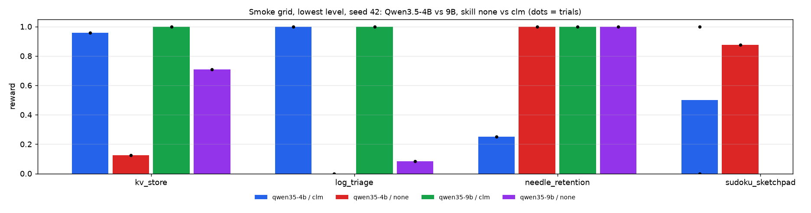
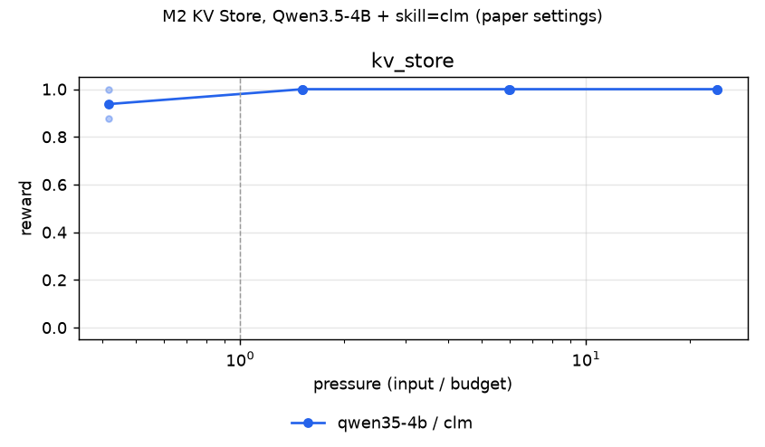
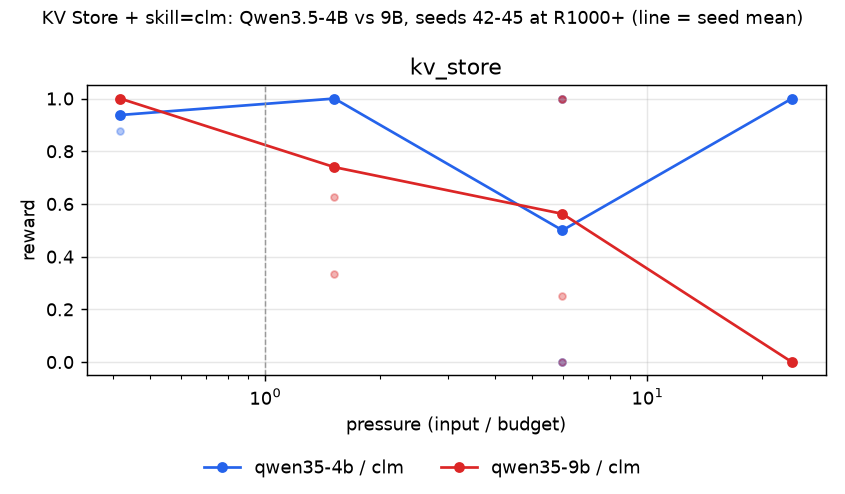
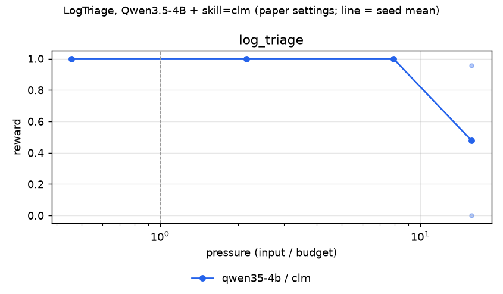
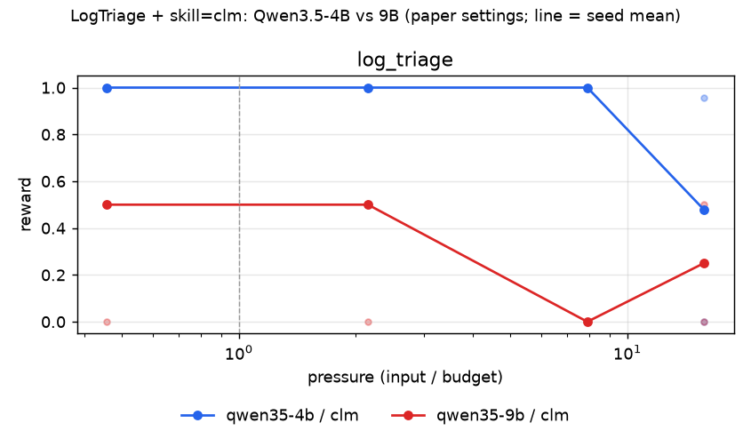
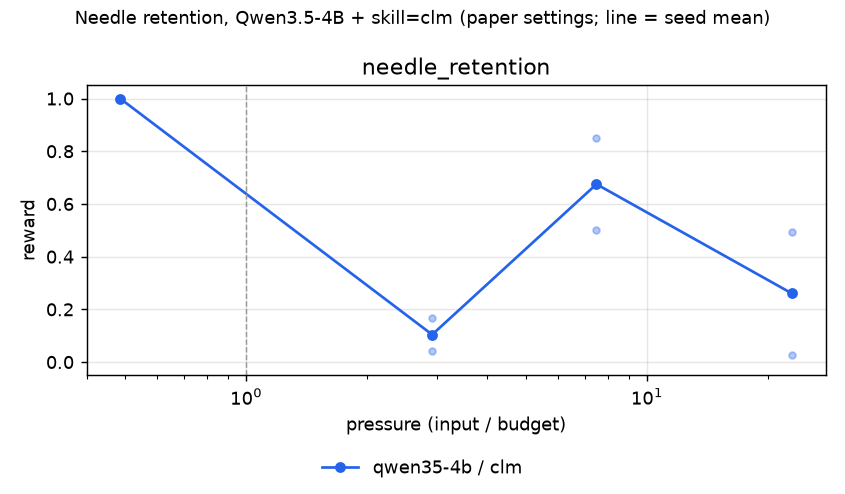
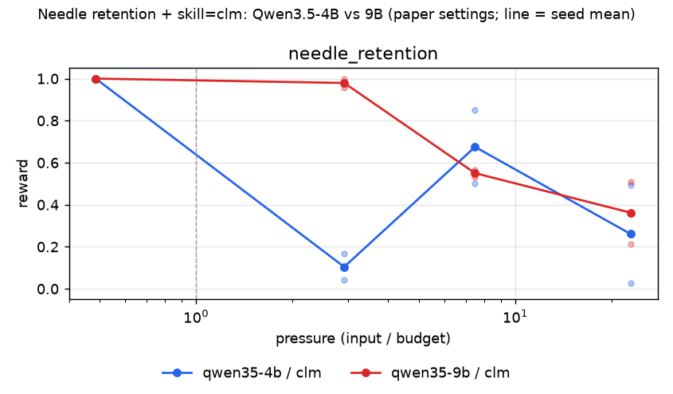

# M2 results: ContextBench, Qwen3.5-4B vs 9B (combined)

Date: 2026-11-14, 18:23–22:49 UTC. Status: **done**. Sudoku: smoke only, then skipped this sprint
([`../decisions.md`](../decisions.md)).
Plan: [`../instruction-reimplementation.md`](../instruction-reimplementation.md) (M2). BrowseComp-Plus (M4) results: [`m2-bcp-results.md`](m2-bcp-results.md).
This file holds the full content of the seven ContextBench per-run notes (originals kept in [`archive/`](archive/), listed at the end),
plus the per-trial evaluation tables from `figs/`. Raw trials live under `runs/` (gitignored).

Contents: [Headline](#headline) · [1. Smoke grid](#1-smoke-grid-model--skill-lowest-level) ·
[2. KV Store](#2-kv-store--clm) · [3. LogTriage](#3-logtriage--clm) · [4. Needle](#4-needle-retention--clm) ·
[Cross-family analysis](#cross-family-analysis) · [Caveats](#caveats)

## ContextBench setup (control unless marked)

- Serving: vLLM 0.33.0, BF16, one A40, one model served at a time on :8000 (65k
  max-model-len, prefix caching, 0.9 memory fraction). Many trials run concurrently on it.
- Agent: `clm_contextbench:ClmStream`; `skill=clm` means the paper's per-family method text
  (sha-checked; `log_triage.md`, `needle_retention.md`, etc.).
- `CB_SETTINGS=paper`, i.e. `PAPER_KWARGS` as-is: budget 32768 / reserve 2048, no step cap, no
  nudges, T=0.7, top_p 0.95, max_tokens 8192, thinking on.
- **Changed vs M1:** M1 used App. F settings: 32000 / 4096 / 240 steps. 240 steps would truncate
  R16000's 184 ops.
- Sandbox: proot (no Docker on this host). Timeout 28800 s per trial.
- **Vary:** model (4B / 9B), skill (none / clm, smoke grid only), family, pressure level, seed.
- Reference: the paper's CLM rows (Qwen3.6-27B, `skill=clm`): 1.0 at KV R1000
  (`data/ContextBench/docs/HARBOR_SMOKE.md`).

| Family | Levels (pressure) | Seeds | Task | Metric |
|---|---|---|---|---|
| KV Store | R260 (0.46x) / R1000 (1.57x) / R4000 (6.04x) / R16000 (23.9x) | 42, 43; plus 44, 45 at R1000+ | SET batches, then GETs | exact value accuracy over 24 GETs |
| LogTriage | L320 (0.51x) / L1600 (2.2x) / L6400 (7.9x) / L12800 (15.8x, highest paper rung) | 42, 43 | log lines pushed in batches, then 24 questions; offload batches to disk, answer with `grep` | 12 lookups of one request's line + 12 counts, exact match |
| Needle | K4-C4 (0.52x) / K4-C24 (2.96x) / K8-C60 (7.54x) / K2-C192 (23.1x) | 42, 43 | each chunk = a few NEEDLE lines (keep verbatim) + a ~4k-token FILLER block (delete) | needles present verbatim in context at the end / total |

Column key for the per-trial tables: **Pressure** = stream tokens / budget, as measured per trial
(slightly below the nominal level pressure above, e.g. 0.42x for R260); **Ops** = stream
operations reached / total; **Edits** = accepted context edits; **Peak ctx** = peak context tokens;
**Min** = wall-clock minutes (inflated by GPU sharing); **End** = `submit` / `stream_exhausted`
(finished) or `budget_wall` (context hit the budget before the stream ended).

## Headline

| Family | 4B + clm | 9B + clm |
|---|---|---|
| KV, R1000 / R4000 / R16000 (4 seeds) | **1.00** / 0.50 / **1.00** | 0.74 / 0.56 / **0.00** |
| LogTriage, mean of 8 trials | **0.87** | 0.31 |
| Needle, mean of 8 trials | 0.51 | **0.72** |

**The two models fail CLM in complementary ways.** The 4B executes the literal "cut a block,
save it to disk" recipes (KV, LogTriage) for hundreds of turns, but often copies the more
intricate Needle recipe wrong. The 9B copies the intricate recipe correctly, but improvises on
long literal ones and lets its own residue build up until it hits the budget wall.
**Without the skill, neither model manages context:** both hit the wall at ~0.5x on KV and LogTriage.

## 1. Smoke grid: model × skill, lowest level

4B part: 18:46–19:22 UTC. 9B part: 19:54–20:15 UTC. Raw trials: `runs/smoke-{4b,9b}-{none,clm}/trials/`.

### Setup (control unless marked)

- Shared ContextBench setup above.
- Level: the lowest main rung near 0.5x of each family (everything fits if no tokens are
  wasted): KV R260, LogTriage L320, Needle K4-C4, Sudoku t8. Seed 42 (+ Sudoku seed 43 with clm).
- **Vary:** `skill` none / clm; model 4B, then 9B (Sudoku not run on the 9B: skipped this sprint).

### Results

| Family | 4B none | 4B clm | 9B none | 9B clm |
|---|---|---|---|---|
| KV R260 | 0.125 (3/24 answered; wall op 7/27) | **0.958** (3 edits) | 0.708 (17/24; wall op 21/27) | **1.000** (3 edits) |
| LogTriage L320 | 0.000 (wall op 17/47) | **1.000** (23 edits) | 0.083 (wall op 27/47) | **1.000** (23 edits) |
| Needle K4-C4 | **1.000** (finished, fits in context) | 0.250 (4 edits, needles deleted) | **1.000** (wall after the last chunk, all needles kept) | **1.000** (4 edits) |
| Sudoku t8 | 0.875 (finished, one bad version) | 0.000 (s42, 8 edits) / 1.000 (s43, 7 edits) | not run | not run |

### Per-trial evaluation

| Family | Level | Model | Skill | Seed | Pressure | Reward | Ops | Edits | LM calls | Peak ctx | Min | End |
|---|---|---|---|---|---|---|---|---|---|---|---|---|
| kv_store | R260 | 4B | clm | 42 | 0.42x | 0.958 | 27/27 | 3 | 50 | 12,923 | 4.0 | submit |
| kv_store | R260 | 4B | none | 42 | 0.42x | 0.125 | 7/27 | 1 | 90 | 26,746 | 36.9 | budget_wall |
| kv_store | R260 | 9B | clm | 42 | 0.42x | 1.000 | 27/27 | 3 | 51 | 13,165 | 6.8 | stream_exhausted |
| kv_store | R260 | 9B | none | 42 | 0.42x | 0.708 | 21/27 | 0 | 55 | 27,086 | 8.2 | budget_wall |
| log_triage | L320 | 4B | clm | 42 | 0.46x | 1.000 | 47/47 | 23 | 77 | 15,738 | 9.7 | stream_exhausted |
| log_triage | L320 | 4B | none | 42 | 0.46x | 0.000 | 17/47 | 0 | 34 | 25,997 | 12.7 | budget_wall |
| log_triage | L320 | 9B | clm | 42 | 0.46x | 1.000 | 47/47 | 23 | 81 | 12,334 | 12.0 | submit |
| log_triage | L320 | 9B | none | 42 | 0.46x | 0.083 | 27/47 | 1 | 39 | 25,433 | 19.9 | budget_wall |
| needle_retention | K4-C4 | 4B | clm | 42 | 0.48x | 0.250 | 4/4 | 4 | 4 | 8,305 | 1.6 | stream_exhausted |
| needle_retention | K4-C4 | 4B | none | 42 | 0.48x | 1.000 | 4/4 | 0 | 8 | 19,056 | 1.0 | submit |
| needle_retention | K4-C4 | 9B | clm | 42 | 0.48x | 1.000 | 4/4 | 4 | 4 | 7,776 | 2.4 | submit |
| needle_retention | K4-C4 | 9B | none | 42 | 0.48x | 1.000 | 4/4 | 0 | 12 | 27,163 | 11.0 | budget_wall |
| sudoku_sketchpad | t8 | 4B | clm | 42 | 0.59x | 0.000 | 8/8 | 8 | 12 | 13,309 | 5.1 | stream_exhausted |
| sudoku_sketchpad | t8 | 4B | clm | 43 | 0.59x | 1.000 | 8/8 | 7 | 9 | 10,299 | 2.7 | stream_exhausted |
| sudoku_sketchpad | t8 | 4B | none | 42 | 0.59x | 0.875 | 8/8 | 0 | 8 | 30,730 | 14.0 | stream_exhausted |

### Analysis (4B)

1. **Where the stream does not fit as delivered, the skill decides everything.** KV and
   LogTriage without the skill hit the budget wall early (op 7/27, 17/47) even at ~0.5x
   pressure: the model keeps raw batches plus its own retyped copies in context. With the
   skill both score ~1.0, and LogTriage makes one offload edit per batch (23).
2. **Where everything fits, the skill can hurt.** Needle K4-C4 and Sudoku t8 fit in the
   window without edits, so `none` scores 1.0 / 0.875. With the skill the 4B must copy a
   more intricate recipe, and one slip is fatal: on Needle it dropped the `t[k:i]` slice
   that keeps the chunk's needles, so each edit deleted the needles (4/16 kept); on Sudoku
   seed 42 it lost one move in the in-place sketchpad (0/8, 255/256 cells right). That slip
   reproduced, so Sudoku was skipped.
3. **Recipe complexity predicts 4B reliability.** KV / LogTriage recipes are "cut block,
   save to disk"; the Needle recipe must cut the filler but keep the lines around it, and
   Sudoku edits a board in place. The 4B executes the first kind every time and the
   second kind inconsistently (see the full Needle run, [§4](#4-needle-retention--clm)).
4. Consequence: at higher pressure only the skill can work (nothing fits), so the full
   runs use `skill=clm`; Needle's score there measures recipe fidelity more than memory.

### 4B vs 9B

1. **With the skill, the 9B is perfect on all three families**; the 4B is near-perfect on KV /
   LogTriage but garbles the Needle recipe (0.25). The 9B copied the Needle recipe
   correctly (header anchor kept), which is exactly the 4B's failure point.
2. **Without the skill, the 9B lasts longer but still hits the wall** on KV (op 21 vs 4B's 7)
   and LogTriage (op 27 vs 17). It made 0–1 edits: neither model manages context unaided.
   9B KV `none` scored 0 in M1 (App. F settings, 32000 / 4096); here 0.71 with paper settings
   (32768 / 2048), so the extra ~2.5k tokens of headroom matter at this level.
3. **So the skill, not the model size, is what makes CLM work**, and the 9B's advantage is
   recipe fidelity on the harder recipe. The full runs below test whether that holds under pressure.

## 2. KV Store + clm

4B: 18:23–18:53 UTC (`runs/m2-kv-clm/`), concurrently with the BCP smoke test. 9B: 19:54–20:35 UTC
(`runs/m2-kv-9b-clm/`), concurrently with the 9B smoke grid and the 9B LogTriage / Needle runs.
Extra seeds 44 / 45 (both models, R1000+): 20:34–22:49 UTC (`runs/m2-kv-{9b-,}clm-s4445/`).
Setup: shared ContextBench setup; **vary:** model, level, seed.

**Seed counts differ between the two figures:**
- `m2-kv.png` (4B only): **2 seeds** (42, 43) at every level.
- `m2-kv-4b-vs-9b.png` (4B vs 9B): **2 seeds** (42, 43) at R260; **4 seeds** (42–45) at R1000 / R4000 / R16000.
  The 4B's R4000 point drops from 1.0 to 0.5 here only because seeds 44 / 45 scored 0.

### Results: 4B, seeds 42 / 43

| Level | Pressure | seed 42 | seed 43 | offload edits | peak ctx (tokens) | wall time |
|---|---|---|---|---|---|---|
| R260 | 0.46x | 0.875 (21/24) | **1.0** | 3 / 3 | 13.2k / 13.9k | 5 min |
| R1000 | 1.57x | **1.0** | **1.0** | 10 / 10 | 13.3k / 13.2k | 7 min |
| R4000 | 6.04x | **1.0** | **1.0** | 40 / 40 | 14.3k / 13.5k | 11–12 min |
| R16000 | 23.9x | **1.0** | **1.0** | 160 / 160 | 14.9k / 10.8k | 27–30 min |

Overall 189/192 GETs correct (0.984); the 3 misses are all in R260 seed 42.

### Results: 9B vs 4B, seeds 42 / 43

| Level | Pressure | 9B s42 | 9B s43 | 4B s42 | 4B s43 | 9B end (s42 / s43) |
|---|---|---|---|---|---|---|
| R260 | 0.46x | **1.000** | **1.000** | 0.875 | 1.000 | submit / submit |
| R1000 | 1.57x | 0.625 | 0.333 | 1.000 | 1.000 | wall op 26/34 / wall op 19/34 |
| R4000 | 6.04x | **1.000** | 0.250 | 1.000 | 1.000 | submit / wall op 47/64 |
| R16000 | 23.9x | 0.000 | 0.000 | 1.000 | 1.000 | wall op 32/184 / wall op 43/184 |

Seeds 42/43 only: 9B 3/8 trials perfect, mean 0.53; 4B 7/8 perfect, mean 0.98.

### Results: with extra seeds 44 / 45 (R1000 / R4000 / R16000, both models)

| Level | 4B s42 / s43 / s44 / s45 | 4B mean | 9B s42 / s43 / s44 / s45 | 9B mean |
|---|---|---|---|---|
| R260 | 0.875 / 1 / – / – | 0.94 | 1 / 1 / – / – | **1.00** |
| R1000 | 1 / 1 / 1 / 1 | **1.00** | 0.63 / 0.33 / 1 / 1 | 0.74 |
| R4000 | 1 / 1 / **0 / 0** | 0.50 | 1 / 0.25 / 1 / 0 | 0.56 |
| R16000 | 1 / 1 / 1 / 1 | **1.00** | 0 / 0 / 0 / 0 | **0.00** |

The 4B's R4000 seeds 44 / 45 both hit the budget wall (ops 34, 38 of 64): the same failure
as the 9B's. Seed 45's messages in context climbed steadily (60 → 78, the `prev` cut stopped
working); seed 44 carried ~18.8k from early on and then one batch was not offloaded.

### Per-trial evaluation (28 trials)

| Level | Model | Seed | Pressure | Reward | Ops | Edits | LM calls | Peak ctx | Min | End |
|---|---|---|---|---|---|---|---|---|---|---|
| R260 | 4B | 42 | 0.42x | 0.875 | 27/27 | 3 | 51 | 13,186 | 5.3 | stream_exhausted |
| R260 | 4B | 43 | 0.42x | **1.000** | 27/27 | 3 | 51 | 13,880 | 5.4 | stream_exhausted |
| R260 | 9B | 42 | 0.42x | **1.000** | 27/27 | 3 | 53 | 14,070 | 7.9 | submit |
| R260 | 9B | 43 | 0.42x | **1.000** | 27/27 | 3 | 51 | 13,095 | 7.0 | submit |
| R1000 | 4B | 42 | 1.52x | **1.000** | 34/34 | 10 | 58 | 13,304 | 6.7 | submit |
| R1000 | 4B | 43 | 1.52x | **1.000** | 34/34 | 10 | 56 | 13,212 | 6.6 | stream_exhausted |
| R1000 | 4B | 44 | 1.51x | **1.000** | 34/34 | 10 | 58 | 13,354 | 5.0 | submit |
| R1000 | 4B | 45 | 1.52x | **1.000** | 34/34 | 10 | 58 | 17,584 | 5.7 | stream_exhausted |
| R1000 | 9B | 42 | 1.52x | 0.625 | 26/34 | 9 | 47 | 26,881 | 24.6 | budget_wall |
| R1000 | 9B | 43 | 1.52x | 0.333 | 19/34 | 10 | 69 | 29,002 | 17.6 | budget_wall |
| R1000 | 9B | 44 | 1.51x | **1.000** | 34/34 | 10 | 58 | 13,133 | 9.6 | stream_exhausted |
| R1000 | 9B | 45 | 1.52x | **1.000** | 34/34 | 10 | 58 | 13,549 | 9.6 | submit |
| R4000 | 4B | 42 | 5.99x | **1.000** | 64/64 | 40 | 90 | 14,282 | 11.8 | submit |
| R4000 | 4B | 43 | 6.00x | **1.000** | 64/64 | 40 | 89 | 13,516 | 11.2 | stream_exhausted |
| R4000 | 4B | 44 | 5.98x | 0.000 | 34/64 | 31 | 37 | 30,129 | 6.6 | budget_wall |
| R4000 | 4B | 45 | 5.99x | 0.000 | 38/64 | 37 | 37 | 27,614 | 9.4 | budget_wall |
| R4000 | 9B | 42 | 5.99x | **1.000** | 64/64 | 39 | 88 | 19,292 | 22.5 | submit |
| R4000 | 9B | 43 | 6.00x | 0.250 | 47/64 | 39 | 69 | 31,199 | 21.5 | budget_wall |
| R4000 | 9B | 44 | 5.98x | **1.000** | 64/64 | 39 | 94 | 20,003 | 18.3 | stream_exhausted |
| R4000 | 9B | 45 | 5.99x | 0.000 | 16/64 | 11 | 22 | 34,892 | 25.8 | budget_wall |
| R16000 | 4B | 42 | 23.88x | **1.000** | 184/184 | 160 | 209 | 14,887 | 29.6 | stream_exhausted |
| R16000 | 4B | 43 | 23.89x | **1.000** | 184/184 | 160 | 185 | 10,752 | 26.5 | stream_exhausted |
| R16000 | 4B | 44 | 23.87x | **1.000** | 184/184 | 160 | 209 | 14,375 | 23.9 | stream_exhausted |
| R16000 | 4B | 45 | 23.87x | **1.000** | 184/184 | 160 | 208 | 14,589 | 23.5 | stream_exhausted |
| R16000 | 9B | 42 | 23.88x | 0.000 | 32/184 | 30 | 38 | 30,793 | 34.7 | budget_wall |
| R16000 | 9B | 43 | 23.89x | 0.000 | 43/184 | 37 | 48 | 35,869 | 21.7 | budget_wall |
| R16000 | 9B | 44 | 23.87x | 0.000 | 49/184 | 45 | 54 | 26,491 | 15.2 | budget_wall |
| R16000 | 9B | 45 | 23.87x | 0.000 | 16/184 | 12 | 25 | 27,224 | 6.3 | budget_wall |

### Analysis: 4B

1. **4B + clm solves KV at every pressure level on seeds 42 / 43.** 7 of 8 trials score 24/24, including
   both 24x trials (16,000 records, ~775k value tokens through a 32k window). This
   matches the paper's 27B CLM result at R1000 and holds out to 24x. With seeds 44 / 45, R1000 and
   R16000 stay 1.0 on all 4 seeds, but **R4000 seeds 44 and 45 both scored 0** (budget wall from residue build-up).
2. **Exactly one offload per batch, every time** (on the completed runs). Edits = number of SET batches at
   every level (3 / 10 / 40 / 160), so the model ran the paper's recipe mechanically
   for up to 160 consecutive batches without drifting.
3. **Context stays flat regardless of input size.** Peak context is 11–15k tokens at
   every level, i.e. under half the budget; the R16000 context sat at ~8.5k for its
   first 60 turns. Cost grows linearly with batches (≈1.1–1.3 LM calls per op).
4. **The only misses among seeds 42 / 43 are at the easiest level** (R260 seed 42, 21/24; M1 got 22/24 on
   the same task with M1 settings). At R260 everything fits in context, so some values
   are answered from context instead of `grep` on disk. Not investigated further; n=2.
5. **Without the skill, 4B scores 0 here** (M1: `budget_wall` at op 3/27). The skill,
   not model size, is what makes CLM work at this scale (9B without skill also 0 in M1).

### Analysis: 9B vs 4B

1. **The 9B is worse than the 4B at KV, but not uniformly.** With 4 seeds: R16000 4/4 vs
   0/4 and R1000 4/4 vs 2/4 favour the 4B; at R4000 they tie (2/4 each). Above 0.5x the 9B
   hit the budget wall in 8 of 12 trials, the 4B in 2 of 12. Every answer the 9B gave was right except one
   (101 of 102 answered GETs correct), so retrieval from disk works; it runs out of context first.
2. **The failure is residue build-up, at no fixed point.** The 9B offloads batches (edits ≈
   batches delivered) but does not keep the recipe's `prev` cut, so its own commands and
   harness notes pile up turn by turn until the wall. It started anywhere from turn 7 to 38,
   in the SET phase (R16000: GETs only start at op 160, the 9B died at ops 32–43) or in the
   GET phase (R1000 s42). R4000 s43 additionally grepped the mirror file 10 times, which the
   recipe forbids (each dump re-adds context). R16000 s43 printed an ANSWER block for a key
   nobody had asked about.
3. **Contrast with the smoke grid and Needle.** The 9B is the more faithful recipe copier on
   Needle ([§4](#4-needle-retention--clm)) and was perfect at
   KV R260, but over long streams it drifts away from the KV recipe that the 4B executes
   mechanically. Bigger is not uniformly better at CLM here: reliability over many repeated
   edits and fidelity to an intricate recipe look like different skills.
4. **Both models share the failure mode; the 9B shows it more often.** Residue build-up
   (the recipe's `prev` cut stops being applied) ended 2 of 12 4B trials and 8 of 12 9B trials
   above 0.5x. The R16000 gap (4/4 vs 0/4) is the clearest single result; R4000 shows that
   2 seeds were not enough to call the 4B "solved" (first two seeds 1.0, next two 0.0).

### Utilization

- 4B (18:23–18:53, 30 s samples): GPU util mean 99% (min 70%), 41 GB of 46 GB (vLLM pre-allocates).
  CPU mean 15% of 96 cores, max 24%; RAM up to 147 GB. GPU-bound: running 8 KV + 5 BCP trials concurrently
  kept the GPU saturated, and more concurrency would mostly queue in vLLM.
- 9B: GPU 100% (17–23 concurrent trials on one 9B server), CPU ~10%. The 9B weights take 17 GB,
  leaving more KV-cache room than the 4B run had at the same 0.9 memory fraction.

## 3. LogTriage + clm

4B: 18:52–19:52 UTC (`runs/m2b-logtriage-clm/`), concurrently with Needle and the BCP 50-question run.
9B: 20:08–21:22 UTC (`runs/m2b-logtriage-9b-clm/`), sharing the server with 9B KV, Needle and BCP runs
(up to 23 concurrent). Setup: shared ContextBench setup, paper's `log_triage.md` method text; **vary:** model, level, seed.

### Results: 4B

| Level | Pressure | seed 42 | seed 43 | offload edits | peak ctx | wall time |
|---|---|---|---|---|---|---|
| L320 | 0.51x | **1.000** | **1.000** | 23 / 23 | 20.0k / 11.8k | 14 min |
| L1600 | 2.2x | **1.000** | **1.000** | 115 / 115 | 12.9k / 12.7k | 45 min |
| L6400 | 7.9x | **1.000** | **1.000** | 119 / 119 | 12.3k / 11.5k | 46 min |
| L12800 | 15.8x | 0.000 (budget wall, op 175/262) | **0.958** (23/24) | 170 / 238 | 26.5k / 13.5k | 54–60 min |

7 of 8 trials ≥ 0.96; mean 0.87.

### Results: 9B vs 4B

| Level | Pressure | 9B s42 | 9B s43 | 4B s42 | 4B s43 | Failure |
|---|---|---|---|---|---|---|
| L320 | 0.51x | **1.000** | 0.000 | 1.000 | 1.000 | 9B s43: wall at 33/47, dumped all request ids into context |
| L1600 | 2.2x | 0.000 | **1.000** | 1.000 | 1.000 | 9B s42: wall at 95/139 |
| L6400 | 7.9x | 0.000 | 0.000 | 1.000 | 1.000 | 9B s42: answers written as chat text, not printed (1/24 graded); s43: wall at 54/143, grepped the mirror file |
| L12800 | 15.8x | 0.000 | 0.500 | 0.000 | 0.958 | 4B s42: drift after 166 good turns, wall at 175/262; 9B s42: wall at 99/262; 9B s43: 2 of 238 batches never offloaded, so all 12 counts off by a few |

Mean: 9B 0.31, 4B 0.87.

### Per-trial evaluation (16 trials)

| Level | Model | Seed | Pressure | Reward | Ops | Edits | LM calls | Peak ctx | Min | End |
|---|---|---|---|---|---|---|---|---|---|---|
| L320 | 4B | 42 | 0.46x | **1.000** | 47/47 | 23 | 74 | 19,994 | 14.2 | stream_exhausted |
| L320 | 4B | 43 | 0.46x | **1.000** | 47/47 | 23 | 73 | 11,791 | 13.9 | stream_exhausted |
| L320 | 9B | 42 | 0.46x | **1.000** | 47/47 | 23 | 74 | 11,888 | 16.2 | stream_exhausted |
| L320 | 9B | 43 | 0.46x | 0.000 | 33/47 | 23 | 104 | 37,139 | 30.3 | budget_wall |
| L1600 | 4B | 42 | 2.15x | **1.000** | 139/139 | 115 | 169 | 12,904 | 45.2 | submit |
| L1600 | 4B | 43 | 2.15x | **1.000** | 139/139 | 115 | 169 | 12,710 | 45.6 | stream_exhausted |
| L1600 | 9B | 42 | 2.15x | 0.000 | 95/139 | 72 | 101 | 26,832 | 31.3 | budget_wall |
| L1600 | 9B | 43 | 2.15x | **1.000** | 139/139 | 114 | 192 | 16,393 | 42.8 | stream_exhausted |
| L6400 | 4B | 42 | 7.89x | **1.000** | 143/143 | 119 | 168 | 12,332 | 46.7 | stream_exhausted |
| L6400 | 4B | 43 | 7.89x | **1.000** | 143/143 | 119 | 161 | 11,513 | 46.2 | stream_exhausted |
| L6400 | 9B | 42 | 7.89x | 0.000 | 143/143 | 119 | 195 | 14,119 | 44.1 | stream_exhausted |
| L6400 | 9B | 43 | 7.89x | 0.000 | 54/143 | 46 | 84 | 28,392 | 27.3 | budget_wall |
| L12800 | 4B | 42 | 15.73x | 0.000 | 175/262 | 170 | 200 | 26,513 | 53.5 | budget_wall |
| L12800 | 4B | 43 | 15.74x | 0.958 | 262/262 | 238 | 289 | 13,500 | 59.7 | stream_exhausted |
| L12800 | 9B | 42 | 15.73x | 0.000 | 99/262 | 91 | 110 | 25,081 | 36.5 | budget_wall |
| L12800 | 9B | 43 | 15.74x | 0.500 | 262/262 | 236 | 288 | 16,036 | 74.5 | submit |

### Analysis: 4B

1. **4B + clm solves LogTriage up to 8x, and up to 16x on one seed.** One offload edit per
   batch (23 / 115 / 119 / 238 = number of batches), context flat at 11–13k, answers via `grep`
   on the offloaded files. Without the skill the 4B hits the wall at 0.5x (smoke grid: 0.0).
2. **The one failure is a drift, not a misunderstanding.** L12800 seed 42 ran the recipe
   correctly for 166 turns (context ~6.9k, 6 messages). Then, around op 170, it stopped
   cutting its own previous turns: messages in context went 6 → 66 and tokens 6.9k → 26.5k in
   ~35 turns, and it hit the budget wall with 22 questions unanswered. Its 2 answers were wrong.
   Same model, same level, seed 43 never drifted (238 edits, 23/24).
3. **Long-horizon reliability is the 4B's limit here.** Error-free up to ~140 ops on every
   run; the only drift came after 166 consecutive correct edits. Compare Needle, where the
   failure is copying the recipe wrong from the start ([§4](#4-needle-retention--clm)).
4. Cost is linear in batches: ~1.2 LM calls per op, ~45 min for ~140 ops at 8–12 concurrent trials.

### Analysis: 9B vs 4B

1. **The 9B is much worse than the 4B at LogTriage** (0.31 vs 0.87); the 4B was perfect up
   to 8x on both seeds, the 9B on 2 of 8 trials.
2. **Four distinct 9B failure modes, none of them retrieval:**
   - *Residue / dumping → budget wall* (4 trials): context fills from its own turns or from
     commands the recipe forbids (`grep` on the mirror file, listing every request id).
   - *Format* (L6400 s42): finished the stream with the right counts but wrote the ANSWER
     blocks as chat text instead of printing them from a command; ungraded.
   - *A few dropped offloads* (L12800 s43): 236 edits for 238 batches; the two missing batches
     make every count slightly low (283 vs 287, 1283 vs 1291, 564 vs 568), and exact-match
     grading zeroes all 12 counts while all 12 lookups are right.
3. **Same picture as KV:** the 9B improvises around the recipe (extra inspection commands,
   free-form answers) where the 4B executes it literally. On a repetitive, literal recipe that
   costs the 9B; on Needle's intricate recipe its fidelity wins ([§4](#4-needle-retention--clm)).

### Utilization

GPU 100% throughout (shared run); CPU 10–18% of 96 cores. Wall times are inflated by
sharing the GPU with up to 16 other trials (4B run) / 23 (9B run).

## 4. Needle Retention + clm

4B: 18:52–19:50 UTC (`runs/m2c-needle-clm/`), concurrently with LogTriage and the BCP 50-question run.
9B: 20:08–21:10 UTC (`runs/m2c-needle-9b-clm/`), concurrently with 9B KV / LogTriage / extra-seed runs.
Setup: shared ContextBench setup, paper's `needle_retention.md` method text; **vary:** model, level, seed.

### Results: 4B

| Level | Pressure | seed 42 | seed 43 | ops (s42 / s43) | anchor `h` in last edit (s42 / s43) |
|---|---|---|---|---|---|
| K4-C4 | 0.52x | **1.000** | **1.000** | 4/4, 4/4 | chunk header / chunk header |
| K4-C24 | 2.96x | 0.042 | 0.167 | 24/24, 24/24 | filler START / (inline, no `h`) |
| K8-C60 | 7.54x | 0.500 | 0.850 | 34/60 wall, 52/60 wall | filler START / chunk header |
| K2-C192 | 23.1x | 0.026 | 0.495 | 6/192 wall, 101/192 wall | filler END / (inline) |

Mean 0.51. Five of eight trials hit the budget wall before the end of the stream.

### Results: 9B vs 4B

| Level | Pressure | 9B s42 | 9B s43 | 4B s42 | 4B s43 | 9B end (ops reached) |
|---|---|---|---|---|---|---|
| K4-C4 | 0.52x | **1.000** | **1.000** | 1.000 | 1.000 | end of stream |
| K4-C24 | 2.96x | **0.958** | **1.000** | 0.042 | 0.167 | end of stream |
| K8-C60 | 7.54x | 0.567 | 0.533 | 0.500 | 0.850 | wall at 34/60, 32/60 |
| K2-C192 | 23.1x | 0.214 | 0.510 | 0.026 | 0.495 | wall at 41/192, 98/192 |

Mean: 9B 0.72, 4B 0.51.

### Per-trial evaluation (16 trials)

| Level | Model | Seed | Pressure | Reward | Ops | Edits | LM calls | Peak ctx | Min | End |
|---|---|---|---|---|---|---|---|---|---|---|
| K4-C4 | 4B | 42 | 0.48x | **1.000** | 4/4 | 4 | 4 | 7,616 | 2.2 | stream_exhausted |
| K4-C4 | 4B | 43 | 0.49x | **1.000** | 4/4 | 4 | 4 | 9,388 | 4.1 | stream_exhausted |
| K4-C4 | 9B | 42 | 0.48x | **1.000** | 4/4 | 4 | 4 | 7,519 | 2.9 | stream_exhausted |
| K4-C4 | 9B | 43 | 0.49x | **1.000** | 4/4 | 4 | 4 | 8,805 | 3.6 | stream_exhausted |
| K4-C24 | 4B | 42 | 2.91x | 0.042 | 24/24 | 24 | 24 | 8,017 | 20.2 | stream_exhausted |
| K4-C24 | 4B | 43 | 2.92x | 0.167 | 24/24 | 24 | 24 | 8,216 | 22.2 | stream_exhausted |
| K4-C24 | 9B | 42 | 2.91x | 0.958 | 24/24 | 24 | 24 | 10,384 | 14.6 | stream_exhausted |
| K4-C24 | 9B | 43 | 2.92x | **1.000** | 24/24 | 24 | 24 | 18,228 | 13.6 | stream_exhausted |
| K8-C60 | 4B | 42 | 7.48x | 0.500 | 34/60 | 36 | 46 | 28,356 | 51.9 | budget_wall |
| K8-C60 | 4B | 43 | 7.49x | 0.850 | 52/60 | 51 | 51 | 24,707 | 26.6 | budget_wall |
| K8-C60 | 9B | 42 | 7.48x | 0.567 | 34/60 | 33 | 34 | 25,902 | 22.0 | budget_wall |
| K8-C60 | 9B | 43 | 7.49x | 0.533 | 32/60 | 31 | 31 | 25,643 | 17.9 | budget_wall |
| K2-C192 | 4B | 42 | 23.00x | 0.026 | 6/192 | 5 | 5 | 32,811 | 4.4 | budget_wall |
| K2-C192 | 4B | 43 | 23.01x | 0.495 | 101/192 | 100 | 111 | 25,532 | 52.0 | budget_wall |
| K2-C192 | 9B | 42 | 23.00x | 0.214 | 41/192 | 40 | 40 | 26,009 | 22.1 | budget_wall |
| K2-C192 | 9B | 43 | 23.01x | 0.510 | 98/192 | 97 | 117 | 25,048 | 61.9 | budget_wall |

### Analysis: 4B

1. **The score tracks one substitution in the recipe.** The paper's command sets
   `h = '=== chunk N/'`, the chunk header that comes *before* the needle lines, and keeps
   `t[k:i]` (header + needles) while cutting the filler. The 4B often replaces `h` with the
   filler block's START or END line, which it can see right there. Then `t[k:i]` is empty
   (or negative), and every edit deletes that chunk's needles along with its filler. Runs whose
   last edit kept the header anchor score 0.85–1.0; runs that swapped it score 0.03–0.5.
   (Only the last edit survives in the trajectory, so this is per-run, not per-edit, evidence.)
2. **Context management itself works.** One edit per chunk, peak context 8k at K4-C24, i.e.
   the model offloads exactly as on KV. The failure is recipe fidelity, not willingness to edit.
3. **At ≥ 7.5x a second failure appears: the budget wall.** K8-C60 and K2-C192 hit the wall
   at 34–101 of 60–192 chunks: retained needles plus leftover residue from imperfect edits
   (e.g. K2-C192 s42 wrote `head + t[i:j]`, re-inserting the filler, and the harness flagged
   that the edit GREW context) push the context to 25–33k.
4. **Contrast with KV / LogTriage:** their recipes only cut a block; Needle must cut a block
   while keeping text around it, which is where the 4B slips. Same pattern as Sudoku's
   in-place edit (smoke grid). Recipe complexity, not pressure, is the 4B's limit here.

### Analysis: 9B vs 4B

1. **The 9B copies the Needle recipe correctly; the 4B mostly does not.** Every 9B trial
   keeps every needle it has seen: its score equals the fraction of the stream it got through
   before the wall (e.g. K8-C60 s42: 34/60 chunks = 0.567 = 272/480 needles). Its last edits
   anchor on the chunk header or the NEEDLES line, both of which keep the needles. At K4-C24
   (3x), where neither model hits the wall, the gap is 0.98 vs 0.10.
2. **At ≥ 7.5x both models hit the budget wall**, around 25–26k tokens, after 32–98 chunks.
   Retained needles are only ~10–12k tokens even at the end of these streams, so the wall
   comes from residue (own commands, harness notes) building up, the same failure the 9B
   shows on KV ([§2](#2-kv-store--clm)).
3. **Two separate skills, split across the two models.** Recipe fidelity (copy an intricate
   edit exactly): 9B ≫ 4B. Long-horizon hygiene (keep cutting your own residue for 100+
   turns): 4B ≥ 9B on KV / LogTriage, both weak on Needle at high pressure.

### Utilization

GPU 100% throughout (shared run); CPU 10–18%. vLLM decoded ~170 tok/s total across ~11 concurrent
requests (4B run), so long thinking turns took minutes, and one K8-C60 request timed out once and
was retried (no effect on the result).

## Cross-family analysis

1. **The skill, not model size, is what makes CLM work at all.** Without it both models hit the
   wall at ~0.5x on KV and LogTriage with 0–1 edits.
2. **Two separate abilities, split across the two models:**
   - *Recipe fidelity* (copy an intricate edit exactly): 9B ≫ 4B (Needle, Sudoku).
   - *Long-horizon hygiene* (keep cutting your own residue for 100+ turns): 4B > 9B on KV and
     LogTriage; both weak on Needle at high pressure.
3. **Residue build-up is the common failure.** The recipe's `prev` cut stops being applied and
   the context fills from the model's own turns. It appears for both models in all three families
   (KV above 0.5x: 4B 2/12, 9B 8/12), at no fixed point in the stream. This is the natural target
   for the elicitation / interp experiments.
4. **The 9B improvises around literal recipes** (dumps, mirror-file greps, chat-text answers);
   the 4B executes them literally. That costs the 9B on long literal streams and helps it on
   the intricate one, and on BCP, where there is no fixed recipe to follow ([`m2-bcp-results.md`](m2-bcp-results.md)).

## Utilization and cost (overall)

GPU ~100% throughout (8–23 concurrent trials per server, shared with the BCP runs); CPU 10–24% of 96
cores; RAM up to 147 GB. Cost grows linearly with batches (~1.1–1.3 LM calls per op); wall times
(5 min at R260 to ~60 min at L12800) are inflated by GPU sharing. Log: `runs/logs/util-bcp-smoke-m2.csv`.

## Caveats

- n = 2 seeds per level (4 for KV at R1000+). KV R4000 shows that 2 seeds can hide failures:
  treat every 2-seed result as provisional. L12800 is 15.8x, the highest LogTriage rung in paper.yaml (no 24x).
- Failure diagnoses ("residue build-up", drift) come from snapshot token / message counts and the last
  edit command per trial (the model's own edits remove earlier commands from the trajectory), not a
  turn-by-turn read of every run. Needle anchor evidence comes from the final edit command only; Needle
  scores swing 0.04–1.0 depending on which anchor the model copies.
- LogTriage count diagnosis: expected counts recomputed from the task stream, model answers read from
  context snapshots (the sandbox itself is deleted after each trial).
- Paper settings, not App. F; proot instead of Docker (no CPU / memory limits, no network isolation).
- The paper's reference rows are Qwen3.6-27B (1.0 at KV R1000), so "matches" means "same ceiling".

## Source notes (archived originals)

| Run | Note | Per-trial table |
|---|---|---|
| Smoke grid | [`smoke-grid-results.md`](archive/smoke-grid-results.md) | [`figs/smoke-grid.md`](figs/smoke-grid.md) |
| KV 4B | [`m2-kv-results.md`](archive/m2-kv-results.md) | [`figs/m2-kv.md`](figs/m2-kv.md) |
| KV 9B, extra seeds | [`m2-kv-9b-results.md`](archive/m2-kv-9b-results.md) | [`figs/m2-kv-4b-vs-9b.md`](figs/m2-kv-4b-vs-9b.md) |
| LogTriage 4B | [`m2b-logtriage-results.md`](archive/m2b-logtriage-results.md) | [`figs/m2b-logtriage.md`](figs/m2b-logtriage.md) |
| LogTriage 9B | [`m2b-logtriage-9b-results.md`](archive/m2b-logtriage-9b-results.md) | [`figs/m2b-logtriage-4b-vs-9b.md`](figs/m2b-logtriage-4b-vs-9b.md) |
| Needle 4B | [`m2c-needle-results.md`](archive/m2c-needle-results.md) | [`figs/m2c-needle.md`](figs/m2c-needle.md) |
| Needle 9B | [`m2c-needle-9b-results.md`](archive/m2c-needle-9b-results.md) | [`figs/m2c-needle-4b-vs-9b.md`](figs/m2c-needle-4b-vs-9b.md) |
