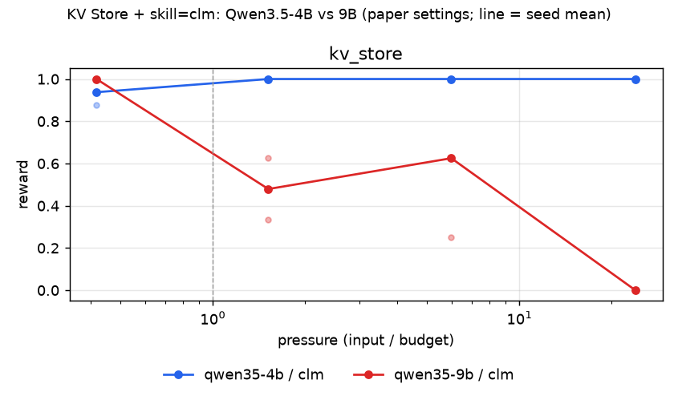

# M2 (9B): ContextBench KV Store, Qwen3.5-9B + skill=clm, vs 4B

Date: 2026-11-14, 19:54–20:35 UTC. Status: **done** (8/8 trials).
Raw trials: `runs/m2-kv-9b-clm/trials/` (gitignored). Per-trial table (both models):
[`figs/m2-kv-4b-vs-9b.md`](figs/m2-kv-4b-vs-9b.md). 4B run: [`m2-kv-results.md`](m2-kv-results.md).
Ran concurrently with the 9B smoke grid and the 9B LogTriage / Needle runs.

## Setup

Identical to the 4B M2 run (`skill=clm`, `CB_SETTINGS=paper`: 32768 / 2048, no step cap, no
nudges, T=0.7; levels R260 / R1000 / R4000 / R16000; seeds 42 / 43; proot), except
**vary: model = Qwen3.5-9B** (BF16, vLLM 0.33.0, same flags).

## Results

| Level | Pressure | 9B s42 | 9B s43 | 4B s42 | 4B s43 | 9B end (s42 / s43) |
|---|---|---|---|---|---|---|
| R260 | 0.46x | **1.000** | **1.000** | 0.875 | 1.000 | submit / submit |
| R1000 | 1.57x | 0.625 | 0.333 | 1.000 | 1.000 | wall op 26/34 / wall op 19/34 |
| R4000 | 6.04x | **1.000** | 0.250 | 1.000 | 1.000 | submit / wall op 47/64 |
| R16000 | 23.9x | 0.000 | 0.000 | 1.000 | 1.000 | wall op 32/184 / wall op 43/184 |

9B: 3/8 trials perfect, mean 0.53. 4B: 7/8 perfect, mean 0.98.

## Analysis

1. **The 9B is worse than the 4B at KV under pressure.** Above 0.5x it hit the budget wall
   in 5 of 6 trials; the 4B never did. Every answer the 9B gave was right except one
   (101 of 102 answered GETs correct), so retrieval from disk works; it runs out of context first.
2. **The failure is residue build-up, at no fixed point.** The 9B offloads batches (edits ≈
   batches delivered) but does not keep the recipe's `prev` cut, so its own commands and
   harness notes pile up turn by turn until the wall. It started anywhere from turn 7 to 38,
   in the SET phase (R16000: GETs only start at op 160, the 9B died at ops 32–43) or in the
   GET phase (R1000 s42). R4000 s43 additionally grepped the mirror file 10 times, which the
   recipe forbids (each dump re-adds context). R16000 s43 printed an ANSWER block for a key
   nobody had asked about.
3. **Contrast with the smoke grid and Needle.** The 9B is the more faithful recipe copier on
   Needle ([`m2c-needle-9b-results.md`](m2c-needle-9b-results.md), pending) and was perfect at
   KV R260, but over long streams it drifts away from the KV recipe that the 4B executes
   mechanically. Bigger is not uniformly better at CLM here: reliability over many repeated
   edits and fidelity to an intricate recipe look like different skills.
4. **Caution: n = 2 per level**, and 9B variance is high (R4000: 1.0 vs 0.25). The 4B / 9B
   gap at R16000 (1.0 vs 0.0 on both seeds) is the clearest single result.

## Utilization

GPU 100% (17–23 concurrent trials on one 9B server), CPU ~10%. The 9B weights take 17 GB,
leaving more KV-cache room than the 4B run had at the same 0.9 memory fraction.

## Caveats

- "Residue build-up" comes from snapshot message counts plus the last commands in each
  trajectory, not a turn-by-turn read of every run.
- Paper settings, proot sandbox, n = 2 seeds, as for the 4B run.
