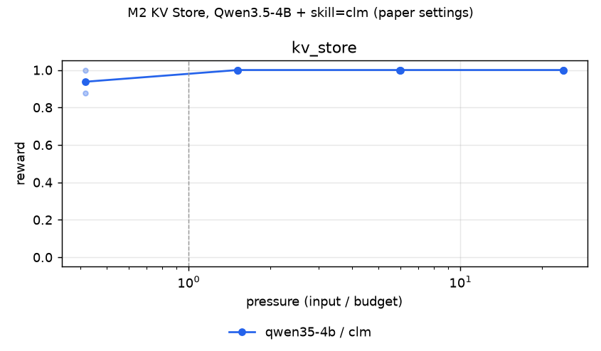

# M2 results: ContextBench KV Store, Qwen3.5-4B + skill=clm

Date: 2026-11-14, 18:23–18:53 UTC. Status: **done** (8/8 trials).
Plan: [`../instruction-reimplementation.md`](../instruction-reimplementation.md) (M2).
Raw trials: `runs/m2-kv-clm/trials/` (gitignored). Per-trial table: [`figs/m2-kv.md`](figs/m2-kv.md).
Plot: [`figs/m2-kv.png`](figs/m2-kv.png). Utilization: `runs/logs/util-bcp-smoke-m2.csv`.
Ran concurrently with the BCP smoke test on the same vLLM server.

## Setup (control unless marked)

- Model: Qwen3.5-4B BF16, vLLM 0.33.0, 65k max-model-len, prefix caching (shared server).
- Agent: `clm_contextbench:ClmStream`, `skill=clm` (paper method text, sha-checked).
- **Changed vs M1:** `CB_SETTINGS=paper`, i.e. `PAPER_KWARGS` as-is: budget 32768 /
  reserve 2048, no step cap (M1 used 32000 / 4096 / 240 steps; 240 steps would truncate
  R16000's 184 ops). No nudges, T=0.7, top_p 0.95, max_tokens 8192, thinking on.
- **Vary:** level R260 (0.46x) / R1000 (1.57x) / R4000 (6.04x) / R16000 (23.9x); seed 42 / 43.
- Timeout 28800 s. Sandbox: proot. Metric: exact-value accuracy over 24 GETs.
- Reference: the paper's CLM rows (Qwen3.6-27B, `skill=clm`): 1.0 at KV R1000
  (`data/ContextBench/docs/HARBOR_SMOKE.md`).

## Results

| Level | Pressure | seed 42 | seed 43 | offload edits | peak ctx (tokens) | wall time |
|---|---|---|---|---|---|---|
| R260 | 0.46x | 0.875 (21/24) | **1.0** | 3 / 3 | 13.2k / 13.9k | 5 min |
| R1000 | 1.57x | **1.0** | **1.0** | 10 / 10 | 13.3k / 13.2k | 7 min |
| R4000 | 6.04x | **1.0** | **1.0** | 40 / 40 | 14.3k / 13.5k | 11–12 min |
| R16000 | 23.9x | **1.0** | **1.0** | 160 / 160 | 14.9k / 10.8k | 27–30 min |

Overall 189/192 GETs correct (0.984); the 3 misses are all in R260 seed 42.

> **Update 22:50 UTC (extra seeds 44 / 45):** R1000 and R16000 stay 1.0 on all 4 seeds, but
> **R4000 seeds 44 and 45 both scored 0** (budget wall from residue build-up). Point 1 below
> holds for seeds 42 / 43 only; 4-seed table and analysis in [`m2-kv-9b-results.md`](m2-kv-9b-results.md).

## Analysis

1. **4B + clm solves KV at every pressure level (seeds 42 / 43).** 7 of 8 trials score 24/24, including
   both 24x trials (16,000 records, ~775k value tokens through a 32k window). This
   matches the paper's 27B CLM result at R1000 and holds out to 24x.
2. **Exactly one offload per batch, every time.** Edits = number of SET batches at
   every level (3 / 10 / 40 / 160), so the model ran the paper's recipe mechanically
   for up to 160 consecutive batches without drifting.
3. **Context stays flat regardless of input size.** Peak context is 11–15k tokens at
   every level, i.e. under half the budget; the R16000 context sat at ~8.5k for its
   first 60 turns. Cost grows linearly with batches (≈1.1–1.3 LM calls per op).
4. **The only misses are at the easiest level** (R260 seed 42, 21/24; M1 got 22/24 on
   the same task with M1 settings). At R260 everything fits in context, so some values
   are answered from context instead of `grep` on disk. Not investigated further; n=2.
5. **Without the skill, 4B scores 0 here** (M1: `budget_wall` at op 3/27). The skill,
   not model size, is what makes CLM work at this scale (9B without skill also 0 in M1).

## Utilization (18:23–18:53, 30 s samples)

GPU util mean 99% (min 70%), 41 GB of 46 GB (vLLM pre-allocates). CPU mean 15% of 96
cores, max 24%; RAM up to 147 GB. GPU-bound: running 8 KV + 5 BCP trials concurrently
kept the GPU saturated, and more concurrency would mostly queue in vLLM.

## Caveats

- n = 2 seeds per level; the paper's reference is 27B, so "matches" means "same ceiling".
- Paper settings differ from M1 (budget 32768 vs 32000, reserve 2048 vs 4096, no step cap).
- Sandbox is proot, not Docker (no CPU/memory limits, no network isolation).
