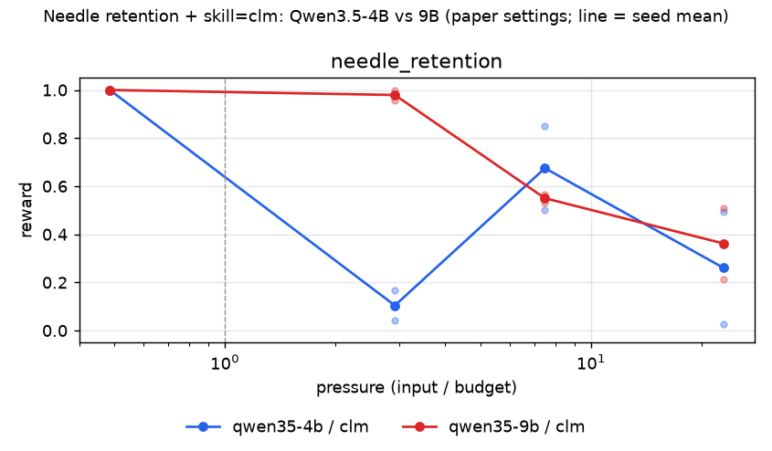

# M2c (9B): ContextBench Needle Retention, Qwen3.5-9B + skill=clm, vs 4B

Date: 2026-11-14, 20:08–21:10 UTC. Status: **done** (8/8 trials).
Raw trials: `runs/m2c-needle-9b-clm/trials/` (gitignored). Per-trial table (both models):
[`figs/m2c-needle-4b-vs-9b.md`](figs/m2c-needle-4b-vs-9b.md). 4B run: [`m2c-needle-results.md`](m2c-needle-results.md).

## Setup

Identical to the 4B Needle run (`skill=clm`, `CB_SETTINGS=paper`, levels K4-C4 / K4-C24 /
K8-C60 / K2-C192, seeds 42 / 43, proot), except **vary: model = Qwen3.5-9B**.

## Results

| Level | Pressure | 9B s42 | 9B s43 | 4B s42 | 4B s43 | 9B end (ops reached) |
|---|---|---|---|---|---|---|
| K4-C4 | 0.52x | **1.000** | **1.000** | 1.000 | 1.000 | end of stream |
| K4-C24 | 2.96x | **0.958** | **1.000** | 0.042 | 0.167 | end of stream |
| K8-C60 | 7.54x | 0.567 | 0.533 | 0.500 | 0.850 | wall at 34/60, 32/60 |
| K2-C192 | 23.1x | 0.214 | 0.510 | 0.026 | 0.495 | wall at 41/192, 98/192 |

Mean: 9B 0.72, 4B 0.51.

## Analysis

1. **The 9B copies the Needle recipe correctly; the 4B mostly does not.** Every 9B trial
   keeps every needle it has seen: its score equals the fraction of the stream it got through
   before the wall (e.g. K8-C60 s42: 34/60 chunks = 0.567 = 272/480 needles). Its last edits
   anchor on the chunk header or the NEEDLES line, both of which keep the needles. At K4-C24
   (3x), where neither model hits the wall, the gap is 0.98 vs 0.10.
2. **At ≥ 7.5x both models hit the budget wall**, around 25–26k tokens, after 32–98 chunks.
   Retained needles are only ~10–12k tokens even at the end of these streams, so the wall
   comes from residue (own commands, harness notes) building up, the same failure the 9B
   shows on KV ([`m2-kv-9b-results.md`](m2-kv-9b-results.md)).
3. **Two separate skills, split across the two models.** Recipe fidelity (copy an intricate
   edit exactly): 9B ≫ 4B. Long-horizon hygiene (keep cutting your own residue for 100+
   turns): 4B ≥ 9B on KV / LogTriage, both weak on Needle at high pressure.

## Caveats

- n = 2 seeds per level. Anchor evidence comes from the final edit command only.
- Ran concurrently with 9B KV / LogTriage / extra-seed runs on one 9B server.
