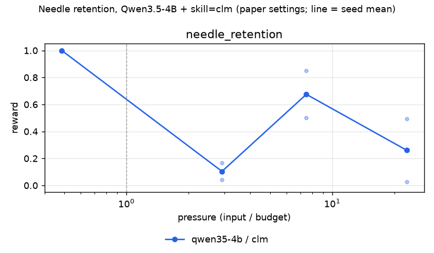

# M2c results: ContextBench Needle Retention, Qwen3.5-4B + skill=clm

Date: 2026-11-14, 18:52–19:50 UTC. Status: **done** (8/8 trials).
Raw trials: `runs/m2c-needle-clm/trials/` (gitignored). Per-trial table: [`figs/m2c-needle.md`](figs/m2c-needle.md).
Ran concurrently with LogTriage (M2b) and the BCP 50-question run on one vLLM server.

## Setup (control unless marked)

- Model: Qwen3.5-4B BF16, vLLM 0.33.0. Agent: `ClmStream`, `skill=clm` (paper's
  `needle_retention.md` method text), `CB_SETTINGS=paper` (32768 / 2048, no step cap, no nudges).
- Task: each chunk = a few NEEDLE lines (to keep verbatim) + a ~4k-token FILLER block (to delete).
  Score = needles present verbatim in context at the end / total.
- **Vary:** level K4-C4 (0.52x) / K4-C24 (2.96x) / K8-C60 (7.54x) / K2-C192 (23.1x); seed 42 / 43.
- Timeout 28800 s, proot sandbox.

## Results

| Level | Pressure | seed 42 | seed 43 | ops (s42 / s43) | anchor `h` in last edit (s42 / s43) |
|---|---|---|---|---|---|
| K4-C4 | 0.52x | **1.000** | **1.000** | 4/4, 4/4 | chunk header / chunk header |
| K4-C24 | 2.96x | 0.042 | 0.167 | 24/24, 24/24 | filler START / (inline, no `h`) |
| K8-C60 | 7.54x | 0.500 | 0.850 | 34/60 wall, 52/60 wall | filler START / chunk header |
| K2-C192 | 23.1x | 0.026 | 0.495 | 6/192 wall, 101/192 wall | filler END / (inline) |

Mean 0.51. Five of eight trials hit the budget wall before the end of the stream.

## Analysis

1. **The score tracks one substitution in the recipe.** The paper's command sets
   `h = '=== chunk N/'`, the chunk header that comes *before* the needle lines, and keeps
   `t[k:i]` (header + needles) while cutting the filler. The 4B often replaces `h` with the
   filler block's START or END line, which it can see right there. Then `t[k:i]` is empty
   (or negative), and every edit deletes that chunk's needles along with its filler. Runs whose
   last edit kept the header anchor score 0.85–1.0; runs that swapped it score 0.03–0.5.
   (Only the last edit survives in the trajectory, so this is per-run, not per-edit, evidence.)
2. **Context management itself works.** One edit per chunk, peak context 8k at K4-C24, i.e.
   the model offloads exactly as on KV. The failure is recipe fidelity, not willingness to edit.
3. **At ≥ 7.5x a second failure appears: the budget wall.** K8-C60 and K2-C192 hit the wall
   at 34–101 of 60–192 chunks: retained needles plus leftover residue from imperfect edits
   (e.g. K2-C192 s42 wrote `head + t[i:j]`, re-inserting the filler, and the harness flagged
   that the edit GREW context) push the context to 25–33k.
4. **Contrast with KV / LogTriage:** their recipes only cut a block; Needle must cut a block
   while keeping text around it, which is where the 4B slips. Same pattern as Sudoku's
   in-place edit (smoke grid). Recipe complexity, not pressure, is the 4B's limit here.

## Utilization

GPU 100% throughout (shared run, see [`bcp50-v3-results.md`](bcp50-v3-results.md)); CPU 10–18%.
vLLM decoded ~170 tok/s total across ~11 concurrent requests, so long thinking turns took
minutes, and one K8-C60 request timed out once and was retried (no effect on the result).

## Caveats

- n = 2 seeds per level; Needle scores swing 0.04–1.0 depending on which anchor the model copies.
- Anchor evidence comes from the final edit command only.
