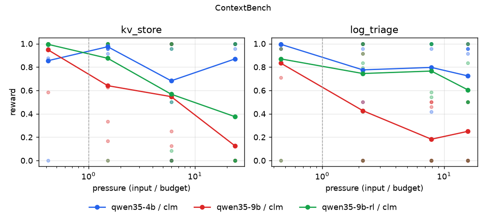
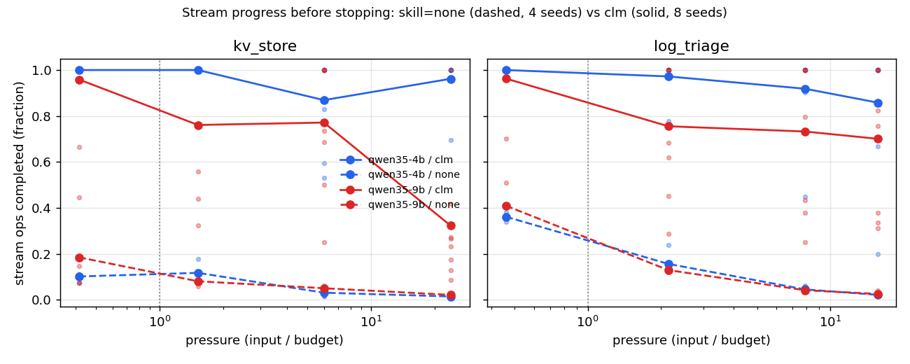

# M5 results: ContextBench seed sweep, 4B vs 9B vs 9B-RL

Date: 2026-11-15, 07:22–10:37 UTC. Status: **done** (148 new trials, 0 errors).
Plan: [`../instruction-seed-sweep.md`](../instruction-seed-sweep.md). Decisions: [`../decisions.md`](../decisions.md).
Pod `ia4u423t1fi61l` (2×A40, EU-SE-1). Raw trials: `runs/m5-{4b,9b,9b-rl}/` on the network volume (gitignored).
Per-trial tables: [`figs/m5-seed-sweep.md`](figs/m5-seed-sweep.md) (M5 only), [`figs/m5-combined.md`](figs/m5-combined.md) (M5 + M2 seeds).

## Setup

**Control (same as M2):**
- `CB_SETTINGS=paper`: budget 32768, reserve 2048, no step cap, no nudges, T 0.7, top_p 0.95, max_tokens 8192, thinking on.
- `skill=clm`.
- vLLM 0.33.0 BF16, 65k max-model-len, prefix caching.
- proot sandbox, timeout 28800 s.
- KV R260 / R1000 / R4000 / R16000 and LogTriage L320 / L1600 / L6400 / L12800.

**Vary:**
- **Model: 4B / 9B / 9B-RL.**
  - 9B-RL is [`context-language-model/rl-ckpt-livectx_dapo-iter44`](https://huggingface.co/context-language-model/rl-ckpt-livectx_dapo-iter44)
    pinned at `ffc4aab2f30cb5b802ced6c84e6590ab5fec213d`. It is the paper's CLM-arm RL checkpoint, trained on OpenResearcher,
    not on ContextBench.
- **Seeds:** 8 per cell. 4B / 9B combine M2 seeds 42–43 (KV R1000+ also 44–45) with **new seeds only** in M5.
  The 9B-RL has seeds 42–49, all new.

**Deviations:**
- New rootfs pull (python:3.12-slim digest `sha256:05a994d2…`, possibly newer than M2's).
- Trials ran 40–60 at once per GPU, against 8–23 in M2.
- 16 9B-RL trials (L12800 and L6400) were restarted on GPU1 after ~20 min; the aborted attempts are not counted.
- **New:** every LM call (full request + response) is logged in `runs/m5-lmlog/<run>__<task>.jsonl`
  (~0.7 GB, 148 + 2 smoke files). Step 2 will replay these.

Success = reward ≥ 0.95. "Wall" = `budget_wall`: the context hit the 32k budget before the stream ended.

## Headline

1. **The 9B gets worse as pressure rises; the 4B does not.**
   - **9B:** a steady, significant decline on both families.
     - KV: 0.95 → 0.64 → 0.55 → 0.12; trend z = −2.84, one-sided p = 0.002.
     - LogTriage: 0.83 → 0.43 → 0.18 → 0.25; z = −3.27, p < 0.001.
   - **4B:** flat on KV (z = 0.19, p = 0.58) and a weak downward trend on LogTriage (0.99 → 0.72; z = −1.54, p = 0.06).
   - **Model × log₂-pressure interaction (logit, family fixed effect): −0.49 (SE 0.22, p = 0.027).**
     The 9B's success odds fall faster with pressure than the 4B's.
2. **The decline is a context-management failure, not a retrieval failure.** Above 0.5x the 9B hit the budget wall in
   **28/48** trials, against **9/48** for the 4B.
3. **The 9B-RL sits between them.**
   - It hits the wall about half as often as the base 9B (13/48 above 0.5x) and does much better on LogTriage
     (0.60–0.87 against 0.18–0.43).
   - It still declines with pressure (KV z = −3.07, LogTriage z = −2.04), and its slope is not different from the base 9B's
     (interaction 0.09, p = 0.68). The RL mainly shifts the curve up (main effect +1.08, p = 0.07); it does not flatten it.
   - On KV at ≥ 6x it is no better than the base 9B (0.57 / 0.38 against 0.55 / 0.12; 9 walls of 16).

## Per cell (8 seeds each)

| Family | Model | Level | Mean reward | Success | Wall |
|---|---|---|---|---|---|
| KV | 4B | R260 (0.4x) | 0.85 | 6/8 | 0/8 |
| KV | 4B | R1000 (1.5x) | 0.97 | 7/8 | 0/8 |
| KV | 4B | R4000 (6.0x) | 0.68 | 5/8 | 3/8 |
| KV | 4B | R16000 (23.9x) | 0.87 | 7/8 | 1/8 |
| KV | 9B | R260 | 0.95 | 7/8 | 1/8 |
| KV | 9B | R1000 | 0.64 | 4/8 | 4/8 |
| KV | 9B | R4000 | 0.55 | 4/8 | 4/8 |
| KV | 9B | R16000 | **0.12** | 1/8 | 7/8 |
| KV | 9B-RL | R260 | 0.99 | 8/8 | 0/8 |
| KV | 9B-RL | R1000 | 0.88 | 7/8 | 0/8 |
| KV | 9B-RL | R4000 | 0.57 | 4/8 | 4/8 |
| KV | 9B-RL | R16000 | 0.38 | 3/8 | 5/8 |
| LogTriage | 4B | L320 (0.5x) | 0.99 | 8/8 | 0/8 |
| LogTriage | 4B | L1600 (2.2x) | 0.78 | 5/8 | 1/8 |
| LogTriage | 4B | L6400 (7.9x) | 0.80 | 6/8 | 2/8 |
| LogTriage | 4B | L12800 (15.7x) | 0.72 | 5/8 | 2/8 |
| LogTriage | 9B | L320 | 0.83 | 6/8 | 1/8 |
| LogTriage | 9B | L1600 | 0.43 | 2/8 | 4/8 |
| LogTriage | 9B | L6400 | **0.18** | 0/8 | 4/8 |
| LogTriage | 9B | L12800 | 0.25 | 1/8 | 5/8 |
| LogTriage | 9B-RL | L320 | 0.87 | 7/8 | 0/8 |
| LogTriage | 9B-RL | L1600 | 0.74 | 3/8 | 2/8 |
| LogTriage | 9B-RL | L6400 | 0.77 | 5/8 | 1/8 |
| LogTriage | 9B-RL | L12800 | 0.60 | 2/8 | 1/8 |

**Trend tests:** Cochran–Armitage on success against log₂ pressure, one-sided for a decrease.

| Model | KV z (p) | LogTriage z (p) |
|---|---|---|
| 4B | 0.19 (0.58) | −1.54 (0.062) |
| 9B | **−2.84 (0.002)** | **−3.27 (0.0005)** |
| 9B-RL | **−3.07 (0.001)** | **−2.04 (0.021)** |

**Logistic model:** `success ~ model × log2(pressure) + family`, n = 128 per pair.

| Comparison | Interaction (slope difference) | Main effect |
|---|---|---|
| 9B vs 4B | **−0.49 (SE 0.22, p = 0.027)** | −1.01 (p = 0.07) |
| 9B-RL vs 9B | 0.09 (SE 0.23, p = 0.68) | +1.08 (p = 0.07) |
| 9B-RL vs 4B | −0.39 (SE 0.22, p = 0.07) | 0.03 (p = 0.96) |

## Failures that are not context management

Four trials scored 0 without hitting the wall. Diagnosed from their last LM calls in `runs/m5-lmlog/`:

| Trial | What went wrong |
|---|---|
| 4B KV R260 s47 | printed every ANSWER block to `> /dev/null`, so nothing reached the grader |
| 9B-RL KV R1000 s43 | its `sed` stripped the value's trailing `#checksum`, so every value mismatches |
| 9B-RL LogTriage L320 s49 | malformed tag `<<<ANSWER qid=23>>` (missing `>`) |
| 9B LogTriage L6400 s42 (M2) | answers written as chat text (M2 diagnosis) |

The 9B's ~0.5 rewards on finished LogTriage streams (L1600 s48, L6400 s44 / s46 / s49, L12800 s45) come from wrong counts.
M2 traced the same pattern to a few batches that were never offloaded. This was not re-checked here.

## Implications for step 2 (uncertainty)

- **The 9B's budget-wall failures are the target.**
  - There are 28 9B and 13 9B-RL wall trials, against 9 for the 4B, with matched successful seeds at the same levels.
  - Every LM call is logged, so the context at each edit turn before a wall can be replayed and resampled.
- **Three model contrasts on the same tasks:**
  - 4B against 9B: different slopes.
  - 9B against 9B-RL: same slope, different level.
  - The uncertainty scores can be tested against each.

## Caveats

- 8 seeds per cell. Single-cell differences, such as 4B KV R4000 0.68 against 9B 0.55, are not significant on their own;
  the claims rest on the trend and interaction tests.
- The 4B / 9B cells mix M2 seeds (run at 8–23 concurrent trials) with M5 seeds (40–60 concurrent).
  - Concurrency changes latency, not the sampled tokens, but the rootfs pull also differs.
- The 9B-RL "transfer" result is out of distribution for that checkpoint (it was trained on search tasks).
- The diagnoses of the zero-reward trials rest on their final calls only.

## `skill=none` arm (4B and 9B done; 9B-RL running)

Date: 2026-11-15, 13:39–16:24 UTC, pod `f9a3dd720awllw` (1×A40, EU-SE-1, $0.59/h).
Per-trial table: [`figs/m5-none.md`](figs/m5-none.md). Plots: [`figs/m5-none.png`](figs/m5-none.png) (reward),
[`figs/m5-none-progress.png`](figs/m5-none-progress.png) (stream progress, `none` vs `clm`).

**Control:** as M5 above, same rootfs digest (`sha256:05a994d2…`), every LM call logged
(`runs/m5-lmlog/m5n-<model>__<task>.jsonl`).
**Vary:**
- `skill=none`: harness system prompt only, no per-family method text.
- 4 seeds per cell: 42–45, except 4B / 9B at R260 and L320, which use 43–46 (M2's seed-42 `none` trials there were not logged).
- 32 trials per model, all new.

**Deviations:**
- 10 9B KV trials died on litellm request timeouts when 32 full-context trials overflowed the KV cache (143 preemptions).
  They were rerun 10 at a time; the failed attempts are in `runs/m5n-9b-failed/` and not counted.
- 9B-RL runs 16 at a time.

### Result: without the method text, both models fail at every level

| Family | Model | Level | Mean reward | Wall | Ops done (of total) | Edits / trial | Peak ctx |
|---|---|---|---|---|---|---|---|
| KV | 4B | R260 (0.4x) | 0.00 | 4/4 | 2.8 / 27 | 0 | 31.3k |
| KV | 4B | R1000 (1.5x) | 0.00 | 4/4 | 4.0 / 34 | 0.5 | 34.3k |
| KV | 4B | R4000 (6.0x) | 0.00 | 4/4 | 2.0 / 64 | 0.25 | 43.6k |
| KV | 4B | R16000 (23.9x) | 0.00 | 4/4 | 2.8 / 184 | 0 | 30.8k |
| KV | 9B | R260 | **0.09** | 4/4 | 5.0 / 27 | 0 | 32.0k |
| KV | 9B | R1000 | 0.00 | 4/4 | 2.8 / 34 | 0 | 31.4k |
| KV | 9B | R4000 | 0.00 | 4/4 | 3.3 / 64 | 0 | 31.6k |
| KV | 9B | R16000 | 0.00 | 4/4 | 4.0 / 184 | 0 | 31.6k |
| LogTriage | 4B | L320 (0.5x) | 0.00 | 4/4 | 17.0 / 47 | 0 | 25.5k |
| LogTriage | 4B | L1600 (2.2x) | 0.00 | 4/4 | 21.8 / 139 | 0 | 25.6k |
| LogTriage | 4B | L6400 (7.9x) | 0.00 | 4/4 | 6.5 / 143 | 0 | 26.3k |
| LogTriage | 4B | L12800 (15.7x) | 0.00 | 4/4 | 5.8 / 262 | 0 | 26.7k |
| LogTriage | 9B | L320 | 0.00 | 4/4 | 19.3 / 47 | 1.25 | 25.9k |
| LogTriage | 9B | L1600 | 0.00 | 4/4 | 18.0 / 139 | 0 | 25.6k |
| LogTriage | 9B | L6400 | 0.00 | 4/4 | 6.0 / 143 | 0 | 27.9k |
| LogTriage | 9B | L12800 | 0.00 | 4/4 | 6.8 / 262 | 0.25 | 28.5k |

1. **64/64 trials hit the budget wall; 63/64 score 0.** The one nonzero is 9B KV R260 s44 (0.375: 12/27 ops,
   0 edits). Mean reward: 4B 0.00, 9B 0.01. Trend tests and the logistic model are undefined with no successes.
2. **Neither model manages its context without the method text.** 9 edits in 64 trials (4B 3, 9B 6), against one edit
   per batch with `skill=clm`. Each trial stops after a few ops, once the stream fills the 32k budget.
3. **Progress falls with pressure for both models, at the same rate** (dashed lines in the plot). KV: 4B 10% → 1%,
   9B 19% → 2% of the stream. LogTriage: 4B 36% → 2%, 9B 41% → 3%. This is mechanical: a fixed ~30k of context
   covers a shrinking share of a longer stream. The 4B / 9B difference from M5 appears only with `skill=clm`.
4. **Against M2's single seed-42 `none` trials** (4B R260 0.125, 9B R260 0.708, 4B L320 0.000, 9B L320 0.083): the
   9B KV R260 0.708 looks like an outlier (17/24 answers before the wall); the new seeds reach 2–12 of 27 ops.
   Rootfs and seeds differ, so this is not a direct comparison.

**For step 2:** `none` gives a no-management baseline. Its context decisions are almost never edits, so semantic
entropy over edit/offload/delete clusters will be near 0 by construction. The useful contrast is `clm` trials
(and possibly the 9 `none` trials with edits).

## Runtime and cost

| Batch | Wall clock |
|---|---|
| 4B (42 trials, GPU0) | 07:22–08:36 (73 min) |
| 9B (42 trials, GPU1) | 07:25–09:00 (95 min) |
| 9B-RL smoke (2 trials, GPU0) | 08:39–08:46 |
| 9B-RL main (46 on GPU0) | 08:46–10:12 |
| 9B-RL moved trials (16 on GPU1) | 09:24–10:37 |

- About 3.5 h of pod time (incl. ~20 min setup), at $1.18/h.
- CPU never exceeded 3 of the 16 available cores; GPU at 100%; 0 vLLM preemptions throughout.
