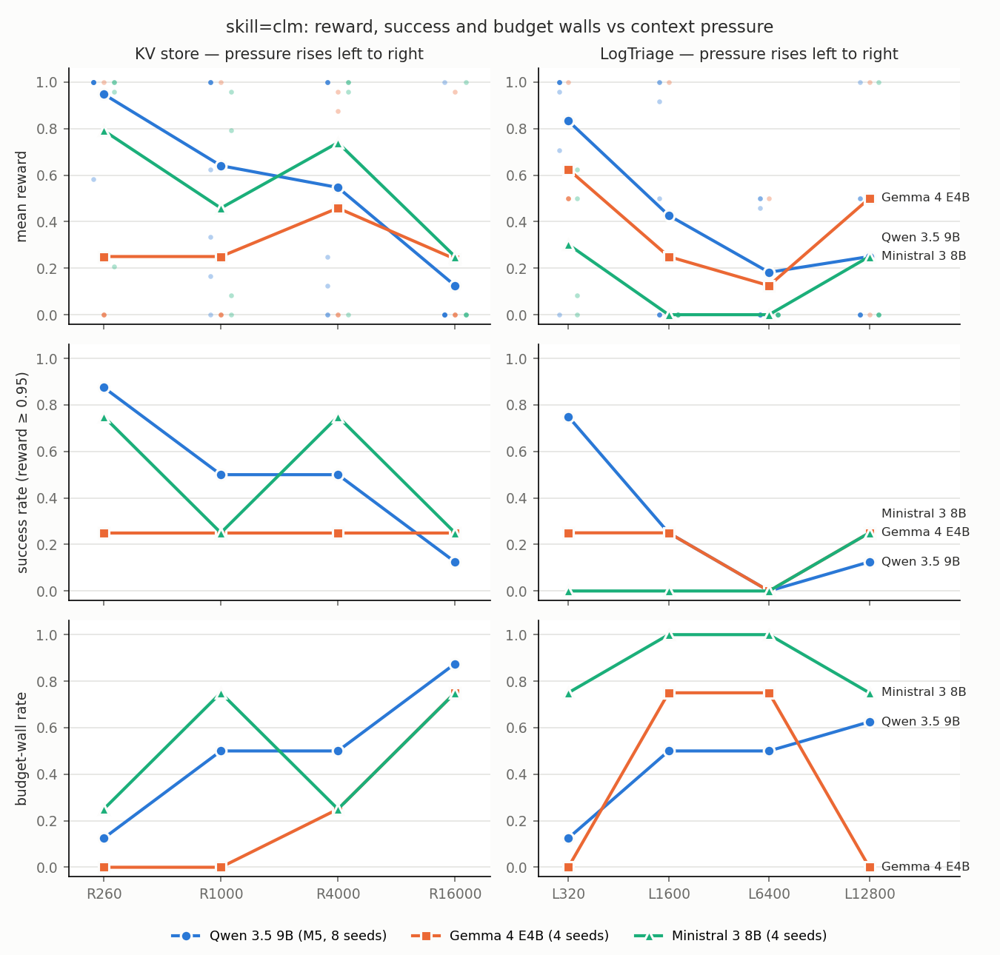

# M5B results: does Qwen's context-pressure failure transfer to Gemma 4 E4B and Ministral 3 8B?

Date: 2026-11-16, 11:32–15:35 UTC+8 (main runs), plus 5 Gemma reruns 14:23–15:16 UTC+8.
Status: **done**. 80 scored trials: Gemma `clm` 32, Gemma `none` 16, Ministral `clm` 32. 0 errors in the final data.

- Plan: [`../instruction-m5b.md`](../instruction-m5b.md). Decisions: [`../decisions.md`](../decisions.md) (2026-11-16 M5B entries). Handoff: [`../handoff/handoff-m5b.md`](../handoff/handoff-m5b.md).
- Pod `090hikvwfs22gk` (2×A40, EU-SE-1, now deleted). Raw trials: `runs/m5b-{gemma4-e4b-clm,gemma4-e4b-none,ministral3-8b-clm}/` on the network volume (gitignored).
- Per-trial table: [`figs/m5b.md`](figs/m5b.md). Figure: [`figs/m5b-vs-qwen.png`](figs/m5b-vs-qwen.png).
  The Qwen comparison uses M5's [`figs/m5-combined.md`](figs/m5-combined.md).



*Top row: mean reward, with one faint point per seed. Middle row: success rate. Bottom row: budget-wall rate. Columns: KV store and LogTriage.
Pressure rises left to right. Qwen 3.5 9B has 8 seeds per cell (M5); Gemma 4 E4B and Ministral 3 8B have 4 (seeds 42–45).*

## Summary

1. **Neither model shows Qwen 3.5 9B's success decline.**
   - Qwen 9B's success falls with pressure on both families (KV z = −2.84, p = 0.002; LogTriage z = −3.27, p = 0.0005).
   - Gemma 4 E4B: KV z = −0.01 (p = 0.50), LogTriage z = −0.41 (p = 0.34). Ministral 3 8B: KV z = −0.89 (p = 0.19), LogTriage z = +1.19 (p = 0.88).
   - In a logistic model (success ~ model × log₂ pressure + family), both slopes are **significantly flatter than Qwen 9B's**
     (interaction +0.58, p = 0.028 and +0.61, p = 0.021).
   - They are **indistinguishable from Qwen 3.5 4B's** slope (+0.08, p = 0.76 and +0.07, p = 0.78), at a much lower level.
2. **The flat curves hide three different failure modes, and only one of them is Qwen's.**
   Splitting success into "avoided the budget wall" and "answered correctly when it did":
   - **Qwen 3.5 9B:**
     - It fails by hitting the wall mid-stream after managing context for a while.
     - Its wall rate rises with pressure on both families.
     - On KV it is perfect whenever it avoids the wall (16/16).
   - **Ministral 3 8B fails the same way as Qwen** (mid-stream walls; 8/8 correct on KV when there's no wall), **but its walls don't depend on pressure.**
     - KV: 1/3/1/3 walls of 4 per level.
     - LogTriage: 3/4/4/3 of 4; it hits the wall even at L320, where the whole stream fits in budget.
     - Its context management breaks down at every level, so there's no low-pressure success to lose.
   - **Gemma 4 E4B fails in two other ways:**
     - **It doesn't start managing context.** All 10 of its walls happen within the first 10% of the stream. It does 0–6 edits,
       then loops on no-op commands.
     - **It gives wrong answers on streams it completes.** 15 of 22 completed `clm` streams score below 0.95, because of
       answer-extraction bugs (values with their spaces stripped, malformed answer tags, a `grep` regex mistake on counts).
     - Its KV walls do rise with pressure (0/0/1/3, p = 0.005), but they're early "never engaged" failures, not Qwen's mid-stream ones.
3. **Without the method text (`none`), Gemma scores 0 on all 16 trials and makes 0 context edits**, as Qwen did in M5
   (96/96 walls there). The method text is what makes these models manage context at all.
4. **Bottom line for the project:** Qwen 9B's decline is not a generic property of small models under this harness.
   - The two new models fail at low pressure too.
   - Ministral reproduces Qwen's *mechanism* (mid-stream budget walls), but not its *pressure dependence*.
   - Gemma's results are dominated by task-execution errors unrelated to context.
   - With 4 seeds per cell, a moderate trend could still be missed. See Power below.

## Setup

**Control (as M5):**
- `CB_SETTINGS=paper`: budget 32,768 tokens, reserve 2,048, no step cap, no nudges, temperature 0.7, top_p 0.95, max_tokens 8,192, `skill=clm`.
- Cells:
  - KV store: R260 / R1000 / R4000 / R16000, pressures 0.4× / 1.5× / 6.0× / 23.9×.
  - LogTriage: L320 / L1600 / L6400 / L12800, pressures 0.5× / 2.1× / 7.9× / 15.7×.
- Seeds 42–45 in every cell. The two smoke trials (KV R260 s42 and LT L320 s42) are part of the `clm` set.
- vLLM 0.33.0, BF16, max-model-len 65,536, prefix caching.
- proot sandbox with the same rootfs digest as M5 (`sha256:05a994d2…`).
- Every LM call is logged (`runs/m5-lmlog/m5b-<model>-<arm>__<task>.jsonl`).

**Vary: the model.**

| Model | Weights | Tool calling | Thinking |
|---|---|---|---|
| Gemma 4 E4B | `google/gemma-4-E4B-it` @ `4ecc2ba6` | Native (`gemma4` parser, vLLM's Gemma 4 tool template) | On (`gemma4` reasoning parser) |
| Ministral 3 8B Instruct 2512 | `mistralai/Ministral-3-8B-Instruct-2512-BF16` @ `f6fae979` | Native (`mistral` parser, `--tokenizer-mode mistral`) | None (no thinking mode) |

**Arms:**
- Gemma: `clm` (32 trials) and `none` (seeds 42–43, 16 trials).
- The plan's rule (≥ 13/16 zero and ≤ 2/16 edit) kept Gemma's `none` arm at 2 seeds.
- Ministral: `clm` only. The user skipped its `none` arm to save cost.

**Deviations from the plan:**
- **Model set changed.** The plan named Llama 3.1 8B and Gemma 3 4B → 12B.
  - Neither could drive the harness's native `bash` tool. Llama 3.1 wrote "THOUGHT … ```bash``` " as text, and Gemma 3 has no tool-call tokens.
  - A text-parsing fallback got Llama to 89/102 parsed calls, but Gemma 3 then copied the context mirror's `bash {…}`
    notation and looped. The user chose models with native tool calls instead (see `decisions.md`).
- **Ministral needed three compatibility fixes.** None changes what the model sees, except the third:
  1. The harness's `chat_template_kwargs` (`enable_thinking`) are not sent: vLLM's Mistral tokenizer mode rejects them, and the model has no thinking to toggle.
  2. `mistral-common` is pinned to 1.12.0. Version 1.13 changed an API that vLLM 0.33.0 calls.
  3. **The logging proxy drops assistant turns with empty content and no tool call** before forwarding, because mistral-common rejects them.
     So Ministral never sees its own empty replies; Qwen and Gemma do.
- **5 Gemma `clm` trials were rerun with the same seeds** (LT L6400 s43–45 and LT L12800 s44–45).
  - Their first attempts died with "Connection error" when the logging proxy froze on a network-volume stall. They were
    never scored, and are kept in `runs/m5b-gemma4-outage-20261116/`.
  - The reruns used the same pod, server and settings.
- **Concurrency:** 30–32 trials at once per GPU, against 40–60 in M5. Ministral's vLLM preempted 15 times when its KV cache filled.
  Preemption changes latency only, not the sampled tokens.

Definitions, as in M5:
- **Success:** reward ≥ 0.95.
- **Wall:** the run ended with `budget_wall`, meaning the context reached the 32k budget before the stream ended.
- **Ops done:** the share of stream operations delivered before the end.
- **Edits:** real context-mirror rewrites (`n_ctx_syncs_real`).

## 1. Success and trend tests

| Model | KV success | KV trend z (p) | LogTriage success | LogTriage trend z (p) |
|---|---|---|---|---|
| Qwen 3.5 9B (M5) | 16/32 | **−2.84 (0.002)** | 9/32 | **−3.27 (0.0005)** |
| Qwen 3.5 4B (M5) | 25/32 | +0.19 (0.57) | 24/32 | −1.54 (0.062) |
| Qwen 3.5 9B-RL (M5) | 22/32 | **−3.07 (0.001)** | 17/32 | **−2.04 (0.021)** |
| Gemma 4 E4B | 4/16 | −0.01 (0.50) | 3/16 | −0.41 (0.34) |
| Ministral 3 8B | 8/16 | −0.89 (0.19) | 1/16 | +1.19 (0.88) |

The test is Cochran–Armitage on success against log₂ pressure, one-sided for a decrease (`infra/cb_rules.py`).

**Logistic model:** success ~ model × log₂(pressure) + family, fit on the two models' pooled trials.

| Comparison | Interaction (slope difference) | Main effect (new model) | Reference model's slope | n |
|---|---|---|---|---|
| Gemma 4 E4B vs Qwen 9B | **+0.58 (SE 0.27, p = 0.028)** | −1.70 (p = 0.010) | −0.63 (p = 0.0001) | 96 |
| Ministral 3 8B vs Qwen 9B | **+0.61 (SE 0.26, p = 0.021)** | −1.46 (p = 0.028) | −0.68 (p = 0.0001) | 96 |
| Gemma 4 E4B vs Qwen 4B | +0.08 (SE 0.25, p = 0.76) | **−2.62 (p = 0.0001)** | −0.13 (p = 0.36) | 96 |
| Ministral 3 8B vs Qwen 4B | +0.07 (SE 0.24, p = 0.78) | **−2.37 (p = 0.0004)** | −0.14 (p = 0.37) | 96 |

Read together:
- Both new models have Qwen 4B's flat slope and a much lower level.
- Their slopes differ significantly from Qwen 9B's: a positive interaction cancels most of 9B's −0.63 to −0.68.
- The pressure decline is specific to Qwen 9B and 9B-RL among the five models tested so far.

## 2. Per-cell results (`skill=clm`)

| Family | Model | Level (pressure) | n | Mean reward | Success | Wall | Ops done (of total) | Edits / trial | LM calls / trial | Peak ctx | Minutes |
|---|---|---|---|---|---|---|---|---|---|---|---|
| KV | Qwen 3.5 9B | R260 (0.4×) | 8 | 0.95 | 7/8 | 1/8 | 25.9 / 27 | 2.9 | 54 | 17.3k | 17 |
| KV | Qwen 3.5 9B | R1000 (1.5×) | 8 | 0.64 | 4/8 | 4/8 | 25.9 / 34 | 9.6 | 60 | 21.3k | 22 |
| KV | Qwen 3.5 9B | R4000 (6.0×) | 8 | 0.55 | 4/8 | 4/8 | 49.4 / 64 | 34.2 | 76 | 24.6k | 33 |
| KV | Qwen 3.5 9B | R16000 (23.9×) | 8 | 0.12 | 1/8 | 7/8 | 59.4 / 184 | 52.6 | 69 | 28.2k | 33 |
| KV | Gemma 4 E4B | R260 | 4 | 0.25 | 1/4 | 0/4 | 27.0 / 27 | 3.0 | 28 | 11.4k | 5 |
| KV | Gemma 4 E4B | R1000 | 4 | 0.25 | 1/4 | 0/4 | 34.0 / 34 | 10.0 | 34 | 11.4k | 9 |
| KV | Gemma 4 E4B | R4000 | 4 | 0.46 | 1/4 | 1/4 | 48.8 / 64 | 30.8 | 160 | 22.3k | 46 |
| KV | Gemma 4 E4B | R16000 | 4 | 0.24 | 1/4 | 3/4 | 50.8 / 184 | 47.5 | 415 | 38.9k | 88 |
| KV | Ministral 3 8B | R260 | 4 | 0.79 | 3/4 | 1/4 | 22.5 / 27 | 3.0 | 72 | 20.0k | 15 |
| KV | Ministral 3 8B | R1000 | 4 | 0.46 | 1/4 | 3/4 | 28.0 / 34 | 10.0 | 86 | 23.8k | 46 |
| KV | Ministral 3 8B | R4000 | 4 | 0.74 | 3/4 | 1/4 | 54.8 / 64 | 36.2 | 93 | 21.6k | 63 |
| KV | Ministral 3 8B | R16000 | 4 | 0.25 | 1/4 | 3/4 | 101.2 / 184 | 94.0 | 193 | 29.7k | 97 |
| LogTriage | Qwen 3.5 9B | L320 (0.5×) | 8 | 0.83 | 6/8 | 1/8 | 45.2 / 47 | 22.6 | 82 | 16.1k | 28 |
| LogTriage | Qwen 3.5 9B | L1600 (2.1×) | 8 | 0.43 | 2/8 | 4/8 | 105.0 / 139 | 83.0 | 132 | 26.6k | 52 |
| LogTriage | Qwen 3.5 9B | L6400 (7.9×) | 8 | 0.18 | 0/8 | 4/8 | 104.8 / 143 | 87.0 | 129 | 23.3k | 49 |
| LogTriage | Qwen 3.5 9B | L12800 (15.7×) | 8 | 0.25 | 1/8 | 5/8 | 183.6 / 262 | 169.1 | 197 | 22.6k | 67 |
| LogTriage | Gemma 4 E4B | L320 | 4 | 0.62 | 1/4 | 0/4 | 47.0 / 47 | 22.8 | 83 | 15.5k | 27 |
| LogTriage | Gemma 4 E4B | L1600 | 4 | 0.25 | 1/4 | 3/4 | 38.2 / 139 | 32.2 | 310 | 39.4k | 75 |
| LogTriage | Gemma 4 E4B | L6400 | 4 | 0.12 | 0/4 | 3/4 | 40.5 / 143 | 31.5 | 77 | 33.0k | 27 |
| LogTriage | Gemma 4 E4B | L12800 | 4 | 0.50 | 1/4 | 0/4 | 262.0 / 262 | 238.2 | 305 | 16.5k | 75 |
| LogTriage | Ministral 3 8B | L320 | 4 | 0.30 | 0/4 | 3/4 | 29.2 / 47 | 20.2 | 82 | 23.5k | 52 |
| LogTriage | Ministral 3 8B | L1600 | 4 | 0.00 | 0/4 | 4/4 | 76.5 / 139 | 73.5 | 124 | 28.3k | 91 |
| LogTriage | Ministral 3 8B | L6400 | 4 | 0.00 | 0/4 | 4/4 | 78.2 / 143 | 77.0 | 182 | 27.3k | 94 |
| LogTriage | Ministral 3 8B | L12800 | 4 | 0.25 | 1/4 | 3/4 | 122.5 / 262 | 120.2 | 268 | 26.6k | 100 |

- "Peak ctx" is the verifier's `agent_peak_tokens`, averaged over trials.
- A wall trial can show a mean below 32k: the harness's budget gate counts tokens with its own calibrated tokenizer
  estimate, not the verifier's.
- Minutes are wall-clock time per trial at 30–32 concurrent trials per GPU, so they aren't comparable to M5's.

## 3. Decomposition: avoiding the wall, then answering correctly

Success needs two things: the trial must avoid the budget wall (context management) and answer correctly (task execution).
The trend test below is on the wall rate rising with log₂ pressure, one-sided.

| Model | Family | Walls by level (R260→R16000 / L320→L12800) | Wall trend z (p) | Success when no wall | Mean reward when no wall |
|---|---|---|---|---|---|
| Qwen 3.5 9B | KV | 1 / 4 / 4 / 7 of 8 | **+2.84 (0.002)** | 16/16 | 1.00 |
| Qwen 3.5 9B | LogTriage | 1 / 4 / 4 / 5 of 8 | **+1.98 (0.024)** | 9/18 | 0.75 |
| Qwen 3.5 4B | KV | 0 / 0 / 3 / 1 of 8 | +1.43 (0.077) | 25/28 | 0.95 |
| Qwen 3.5 4B | LogTriage | 0 / 1 / 2 / 2 of 8 | +1.59 (0.056) | 24/27 | 0.96 |
| Qwen 3.5 9B-RL | KV | 0 / 0 / 4 / 5 of 8 | **+3.35 (0.0004)** | 22/23 | 0.95 |
| Qwen 3.5 9B-RL | LogTriage | 0 / 2 / 1 / 1 of 8 | +0.61 (0.27) | 17/28 | 0.84 |
| Gemma 4 E4B | KV | 0 / 0 / 1 / 3 of 4 | **+2.60 (0.005)** | 4/12 | 0.40 |
| Gemma 4 E4B | LogTriage | 0 / 3 / 3 / 0 of 4 | +0.49 (0.31) | 3/10 | 0.60 |
| Ministral 3 8B | KV | 1 / 3 / 1 / 3 of 4 | +0.89 (0.19) | **8/8** | 0.98 |
| Ministral 3 8B | LogTriage | 3 / 4 / 4 / 3 of 4 | +0.24 (0.41) | 1/2 | 0.81 |

**Where in the stream the walls happen** (share of stream operations done at the wall):

| Model | Family | Walls | Walls in the first 10% of the stream | Share of stream done at the wall |
|---|---|---|---|---|
| Qwen 3.5 9B | KV | 16 | 1 | 0.09–0.76, median 0.37 |
| Qwen 3.5 9B | LogTriage | 14 | 0 | 0.25–0.82, median 0.44 |
| Gemma 4 E4B | KV | 4 | **4** | 0.02, 0.03, 0.05, 0.06 |
| Gemma 4 E4B | LogTriage | 6 | **6** | 0.01–0.09 |
| Ministral 3 8B | KV | 8 | 0 | 0.10–0.97, median 0.45 |
| Ministral 3 8B | LogTriage | 14 | 1 | 0.02–0.79, median 0.55 |

What this shows:
- **Qwen 3.5 9B's decline is entirely a context-management failure.**
  - On KV it never fails a trial it doesn't wall (16/16).
  - Its wall rate climbs with pressure on both families.
  - Its walls come mid-stream, after it has managed context for a while: median 37% and 44% of the stream.
- **Ministral 3 8B has the same failure mechanism, without the pressure dependence.**
  - Its walls are mid-stream (median 45% / 55% of the stream), and it's perfect on KV when there's no wall (8/8).
  - But its wall rate is flat and high: 8/16 on KV and 14/16 on LogTriage, with LogTriage walls at every level including L320.
  - L320 needs only light compaction (0.5× pressure), yet Ministral walls there in 3 of 4 trials. It mismanages the mirror
    even when the stream fits.
  - So it's already failing at the low end, and there's no decline left to observe. "No trend" here is a floor effect on the
    context-management side.
- **Gemma 4 E4B's walls are a different phenomenon.**
  - Every Gemma wall happens in the first 2–9% of the stream, after 0–6 edits. It never starts the offload routine (section 4).
  - On KV this "never engaged" outcome does become more common with pressure (0/0/1/3, p = 0.005). That's a
    pressure-dependent failure, but it's about starting to manage context, not keeping it up.
  - On streams Gemma completes, most answers are wrong (15 of 22 below 0.95), which flattens its success curve at a low level.

## 4. Failure modes, diagnosed from the logged LM calls

The diagnoses come from each trial's last LM calls in `runs/m5-lmlog/`, plus the verifier's per-trial fields
(`n_answered`, `matched`, and for LogTriage `reward_lookup` / `reward_count`).

### Gemma 4 E4B, `clm` (32 trials)

| Outcome | Trials | What happened |
|---|---|---|
| Success | 7 | KV R260 s44, R1000 s45, R4000 s45 (0.96), R16000 s45 (0.96); LT L320 s44, L1600 s44, L12800 s42 |
| Early wall ("never engaged") | 10 | KV R4000 s44, R16000 s42–44; LT L1600 s42/43/45, L6400 s42/44/45. 0–6 edits, then loops on no-op commands (`echo COMPLETE_TASK_AND_SUBMIT_FINAL_OUTPUT`, `true`, `echo READY_FOR_NEXT_OP`) until the context fills. Up to 180 replies without a tool call per trial |
| KV: values mangled | 5 | KV R260 s45, R1000 s42/43/44, R4000 s43. Each answered 24/24 and matched 0/24. The answer command extracts the value with `awk -F'=' '{print $2}' \| tr -d ' '`, which deletes every space from multi-word values (values look like "spruce copper pewter …") |
| KV: malformed answer tag | 2 | KV R260 s42/s43 wrote `<<<ANSWER key=K…>>` (one `>` short), so the grader parsed 0 answers |
| KV: partial | 1 | KV R4000 s42, 21/24 matched (0.875); not diagnosed |
| LogTriage: lookups right, counts wrong | 6 | L320 s42/43/45, L6400 s43, L12800 s43/44: `reward_lookup` = 1.0, `reward_count` = 0.0, so reward 0.5. In the inspected commands (L320 s43/s45) the counts use `grep '[WARN] …'` unescaped, which `grep` reads as a character class (any of W, A, R, N), so the counts are wrong. Several trials also answered the last count as chat text: `<<<ANSWER qid=23>>> 0` |
| LogTriage: both wrong | 1 | L12800 s45: completed the stream, 0/24 matched; same unescaped `[WARN]` pattern in its last command |

Gemma's LogTriage behaviour is all-or-nothing:
- **Trials that start the offload routine finish the whole stream at every level.** They make about one edit per operation
  (238 edits per L12800 trial), and peak context stays at 14–18k.
- **Trials that don't start it hit the wall within the first 13 operations.**
- The non-monotonic wall pattern (0/3/3/0) is therefore which of these two modes a seed lands in, not a pressure effect.

### Ministral 3 8B, `clm` (32 trials)

| Outcome | Trials | What happened |
|---|---|---|
| Success | 9 | KV R260 s42/44/45, R1000 s42, R4000 s42/44/45, R16000 s43; LT L12800 s43 |
| KV mid-stream wall | 8 | 10–97% of the stream done; the answers given before the wall are mostly right (R1000 s45: 19/20, R260 s43: 5/6) |
| LogTriage mid-stream wall | 14 | 11–79% of the stream done (one at 2%). LogTriage queries come at the end of the stream, so a wall means 0–1 answers |
| LogTriage completed but partial | 1 | L320 s43: lookups 0.92, counts 0.33 (reward 0.625) |

Ministral's tool-call compliance is high overall (88.5%), but its misses cluster in the LogTriage wall trials:
- Most no-tool replies there copy the context mirror's notation, `bash {"command": …}` as plain text (382 of 507 misses
  overall). This is the same habit that broke Gemma 3 4B in the first M5B attempt.
- The worst case is LT L6400 s43: 246 no-tool replies, including 70 in a row, before it hit the wall.
- These loops add failed turns to the context and bring the wall closer. But KV walls happen with almost no misses (0–14
  per trial), so the misses are a contributor, not the main cause.

## 5. LM-call behaviour

| Model / arm | Trials | LM calls | Native tool calls | No tool call | of which empty | of which `bash {…}` text | of which fenced text | Cut at max_tokens | Completion tokens / call | Reasoning chars / call |
|---|---|---|---|---|---|---|---|---|---|---|
| Gemma 4 E4B / clm | 32 | 5,649 | 4,359 (77.2%) | 1,285 (22.7%) | 3 | 4 | 0 | 0 | 223 | 465 |
| Gemma 4 E4B / none | 16 | 2,076 | 1,164 (56.1%) | 912 (43.9%) | 1 | 0 | 0 | 1 | 124 | 243 |
| Ministral 3 8B / clm | 32 | 4,400 | 3,893 (88.5%) | 507 (11.5%) | 0 | 382 | 118 | 1 | 200 | 0 |

- **Gemma's no-tool replies are mostly plain-text commands or answers** (e.g. `echo READY_FOR_NEXT_OP` as text), with the
  thinking trace in a separate reasoning channel. They pile up in the "never engaged" trials: up to 180 per trial.
- **Ministral never returned an empty reply**, so the proxy's empty-turn drop (a deviation) didn't fire in the final data.
- No HTTP errors in the final data. The proxy outage's errors are confined to the 5 rerun trials' first attempts.

## 6. `skill=none` arm (Gemma 4 E4B, seeds 42–43)

| Family | Level | Mean reward | Wall | Ops done (of total) | Edits / trial | LM calls / trial | Peak ctx |
|---|---|---|---|---|---|---|---|
| KV | R260 | 0.00 | 1/2 | 19.0 / 27 | 0 | 58 | 34.0k |
| KV | R1000 | 0.00 | 2/2 | 4.0 / 34 | 0 | 124 | 36.3k |
| KV | R4000 | 0.00 | 2/2 | 4.0 / 64 | 0 | 132 | 43.0k |
| KV | R16000 | 0.00 | 2/2 | 1.0 / 184 | 0 | 314 | 30.3k |
| LogTriage | L320 | 0.00 | 2/2 | 12.0 / 47 | 0 | 126 | 29.6k |
| LogTriage | L1600 | 0.00 | 2/2 | 18.0 / 139 | 0 | 34 | 27.9k |
| LogTriage | L6400 | 0.00 | 2/2 | 4.5 / 143 | 0 | 96 | 32.4k |
| LogTriage | L12800 | 0.00 | 2/2 | 4.0 / 262 | 0 | 155 | 34.3k |

- **All 16 trials scored 0, 15 hit the wall, and none made a single context edit.**
- The one completed stream, KV R260 s43, answered all 24 queries, partly as chat text rather than through commands, and matched 0 of them.
- This matches M5's Qwen `none` result (96/96 walls, 12 edits in 96 trials). Without the method text no model here manages
  its context, so the `clm` arm is the only informative one.

## 7. Power and caveats

- **Power: 4 seeds per cell** (16 trials per family per model), against Qwen's 8.
  - Qwen 9B's effect is large: success fell from 7/8 to 1/8 on KV. A same-size effect would likely show at 4 seeds.
  - A moderate decline would not. "No trend" means "no large Qwen-sized trend", not "no effect".
- **Floor effects:**
  - Ministral on LogTriage walls at every level, and Gemma fails most completed streams for non-context reasons.
  - For these pairs, a flat success curve says the model can't do the task, not that it's robust to pressure.
  - Ministral on KV is the only pair with a working low-pressure baseline (3/4 at R260). Even there, walls don't follow pressure.
- **Unequal conditions:**
  - Ministral has no thinking mode; Qwen and Gemma 4 think.
  - Ministral can't see its own empty replies. This never fired in the final data (0 empty replies).
  - Gemma used the vLLM Gemma 4 tool template, and Ministral used mistral-common's native format.
  - M5B ran 30–32 trials per GPU against M5's 40–60.
  - 5 Gemma trials are reruns, with the same seeds and settings.
- **Diagnoses are from the last 3 LM calls and the verifier fields:**
  - The `grep '[WARN]'` diagnosis is confirmed in 3 trials' commands and assumed for the other 4 count failures, which show the same reward pattern.
  - KV R4000 s42's 3/24 misses were not diagnosed.
- **Lost data:** a few LM-log lines that failed to write during the volume stalls sat in `/root/lmlog-fallback` on the
  M5B pod and were deleted with it. This doesn't affect any reward or table here.

## 8. Implications

- **For the claim "context pressure degrades CLM performance":** the decline is clearest in Qwen 3.5 9B and 9B-RL.
  - The 4B and the two new families are flat, for different reasons.
  - Context-management failure does appear (Ministral's mid-stream walls, Gemma's never-engaged walls), but only Qwen 9B /
    9B-RL turn it into a pressure-dependent decline.
- **For M6 (uncertainty):**
  - **Ministral's mid-stream walls are the closest analogue to Qwen's**: a working routine that breaks partway through.
    A semantic-entropy replay on them would test whether the "uncertainty before failure" signal generalizes.
  - Gemma's failures (stalling at the start, extraction bugs) aren't context decisions, so they're poor M6 targets.
- **If more data is wanted:**
  - 4 more seeds (46–49) on Ministral KV, about 2.5 h on one A40 (~$1.5), would test whether its KV walls trend with pressure at Qwen's sample size.
  - Gemma's answer-extraction errors could be separated from context management by re-grading with whitespace-insensitive
    matching, offline and at no compute cost. That's a scoring change, so it should be reported as a sensitivity analysis only.

## Runtime and cost

| Batch (UTC+8) | Wall clock |
|---|---|
| Gemma 4 E4B smoke + `clm` (GPU 0) | 11:32–13:32 |
| Gemma 4 E4B `none` (GPU 0) | 13:32–13:59 |
| Ministral 3 8B smoke + `clm` (GPU 1; 4 relaunches for the fixes above) | 11:36–15:35 (final `clm` run from 13:05) |
| Gemma 4 E4B reruns (5 trials, GPU 0) | 14:23–15:16 |

- **The final pod ran about 4.5 h at $1.18/h (about $5.3).**
- **Earlier attempts added about $10:**
  - first two 1×A40 pods left idle for about 6.7 h (about $8);
  - the 2×A40 Llama/Gemma 3 attempt (about $1.2);
  - this report's data extraction ran on an existing M6 pod (no extra cost).
- **Infrastructure incidents:**
  - The network volume stalled for minutes at a time (about 12:30–13:10 UTC+8). The logging proxies froze and both GPUs sat idle about 40 min.
  - Fix: LM logs now go to local disk, and the proxy writes from a thread. See `decisions.md`.

## Reproduce

```bash
# Per-trial table and cb_report's own plot (needs data/cb_tasks/*/task.toml and the trial dirs from the volume)
python3 infra/cb_report.py --out .agent/notes/figs/m5b --title "M5B: Gemma 4 E4B and Ministral 3 8B on ContextBench" \
  runs/m5b-gemma4-e4b-clm runs/m5b-gemma4-e4b-none runs/m5b-ministral3-8b-clm
# Figure above (Qwen from M5's table)
python3 infra/m5b_plot.py --out .agent/notes/figs/m5b-vs-qwen .agent/notes/figs/m5-combined.md .agent/notes/figs/m5b.md
# Per-cell, trend, logistic, LM-call and triage sections (lmlog_summary.jsonl: one line per LM log, built on the pod)
python3 infra/m5b_analyze.py .agent/notes/figs/m5b.md .agent/notes/figs/m5-combined.md lmlog_summary.jsonl
```
