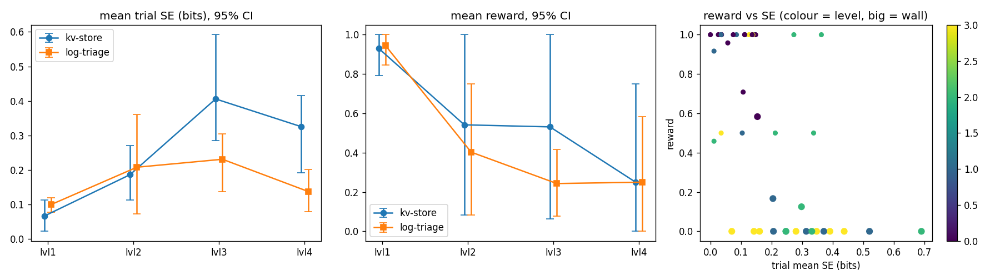
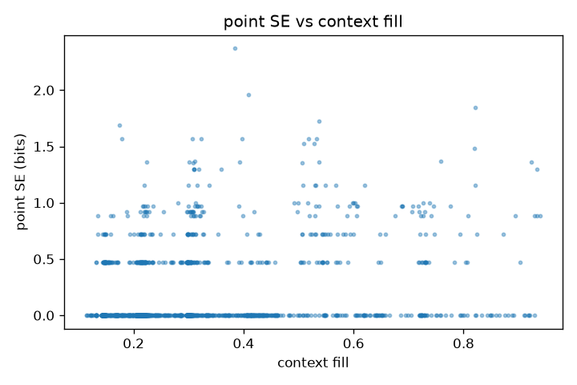
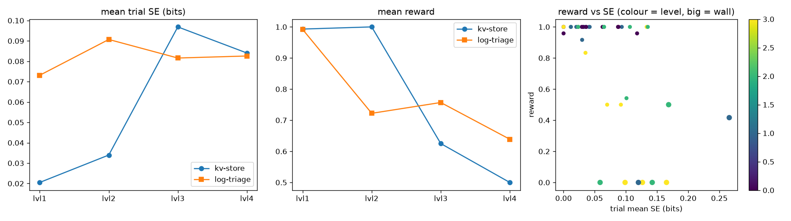

# Semantic Entropy of Context-Management Decisions in a Context Language Model

M6 write-up, 9B and 9B-RL models (H3 in progress). Lab notes: [`m6-se-results.md`](m6-se-results.md). Plan: [`../instruction-semantic-entropy.md`](../instruction-semantic-entropy.md).

> **Paper structure (decided 2026-11-16):** Experiment 1 = M5 reimplementation eliciting the performance drop under context pressure (M5 only, not M5B); Experiment 2 = correlation (H1, §5); Experiment 3 = decodability (H2, §6). This draft does not yet contain Experiment 1 or the relabelled headings; see `../handoff/handoff-m6-paper.md`.

## Abstract

A context language model (CLM) agent manages its own context window. At each turn it decides which parts of its transcript to keep, cut, or offload to disk. We ask two questions. Does the model's uncertainty about these decisions predict task failure? Is that uncertainty linearly readable from its activations?

We replay 42 logged trials each from Qwen3.5-9B and an RL-trained variant (9B-RL) on two ContextBench task families (KV store, LogTriage) at four context-pressure levels. At 1409 (9B) and 1435 (9B-RL) decision points we draw 10 samples from the identical logged prompt. We execute each sampled command on a byte-exact reconstruction of the sandbox and cluster samples by their effect on the context. Discrete semantic entropy (SE) over these clusters measures decision uncertainty.

Trial mean SE predicts lower reward at fixed pressure: partial Spearman ρ = −0.587, 95% CI [−0.775, −0.282] for the 9B, and ρ = −0.477 [−0.736, −0.094] for the 9B-RL. SE adds ΔR² = +0.26 (9B) and +0.19 (9B-RL) over pressure alone. RL training makes the model far more certain (mean SE falls by 60–80% per cell) and more accurate, but residual uncertainty still predicts failure. A linear probe on the residual stream at the last prompt token predicts SE > 0 with AUROC 0.741 (9B) and 0.818 (9B-RL), against 0.578 and 0.493 for a context-length baseline. Both results hold when SE is restricted to the context decision itself, excluding samples whose command failed or whose tool call was malformed: partial ρ = −0.496 (9B) and −0.446 (9B-RL), probe AUROC 0.766 and 0.809 against context-length baselines of 0.520 and 0.487. Uncertainty about context management is therefore behaviourally consequential and represented internally before generation.

## 1. Introduction

Long-horizon agents exceed any fixed context window. A CLM agent handles this itself: it edits a mirror of its own transcript, deleting stale turns or offloading them to files it can read back later. Each edit is a decision with consequences. A value deleted instead of offloaded cannot be recovered. A file overwritten destroys earlier work.

Earlier milestones (M2, M5) showed that task reward falls as context pressure rises. They did not show *why* individual trials fail at a given pressure. One candidate is decision uncertainty: a model unsure how to manage its context may choose inconsistently, and inconsistent choices may compound.

Semantic entropy [1, 2] measures uncertainty over the *meaning* of sampled outputs rather than over tokens. Here the meaning of a sample is its effect on the context. We test three hypotheses:

- **H1 (correlation).** Higher SE over context decisions predicts lower reward, beyond what pressure level alone explains.
- **H2 (decodability).** SE is linearly decodable from the residual stream at the decision point.
- **H3 (causality, future work).** Steering along the decoded direction changes accuracy against an unsteered baseline.

This report covers H1 and H2 for the 9B and 9B-RL models. H3 is in progress (Section 8).

## 2. Setting

### 2.1 The CLM harness

The agent issues exactly one bash command per turn. Each turn runs as follows:

1. The harness writes the editable part of the transcript to a mirror file, `/tmp/.live_ctx/LIVE_CTX_MAIN.txt`. Each message becomes a block headed `[[CTX_TURN n role=…]]`.
2. The harness runs the model's command in a sandbox with persistent shell state.
3. The harness reads the mirror back. If the model edited it, the edit becomes the new message list, unless an edit gate refuses it (an edit that grows the context past 30,720 of 32,768 tokens).
4. The tool result is appended, with a harness note stating whether an edit was applied.

The system prompt describes this protocol. With `skill=clm`, a skill text adds a concrete recipe: offload each incoming data batch to `/tmp/ctx_offload/` with one Python heredoc, then cut it from the mirror.

### 2.2 Tasks and trials

We reuse the M5 trials of two models: Qwen3.5-9B and 9B-RL (`rl-ckpt-livectx_dapo-iter44`, an RL-trained checkpoint of the same model, revision `ffc4aab2`), both with `skill=clm`, served by vLLM 0.33.0 in BF16 with prefix caching. Sampling is temperature 0.7, top-p 0.95, thinking on, max 8192 output tokens. The context budget is 32,768 tokens with a 2,048-token reserve.

| Family | Task | Pressure levels | Seeds | Trials |
| --- | --- | --- | --- | --- |
| KV store | Store streamed SET batches; answer later GET queries | R260 (0.46x), R1000 (1.57x), R4000 (6.04x), R16000 (23.9x) | s44–49 (R260); s46–49 (others) | 18 |
| LogTriage | Triage streamed log batches; answer questions about them | L320 (0.51x), L1600 (2.2x), L6400 (7.9x), L12800 (15.8x) | s44–49 | 24 |

**Pressure** is the total number of tokens the task streams in, divided by the 32,768-token context budget. Above 1x the task cannot fit in context, so the agent must offload or delete. Levels 1–4 in the figures are each family's four levels in increasing order. The families' levels are not matched: level 4 is 23.9x for KV store but 15.8x for LogTriage.

A trial "hits the wall" when its context reaches the budget limit and the session ends. A proxy logged every LM request and response in these trials in full.

## 3. Method

### 3.1 Two kinds of state

The state at turn *t* has two parts. The **prompt** (the message list) determines what the model says; it is logged exactly. The **disk** (offload files, shell state) determines what a command does; it is not logged, because the sandbox is deleted after each trial. Only the harness and the model's own commands write to disk, and every command is logged. Re-running the logged commands in order therefore rebuilds the disk.

### 3.2 Replay and divergence

Pass 1 replays each trial without the model. It re-runs every logged command in a fresh sandbox with the trial's exact harness settings and rootfs (`sha256:05a994d2…`). After each command it compares the replayed tool output with the logged one. The first mismatch sets `diverged_at`. Turns from `diverged_at` onward are excluded, because their disk no longer matches what the model saw.

### 3.3 Decision points

A decision point *t* is one logged turn whose command ran. The harness note in its tool result labels each turn:

- `context_edit_turn`: the note says "edit applied";
- `context_stay_turn`: otherwise.

Per trial, among turns before `diverged_at`, we take all `context_edit_turn`s plus 5 random `context_stay_turn`s from each context-fill quartile, capped at 40 points. The random seed derives from the trial name.

### 3.4 Sampling

Pass 2 resends each point's logged request unchanged except for `n = 10`, `logprobs = true`, and a per-point seed. Requests go directly to the model server, bypassing the logging proxy. Each response must report the same `prompt_tokens` as the logged one; a mismatch would mean a different template or tool list.

### 3.5 Execution and labelling

Pass 3 replays again and pauses before each point's logged command. It snapshots the disk, then runs each of the 10 sampled commands on its own fresh copy of that snapshot, with a fresh harness environment. Each sample receives an outcome key:

- a **status** if the sample did not run normally: `invalid` (non-zero exit and no context change), `no_tool_call`, `context_status`, or `error`;
- otherwise a **label per context block**: `stay` (text unchanged), `edit` (partly kept), `offload` (removed, and found in a file the command wrote), or `delete` (removed, not saved); plus a **clobber flag** (the command destroyed content of a file that existed before it).

Two samples fall in the same semantic cluster if and only if their outcome keys are equal. The replay then runs the logged command and continues to the next point.

### 3.6 Semantic entropy

For a point whose clusters *c* hold shares *p_c* of the 10 samples:

$$\mathrm{SE} = -\sum_{c} p_c \log_2 p_c$$

SE ranges from 0 (all samples agree) to log₂ 10 = 3.32 bits (all differ). A trial's summary is its mean SE over points. This is discrete SE [2]: it needs cluster frequencies only, not log-probabilities. It is a total-uncertainty estimate and does not separate aleatoric from epistemic uncertainty.

Because status outcomes (`invalid`, `no_tool_call`, `context_status`, `error`) are clusters too, SE mixes two kinds of uncertainty: which context decision the model makes, and whether its command or tool call works. We therefore also report two components per point:

- **Decision-only SE:** SE over the samples with status `ok` only (points with fewer than two such samples are dropped). It measures uncertainty about the context decision alone.
- **Status-only SE:** the entropy of the status variable, with all `ok` samples merged into one outcome. It measures uncertainty about whether the command or tool call succeeds.

### 3.7 Analysis (H1)

The unit of analysis is the trial (n = 42). The pre-registered test is a partial Spearman correlation between trial mean SE and reward. It controls for family × pressure level by rank-residualizing both variables on level indicators. The 95% CI comes from 2,000 bootstrap resamples over trials. A secondary OLS regression is `reward ~ mean_SE + C(family:level)`. The pre-registered go criterion for H2 was partial |ρ| ≥ 0.3 with a CI excluding zero, or step-level AUROC ≥ 0.65.

### 3.8 Probes (H2)

We run a Hugging Face forward pass on each point's logged prompt plus logged response and record the residual stream at all 32 decoder layers. Prompt token counts match the vLLM log at every point. Two positions follow Kossen et al. [3]: TBG, the last prompt token (before generation), and SLT, the last response token.

Targets are binary SE > γ* (logistic regression, C = 0.05, scored by AUROC) and continuous SE (ridge, α = 1000, scored by Spearman). The threshold γ* minimizes within-group squared error [3]. Evaluation uses 5-fold GroupKFold by trial, so no trial appears in both train and test; the layer is chosen on inner folds. Controls are a probe on context fill and turn index only, and a probe on shuffled labels.

## 4. Validation

The measurement pipeline passed every pre-registered check before any result was computed.

| Check | Criterion | 9B | 9B-RL |
| --- | --- | --- | --- |
| Gate A: replay fidelity (4 dev trials) | Replayed tool output equals logged output | 432/432 turns byte-identical | – |
| Replay fidelity (all 42 trials) | No divergence | 40 identical; 2 diverge | 41 identical; 1 diverges |
| Gate B: labeller self-consistency | Labeller output for the logged command equals the next logged prompt | 1397/1397 points | 1421/1421 points |
| Hand check of labels | Labels match the commands on reading | 10/10 correct | – |
| Prompt identity | Resampled `prompt_tokens` equals logged value | 0 mismatches in 1409 points | 0 mismatches in 1435 points |
| Sample errors | No harness or execution errors | 0 in 14,090 samples | 0 in 14,350 samples |

Both diverging trials diverge on `ls -la /tmp`: directory size and modification times differ, while file contents are identical. Following the protocol, later points are dropped. LogTriage L320 s49 keeps turns before 43 of 84; L1600 s45 keeps turns before 101 of 130. For the 9B-RL, KV R16000 s46 diverges at turn 93 of 98 (cause not inspected); its later points are dropped. One 9B-RL trial (LogTriage L320 s49) scored 0 without hitting the wall, a format slip, and is excluded from the tests.

The hand check confirmed three label types. The skill's offload script labels the incoming batch `offload` and the earlier cut turns `delete`. A `grep` on a missing offload file is `invalid` (exit code 2, no edit). An answer written with `printf` leaves every block `stay`.

## 5. Results: SE predicts failure (H1)

Trials with higher mean SE score lower at the same pressure level. The pre-registered partial Spearman correlation is **ρ = −0.587, 95% CI [−0.775, −0.282]**. This exceeds the plan's threshold for a strong effect (|ρ| ≥ 0.5).

### 5.1 Descriptive results

| Cell | n | Mean reward | Trials hitting wall | Mean SE (bits) | Share of points with SE = 0 |
| --- | --- | --- | --- | --- | --- |
| KV R260 | 6 | 0.93 | 1 | 0.07 | 0.91 |
| KV R1000 | 4 | 0.54 | 2 | 0.19 | 0.70 |
| KV R4000 | 4 | 0.53 | 2 | 0.41 | 0.50 |
| KV R16000 | 4 | 0.25 | 3 | 0.33 | 0.55 |
| LogTriage L320 | 6 | 0.94 | 0 | 0.10 | 0.82 |
| LogTriage L1600 | 6 | 0.40 | 3 | 0.21 | 0.71 |
| LogTriage L6400 | 6 | 0.24 | 3 | 0.23 | 0.67 |
| LogTriage L12800 | 6 | 0.25 | 4 | 0.14 | 0.78 |

Most points have SE = 0. The skill's offload recipe dominates, so all 10 samples usually take the same action. Samples still differ in reasoning: every inspected point had 10 distinct reasoning traces.

SE rises with pressure up to level 3, then falls at level 4 in both families. A plausible but untested explanation: level-4 trials hit the wall early, so they contribute fewer points and fewer edit decisions.

*Figure 1. Pressure levels 1–4 = KV R260 / R1000 / R4000 / R16000 and LogTriage L320 / L1600 / L6400 / L12800 (Section 2.2). Left: mean trial SE per pressure level. Middle: mean reward per level. Error bars: 95% bootstrap CI of the mean over trials (n = 4–6 per cell). Right: reward against trial mean SE, one dot per trial; colour = pressure level (0 = lowest), large dot = trial hit the wall.*

### 5.2 Main test and regression

| Trial summary | Partial Spearman ρ with reward | 95% CI |
| --- | --- | --- |
| Mean SE (pre-registered) | −0.587 | [−0.775, −0.282] |
| Max SE | −0.42 | [−0.72, −0.05] |
| Mean SE over points with fill ≥ 0.75 (19 trials) | −0.31 | [−0.87, +0.30] |

In the regression `reward ~ mean_SE + C(family:level)`, the SE coefficient is −2.02 (standard error 0.40, p < 0.001). Adding SE raises R² from 0.40 to 0.66. At a fixed pressure level, 0.1 bits more mean SE corresponds to about 0.20 lower reward.

### 5.3 Robustness (not pre-registered)

- **Fill and point count as covariates:** SE coefficient −1.65, p = 0.0003.
- **By family:** KV ρ = −0.78 (n = 18); LogTriage ρ = −0.51 (n = 24).
- **By turn type:** `context_edit_turn`s only ρ = −0.45; `context_stay_turn`s only ρ = −0.42.
- **First half of each trial only** (points with turn index below half the trial's turns): ρ = −0.24. In OLS the SE coefficient is −1.29 (p = 0.028) when controlling for first-half fill, but p = 0.18 when controlling for whole-trial fill. Evidence that uncertainty precedes failure is therefore weak.
- **Context length:** the Spearman correlation of point SE with fill is 0.20. SE is not mainly a proxy for context length (Figure 2).
- **Decision-only SE** (Section 3.6): ρ = −0.496 [−0.731, −0.120]; see Section 5.7.

*Figure 2. Point SE against context fill, one dot per decision point (n = 1409). Non-zero SE occurs at every fill level. (Figure still without error bars; the per-bin mean ± 95% CI version needs the per-point data on the pod.)*

### 5.4 Qualitative analysis of high-SE points

The five highest-SE points in the development trials (1.29–1.57 bits) each mix three distinct decisions:

1. offload the incoming batch now, following the recipe;
2. answer or look up a pending GET first, leaving the context untouched;
3. follow the recipe but cut a different set of earlier turns (for example, delete six old blocks versus edit three).

These are genuine alternatives in context management, not labelling noise.

### 5.5 Step-level prediction

The pre-registered step-level criterion was not met. The harmful-edit proxy gives AUROC 0.38, but the proxy is uninformative: 971 of 1051 edit turns count as harmful, because the recipe routinely deletes earlier command turns. The ground-truth label (a deleted SET whose key is later queried) has not been built. As a weaker step-level signal, point SE predicts whether a point belongs to a trial that hits the wall with AUROC 0.61 [0.59, 0.64].

The go/no-go decision for H2 is **GO**, on the correlation criterion alone.

### 5.6 Replication on the 9B-RL model

The same pipeline on the 9B-RL's 42 trials (same cells and seeds) replicates the main result with a more certain, more accurate model.

| Cell | 9B-RL reward | 9B reward | 9B-RL walls | 9B walls | 9B-RL mean SE | 9B mean SE | 9B-RL share SE = 0 |
| --- | --- | --- | --- | --- | --- | --- | --- |
| KV R260 | 0.99 | 0.93 | 0 | 1 | 0.02 | 0.07 | 0.96 |
| KV R1000 | 1.00 | 0.54 | 0 | 2 | 0.03 | 0.19 | 0.95 |
| KV R4000 | 0.63 | 0.53 | 2 | 2 | 0.10 | 0.41 | 0.84 |
| KV R16000 | 0.50 | 0.25 | 2 | 3 | 0.08 | 0.33 | 0.86 |
| LogTriage L320 | 0.99 | 0.94 | 0 | 0 | 0.07 | 0.10 | 0.89 |
| LogTriage L1600 | 0.72 | 0.40 | 2 | 3 | 0.09 | 0.21 | 0.87 |
| LogTriage L6400 | 0.76 | 0.24 | 1 | 3 | 0.08 | 0.23 | 0.86 |
| LogTriage L12800 | 0.64 | 0.25 | 1 | 4 | 0.08 | 0.14 | 0.89 |

*Figure 3. As Figure 1, for the 9B-RL (no error bars). Pressure levels 1–4 as in Section 2.2.*

| Test | 9B-RL | 9B |
| --- | --- | --- |
| Partial ρ, mean SE (pre-registered) | **−0.477** [−0.736, −0.094] (n = 41) | −0.587 [−0.775, −0.282] (n = 42) |
| Partial ρ, max SE | −0.355 [−0.723, +0.065] | −0.42 [−0.72, −0.05] |
| OLS SE coefficient (p); ΔR² | −3.16 (p = 0.003); +0.19 | −2.02 (p < 0.001); +0.26 |
| + fill and point count | −3.02 (p = 0.006) | −1.65 (p = 0.0003) |
| By family: KV / LogTriage ρ | −0.43 / −0.39 | −0.78 / −0.51 |
| Edit / stay turns only ρ | −0.22 / −0.51 | −0.45 / −0.42 |
| First half of trial only ρ | −0.10 (p = 0.81) | −0.24 (p = 0.028 / 0.18) |
| Point SE vs fill (Spearman) | 0.03 | 0.20 |
| Wall-trial AUROC | 0.56 | 0.61 |

Three differences stand out:

- **RL removes most uncertainty.** 84–96% of 9B-RL points have SE = 0, and the rise of SE with pressure seen in the 9B disappears. Reward is much higher under pressure (level 4: 0.50 vs 0.25 on KV, 0.64 vs 0.25 on LogTriage), and fewer trials hit the wall (8 vs 18).
- **Residual uncertainty still predicts failure.** The pre-registered test passes (GO), and each bit of mean SE costs more reward than in the 9B (coefficient −3.16 vs −2.02), although the SE range is narrow.
- **No early signal.** SE in the first half of 9B-RL trials does not predict reward.

### 5.7 Decision uncertainty versus tool-use uncertainty

SE as defined in Section 3.6 also counts samples whose command failed (`invalid`) or whose tool call was malformed. In the 9B, 11% of points have at least one such sample (9B-RL: 4%); format failures alone are rare (0.2% of samples), so the status component is mostly about commands that fail. We split SE into its decision-only and status-only components and repeat the main test.

| Partial ρ with reward, controlling for level [95% CI] | 9B | 9B-RL |
| --- | --- | --- |
| SE (as reported) | −0.587 [−0.775, −0.282] | −0.477 [−0.737, −0.099] |
| **Decision-only SE** | **−0.496 [−0.731, −0.120]** | **−0.446 [−0.698, −0.063]** |
| Status-only SE | −0.472 [−0.675, −0.218] | −0.287 [−0.618, +0.116] |
| Both in one OLS with level: decision / status coefficient (p) | −1.50 (0.010) / −2.85 (0.004) | −5.59 (0.004) / +0.54 (0.82) |

Trial mean SE and trial mean decision-only SE correlate at 0.93 (9B) and 0.91 (9B-RL). Uncertainty about the context decision alone predicts failure in both models. In the 9B, uncertainty about whether commands succeed is a second, partly independent predictor; in the 9B-RL it adds nothing.

## 6. Results: SE is linearly decodable (H2)

A linear probe reads the SE of the coming decision from the residual stream before the model generates anything. γ* = 0 bits, and 30% of points have SE > 0.

| Target | Position | Score | Fill + turn-index control | Shuffled-label control |
| --- | --- | --- | --- | --- |
| SE > 0 (AUROC) | TBG | **0.741** (layers 18–20) | 0.578 | 0.483 |
| SE (Spearman) | TBG | **0.466** (layers 20–22) | 0.159 | −0.033 |
| SE > 0 (AUROC) | SLT | 0.648 | | |
| SE (Spearman) | SLT | 0.331 | | |
| SE residualized on fill (Spearman) | TBG | **0.371** | | |
| Trial reward < 0.5 (AUROC) | TBG | 0.671 (layer unstable: 0 or 22) | | |

Three observations support H2:

- **Above context length.** The TBG probe exceeds the fill + turn-index control by 0.16 AUROC and 0.31 Spearman. It still predicts SE after fill is regressed out (Spearman 0.371). The signal is therefore not context length alone, the confound raised by Du et al. [4].
- **Before generation.** TBG outperforms SLT, as in Kossen et al. [3]. The uncertainty is present in the prompt representation, not only in the generated response.
- **Not driven by the development trials.** A smoke test on 9 trials gave TBG AUROC 0.78; the full 42 trials give 0.74.

The trial-reward probe is weaker and its best layer is unstable, so we make no claim about it. The probe weight vector and the difference-of-means direction at the best layer are saved for H3 (`figs/direction-m5-9b.npz`).

### 6.1 9B-RL

The same probe on the 9B-RL's 1435 points gives a similar picture. Only 12% of its points have SE > 0 (9B: 30%).

| Target | Position | Score | Fill + turn-index control | Shuffled-label control |
| --- | --- | --- | --- | --- |
| SE > 0 (AUROC) | TBG | **0.818** (layer 28) | 0.493 | 0.522 |
| SE (Spearman) | TBG | **0.383** (layer 28) | 0.004 | −0.006 |
| SE > 0 (AUROC) | SLT | 0.729 | | |
| SE (Spearman) | SLT | 0.260 | | |
| SE residualized on fill (Spearman) | TBG | 0.238 (layer unstable) | | |
| Trial reward < 0.5 (AUROC) | TBG | 0.576 | | |

Whether SE is above zero is at least as decodable as in the 9B, again before generation (TBG > SLT), but the signal peaks later (layer 28 against 18–22). The continuous and fill-residualized scores are weaker, plausibly because non-zero SE is rarer. In the 9B-RL, context fill and turn index carry no information about SE at all (AUROC 0.49, Spearman 0.00).

### 6.2 Decision-only targets

We repeat the TBG probe at a fixed layer (20 for the 9B, 28 for the 9B-RL; same 5-fold GroupKFold by trial) with the targets of Section 5.7.

| Target | 9B: activations / fill + turn index | 9B-RL: activations / fill + turn index |
| --- | --- | --- |
| SE > 0 (as reported) | 0.745 / 0.578 | 0.820 / 0.493 |
| **Decision-only SE > 0** | **0.766 / 0.520** | **0.809 / 0.487** |
| Status-only SE > 0 | 0.741 / 0.675 | 0.833 / 0.545 |
| Decision-only SE (Spearman) | 0.433 / 0.048 | 0.347 / −0.006 |

Decision uncertainty is decodable before generation at least as well as total SE, while the context-length baseline drops to chance. Uncertainty about command success is also decodable, but in the 9B it is partly predictable from context length alone (0.675).

## 7. Discussion and limitations

**Interpretation.** At fixed pressure, trials whose context decisions are less consistent under resampling score lower, in both the 9B and the RL-trained 9B. The effect is not explained by context fill; whether it is present before failure is unclear (the first-half test depends on the fill control in the 9B and is null in the 9B-RL). RL training removes most decision uncertainty and raises reward, consistent with uncertainty being one route to failure, though the comparison of two checkpoints cannot isolate it. The same uncertainty is linearly encoded before generation. Together these suggest that context-management uncertainty is a measurable internal state that relates to failure. The results are correlational; they do not show that uncertainty causes failure.

**Limitations.**

1. **Recipe floor.** 50–91% of points per cell have SE = 0, because the skill's recipe dominates. SE therefore has a narrow range, and the probe labels are imbalanced.
2. **Noisy labels.** Each SE value comes from 10 samples. Point-level SE is a noisy estimate, which bounds achievable probe accuracy.
3. **Sample size.** The trial-level analysis has n = 42 per model. The fill ≥ 0.75 analysis covers only 19 (9B) and 8 (9B-RL) trials and its CIs include zero.
4. **No step-level ground truth.** The harmful-edit proxy is uninformative, so no claim is made about which individual decisions cause failure.
5. **Probe directions disagree.** At layer 20 the logistic direction and the difference-of-means direction are nearly orthogonal (cosine 0.09). Which direction is causally relevant is open.
6. **One model family, one skill.** Results cover Qwen3.5-9B and its RL checkpoint with `skill=clm` only. The 4B and `skill=none` arms are not analysed here.
7. **Total uncertainty.** SE does not separate aleatoric from epistemic uncertainty.
8. **Two kinds of uncertainty in one number.** SE mixes context-decision and command-success uncertainty. The decision-only component reproduces H1 and H2 (Sections 5.7, 6.2), but the headline numbers include both.

## 8. Conclusion and next steps

Semantic entropy over context-management decisions predicts task failure in a CLM agent beyond pressure level (partial ρ = −0.587 for the 9B, −0.477 for the 9B-RL), and a linear probe recovers it from the residual stream before generation (AUROC 0.741 and 0.818).

**H3 (preliminary).** We tested causality by directional ablation [5]: the 9B's difference-of-means SE direction at layer 20 is scaled in every matrix that writes to the residual stream (the embedding and each layer's attention and MLP output; 65 matrices), W ← (I + (λ − 1) d dᵀ) W, and the edited model is resampled at the same decision points with the same seeds. On a subset of 16 trials (two per family and level, 547 points):

| Condition | Tool-call format failures | Δ decision-only SE vs baseline (Wilcoxon p) | Δ per trial [95% CI] |
| --- | --- | --- | --- |
| Random direction, λ = 0 (all 42 trials) | 0.2% | −0.007 (0.56) | −0.006 [−0.015, +0.003] |
| SE direction, λ = 0.5 | 0.1% | −0.062 (0.0001) | −0.053 [−0.090, −0.021] |
| SE direction, λ = 0 | ≈ 48% | +0.18 (1e-10) | +0.17 [+0.10, +0.26] |

Halving the direction keeps tool use intact and makes context decisions slightly more consistent, an effect carried by LogTriage (KV moves slightly the other way). Removing it entirely breaks tool-call formatting in half of the samples; with rejection sampling to ten well-formed calls per point (9 trials), decision-only SE still rises (0.145 → 0.423 bits). These results are preliminary for three reasons: the direction is partly a context-length direction (cosine 0.45 with the fill direction; 31% of its squared norm lies in the span of fill, task family and turn type) and was built from SE that includes failed commands; the random control removes far less of the residual stream (projection spread 0.28 against 7.06); and the dose response is not monotonic. We use the difference-of-means direction rather than the probe weights because mass-mean directions tend to be more causally implicated [6]; here the probe direction also has almost no activation variance (spread 0.30), so ablating it would remove little.

Next steps:

1. Rerun H3 with a direction built from decision-only SE on activations residualized for context fill, task and turn type, against a matched context-fill direction (λ = 0.5), then amplify (λ = 1.5) and test task reward.
2. Build the ground-truth harmful-edit label (a deleted SET later queried) and repeat the step-level test.
3. Extend to the 4B and `skill=none` arms.

## References

1. Kuhn, L., Gal, Y., Farquhar, S. *Semantic Uncertainty: Linguistic Invariances for Uncertainty Estimation in Natural Language Generation.* ICLR 2023. [arXiv:2302.09664](https://arxiv.org/abs/2302.09664)
2. Farquhar, S., Kossen, J., Kuhn, L., Gal, Y. *Detecting hallucinations in large language models using semantic entropy.* Nature, 2024. [PMC11186750](https://pmc.ncbi.nlm.nih.gov/articles/PMC11186750)
3. Kossen, J., Han, J., Razzak, M., Schut, L., Malik, S., Gal, Y. *Semantic Entropy Probes: Robust and Cheap Hallucination Detection in LLMs.* 2024. [arXiv:2406.15927](https://arxiv.org/abs/2406.15927)
4. Du et al. *Context Length Alone Hurts LLM Performance Despite Perfect Retrieval.* EMNLP Findings, 2025. [arXiv:2510.05381](https://arxiv.org/abs/2510.05381)
5. Arditi, A., Obeso, O., Syed, A., Paleka, D., Panickssery, N., Gurnee, W., Nanda, N. *Refusal in Language Models Is Mediated by a Single Direction.* NeurIPS 2024. [arXiv:2406.11717](https://arxiv.org/abs/2406.11717)
6. Marks, S., Tegmark, M. *The Geometry of Truth: Emergent Linear Structure in Large Language Model Representations of True/False Datasets.* 2023. [arXiv:2310.06824](https://arxiv.org/abs/2310.06824)
