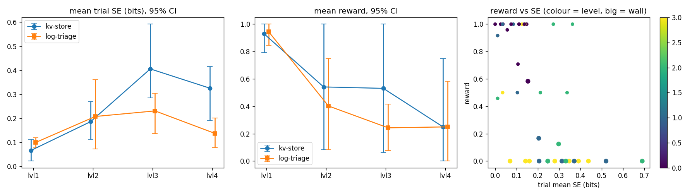
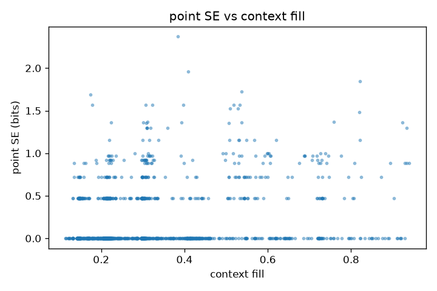
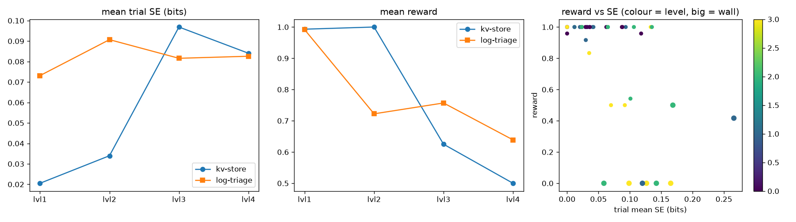

# M6 semantic entropy of CLM context decisions: results (9B, 9B-RL; H3 running)

Plan: [`../instruction-semantic-entropy.md`](../instruction-semantic-entropy.md). Decisions: [`../decisions.md`](../decisions.md).
Code: `infra/semantic_entropy/` (`entropy.py`, `collect.py`, `m6_run.sh`, `m6_status.sh`, `analyze.py`).
Pods (1×A40, $0.59/h, EU-SE-1): 9B `obvrywyztadwv4`; 9B-RL + H3 `dom` `i2qg43j6zshuor`; H3 `rand` `rckduvamr1vclf`. Outputs on volume: `runs/m6-se/`, `runs/m6-probe/`, `runs/m6-h3/`. Logs: `runs/logs/m6-*.log`.

## Config

**Control (M5, unchanged):**
- M5 `skill=clm` 9B trials, 42 logged: KV R260 s44–49, KV R1000/R4000/R16000 s46–49, LogTriage 4 levels s44–49.
- `CB_SETTINGS=paper`, vLLM 0.33.0 BF16, prefix caching on.
- Rootfs `sha256:05a994d2…` (same as M5).
- Sampling = logged request body, resent as is: T 0.7, top_p 0.95, thinking on, max_tokens 8192.

**New:**
- K = 10 samples per point (`n=10`, per-point seed).
- ≤ 40 points per trial: all `context_edit_turn`s + 5 `context_stay_turn`s per fill bin, cap 40.
- Outcome = per-block stay/edit/offload/delete + clobber flag, or `invalid` / `no_tool_call` / `context_status` / `error`.
- Discrete SE in bits.

## Milestones

| # | Done when | State |
|---|---|---|
| 0 | Log fields confirmed | done (earlier session) |
| 1 | `entropy.py` self-check | **done** |
| 2 | Gate A on dev trials | **done: 4/4 trials, 432/432 turns byte-identical** |
| 3 | Gate B + 10 labels hand-checked | **done: Gate B 160/160; 10/10 labels correct** |
| 4 | SE for dev trials; 5 high-SE points read | **done** (below) |
| 5 | Full 9B run + QA | **done: 42/42 trials, 1409 points, 14,090 samples, 0 errors, 0 prompt-token mismatches, Gate B 1397/1397** |
| 6 | Part 2 analysis, go/no-go | **done: GO** (partial ρ = −0.59) |
| 7 | Part 3 probe | **done: TBG probe AUROC 0.74 (controls 0.58 / 0.48), Spearman 0.47** |
| 8 | 9B-RL: full run + Part 2 + Part 3 | **done: GO (partial ρ = −0.48); TBG probe AUROC 0.82 (controls 0.49 / 0.52)** |
| 9 | H3 decision level: SE under directional ablation (`dom`, `rand`) | running |

## Dev trials (milestones 2–4)

| trial | reward | mean SE | max SE | share SE = 0 | edit-turn SE (n) | stay-turn SE (n) | invalid samples |
|---|---|---|---|---|---|---|---|
| KV R4000 s46 (wall) | 0.125 | 0.30 | 1.36 | 0.57 | 0.27 (27) | 0.36 (13) | 21 |
| KV R4000 s49 | 1.0 | 0.36 | 1.52 | 0.57 | 0.39 (31) | 0.26 (9) | 20 |
| LT L1600 s49 (wall) | 0.0 | 0.21 | 1.57 | 0.70 | 0.25 (23) | 0.14 (17) | 1 |
| LT L1600 s47 | 1.0 | 0.04 | 0.47 | 0.93 | 0.04 (33) | 0.00 (7) | 0 |

- **Recipe floor (plan risk 2).** Samples are diverse: every checked point has 10 distinct reasoning traces.
  Most samples still converge on the skill's offload recipe, so 57–93% of points have SE = 0. SE is not flat.
- **5 highest-SE points (1.29–1.57 bits).** Each mixes three decisions:
  1. offload the incoming batch now (the recipe);
  2. answer or look up a pending GET first, context untouched (`grep 'SET K… =' /tmp/ctx_offload/*`);
  3. same recipe, but cut a different set of earlier turns (e.g. delete 6 old blocks vs edit 3).

  These are real context-management choices, not labelling noise.
- **LogTriage:** failed trial (s49) has 5× the mean SE of successful trial (s47). **KV:** no difference on this pair.
- **Hand check** (10 random KV R4000 s46 samples), all 10 correct:
  - offload script: SET-BATCH block `offload`, cut turns (not saved) `delete`;
  - `grep` on a missing offload file: `invalid` (exit 2, no edit);
  - ANSWER `printf`: every block `stay`.

## Full 9B run (milestone 5)

- **Pass 1, 42 trials:** 40 identical, 2 diverge. Both diverge on `ls -la /tmp`: directory size / mtime differ, disk
  content same. Plan drops points after divergence: LT L320 s49 keeps turns < 43 of 84; LT L1600 s45 keeps < 101 of 130.
- **Sampling:** 1409 points, 18:50–20:30 UTC (~1.7 h).
  - Main sampler at 16 concurrent points (dev used 8; KV cache at 4%).
  - Second sampler walks queue in reverse. At 16 it caused 68 vLLM preemptions in ~10 min; restarted at 6, no more
    preemptions. Preemption recomputes; samples unchanged.
- **QA:** Gate B 1237/1237 on 38 non-dev trials (+160/160 dev). 0 sample errors, 0 prompt-token mismatches.

## Part 2: SE vs reward (H1), 9B, n = 42 trials

Full tables: [`figs/m6-se-m5-9b.md`](figs/m6-se-m5-9b.md). Per-trial CSV: `figs/m6-se-trials-m5-9b.csv`.
No format-slip trials among the 42 logged trials.

| cell | n | reward | walls | mean SE | share SE = 0 |
|---|---|---|---|---|---|
| KV R260 | 6 | 0.93 | 1 | 0.07 | 0.91 |
| KV R1000 | 4 | 0.54 | 2 | 0.19 | 0.70 |
| KV R4000 | 4 | 0.53 | 2 | 0.41 | 0.50 |
| KV R16000 | 4 | 0.25 | 3 | 0.33 | 0.55 |
| LT L320 | 6 | 0.94 | 0 | 0.10 | 0.82 |
| LT L1600 | 6 | 0.40 | 3 | 0.21 | 0.71 |
| LT L6400 | 6 | 0.24 | 3 | 0.23 | 0.67 |
| LT L12800 | 6 | 0.25 | 4 | 0.14 | 0.78 |

*Left: mean trial SE per pressure level. Middle: mean reward per level. Right: reward vs trial mean SE, one dot per
trial; colour = level (0 = lowest), big dot = trial hit the context wall.*

**Main test (fixed in plan): partial Spearman ρ(trial mean SE, reward | family×level) = −0.587,
95% bootstrap CI [−0.775, −0.282].** Strong by plan bar (|ρ| ≥ 0.5).
- Max SE: −0.42 [−0.72, −0.05].
- Mean SE over points with fill ≥ 0.75: −0.31 [−0.87, +0.30]. Only 19 trials have such points.

**Regression** `reward ~ mean_SE + C(family:level)`: SE coefficient −2.02 (SE 0.40, p < 0.001); ΔR² = +0.26
(0.40 → 0.66). At same pressure, 0.1 bits more mean uncertainty ≈ 0.20 lower reward.

**Robustness (not pre-registered):**
- add mean fill and number of points: coefficient −1.65, p = 0.0003;
- KV alone ρ = −0.78 (n 18); LogTriage alone ρ = −0.51 (n 24);
- edit turns only ρ = −0.45; stay turns only ρ = −0.42;
- first half of each trial only (points with t / n_turns < 0.5): ρ = −0.24. OLS controlling for first-half fill:
  coefficient −1.29, p = 0.028; controlling for whole-trial fill instead: p = 0.18. **Sensitive to the fill
  control, so only weak evidence that uncertainty precedes failure** (re-checked 2026-11-16);
- point SE vs fill: Spearman 0.20. SE is not mainly context length (plot below).

*One dot per decision point (1409). Most points sit at SE = 0 at every fill; nonzero SE spreads across all fill levels.*

**Pressure shape.** SE rises with pressure up to level 3, then falls at level 4, in both families. Untested guess:
level-4 trials hit the wall early, so they have fewer points and fewer edit decisions.

**Step level:**
- Harmful-edit proxy AUROC 0.38. **Proxy is uninformative.** 971 of 1051 edit turns count as "harmful",
  because the recipe always deletes previous command turns (routine, not damage). Plan's ground-truth label
  (a deleted SET later asked for) is not built yet. Build it next for any step-level claim.
- AUROC of point SE for "point is in a trial that hits the wall": 0.61 [0.59, 0.64].

**Go/no-go: GO.** Partial ρ criterion met. AUROC criterion not met (see above).

## Part 3: SE probes (H2), 9B, 1409 points / 42 trials

Full table: [`figs/probe-m5-9b.md`](figs/probe-m5-9b.md). Direction for H3: `figs/direction-m5-9b.npz` (pod: `runs/m6-probe/`).
Code: `infra/semantic_entropy/probe.py` (`dump` → `extract` → `fit`).

- **Activations:** HF transformers forward pass on logged prompt + logged response. Forward hooks on all 32 decoder
  layers, at TBG (last prompt token) and SLT (last response token). Prompt token counts equal vLLM log at all points.
- **Fit:** γ* = 0 bits (Kossen threshold; 30% of points have SE > 0). Logistic (C 0.05) / ridge (α 1000) on
  standardized activations. 5-fold GroupKFold by trial: no trial in both train and test. Layer chosen on inner folds.

| target | features | score | control |
|---|---|---|---|
| SE > 0 (AUROC) | TBG | **0.741** (layers 18–20) | fill + turn index 0.578; shuffled labels 0.483 |
| SE (Spearman) | TBG | **0.466** (layers 20–22) | fill + turn index 0.159; shuffled −0.033 |
| SE > 0 (AUROC) | SLT | 0.648 | |
| SE (Spearman) | SLT | 0.331 | |
| SE residualized on fill (Spearman) | TBG | **0.371** | |
| trial reward < 0.5 (AUROC) | TBG | 0.671 (layer unstable: 0 or 22) | |

- **H2 supported.** Residual stream encodes SE of the coming context decision *before* generation (TBG).
  Score is well above context-length controls and survives removing fill. TBG > SLT, as in Kossen et al.
- Smoke test (9 trials) gave TBG 0.78; full set gives 0.74. Dev trials did not drive the result.
- **Caveats:**
  1. Probes predict SE from 10 samples, so labels are noisy (most points SE 0).
  2. Logistic direction and diff-of-means direction at layer 20 are nearly orthogonal (cos 0.09). Try both for H3
     steering; diff-of-means is the usual steering choice.
  3. Trial-reward probe is weaker and its layer is unstable. Not a claim.
- Pod `obvrywyztadwv4` stopped after fit.

## 9B-RL (same protocol), 42 trials (milestone 8)

Run 2026-11-16 09:25–12:30 UTC+8, unattended (`m6_chain.sh 9brl m5-9b-rl …`). Model `rl-ckpt-livectx_dapo-iter44`
@ ffc4aab2, served as `qwen35-9b-rl` with the M5 flags. Same 42 cells and seeds as the 9B; everything else unchanged.

- **QA:** Gate A 41/42 identical; KV R16000 s46 diverges at turn 93 of 98 (cause not inspected), later points dropped.
  1435 points, 14,350 samples. Gate B 1421/1421, 0 sample errors, 0 prompt-token mismatches (sampling and probe
  extraction), 133 invalid samples. One format-slip trial excluded from the tests (LT L320 s49: reward 0, no wall).
- First vLLM start died silently during the flashinfer JIT build; relaunched by hand (decisions.md).

Full tables: [`figs/m6-se-m5-9b-rl.md`](figs/m6-se-m5-9b-rl.md), [`figs/probe-m5-9b-rl.md`](figs/probe-m5-9b-rl.md).
Plots `figs/m6-se-m5-9b-rl.png`, `figs/m6-se-fill-m5-9b-rl.png`; CSV `figs/m6-se-trials-m5-9b-rl.csv`.

| cell | n | reward | walls | mean SE | share SE = 0 | 9B reward | 9B mean SE |
|---|---|---|---|---|---|---|---|
| KV R260 | 6 | 0.99 | 0 | 0.02 | 0.96 | 0.93 | 0.07 |
| KV R1000 | 4 | 1.00 | 0 | 0.03 | 0.95 | 0.54 | 0.19 |
| KV R4000 | 4 | 0.63 | 2 | 0.10 | 0.84 | 0.53 | 0.41 |
| KV R16000 | 4 | 0.50 | 2 | 0.08 | 0.86 | 0.25 | 0.33 |
| LT L320 | 5 | 0.99 | 0 | 0.07 | 0.89 | 0.94 | 0.10 |
| LT L1600 | 6 | 0.72 | 2 | 0.09 | 0.87 | 0.40 | 0.21 |
| LT L6400 | 6 | 0.76 | 1 | 0.08 | 0.86 | 0.24 | 0.23 |
| LT L12800 | 6 | 0.64 | 1 | 0.08 | 0.89 | 0.25 | 0.14 |

**Main test (pre-registered): partial ρ(mean SE, reward | level) = −0.477 [−0.736, −0.094] → GO** (9B: −0.587).

| summary | n | ρ [95% CI] |
|---|---|---|
| mean SE | 41 | −0.477 [−0.736, −0.094] |
| max SE | 41 | −0.355 [−0.723, +0.065] |
| mean SE at fill ≥ 0.75 | 8 | −0.640 [−1.00, +0.99] |

- **Regression** `reward ~ mean_SE + C(level)`: coefficient −3.16 (SE 0.98, p = 0.003); ΔR² +0.19 (0.23 → 0.42).
- **Robustness:**
  - add mean fill and number of points: −3.02, p = 0.006;
  - KV ρ = −0.43 (n 18); LogTriage ρ = −0.39 (n 23);
  - edit turns only ρ = −0.22; stay turns only ρ = −0.51;
  - first half only: ρ = −0.10 (OLS p = 0.81 with first-half fill, 0.73 with whole-trial fill). **No early signal;**
  - point SE vs fill: Spearman 0.03.
- **Step level:** harmful-edit proxy AUROC 0.35 (1027/1107 "harmful", same uninformative proxy); wall-trial AUROC 0.56.

**Part 3 probes (9B-RL).** γ* = 0; only 12% of points have SE > 0 (9B: 30%).

| target | features | score (layers) | control |
|---|---|---|---|
| SE > 0 (AUROC) | TBG | **0.818** (28) | fill + turn index 0.493; shuffled 0.522 |
| SE (Spearman) | TBG | **0.383** (28) | fill + turn index 0.004; shuffled −0.006 |
| SE > 0 (AUROC) | SLT | 0.729 (8–10) | |
| SE (Spearman) | SLT | 0.260 | |
| SE residualized on fill (Spearman) | TBG | 0.238 (layer unstable, 12–24) | |
| trial reward < 0.5 (AUROC) | TBG | 0.576 | |

Direction: `figs/direction-m5-9b-rl.npz` (layer 28; cos(w, DoM) = 0.09).

**9B vs 9B-RL:**
- RL scores much higher under pressure (level 4: KV 0.50 vs 0.25, LogTriage 0.64 vs 0.25) and hits the wall less (8 vs 18 trials).
- RL is far more certain: 84–96% of points at SE = 0; mean SE 0.02–0.10 vs 0.07–0.41. The rise of SE with pressure is gone.
- Where RL is uncertain it still does worse (ρ −0.48), with a larger per-bit cost (coefficient −3.16 vs −2.02).
- SE > 0 is at least as decodable (0.82 vs 0.74) but peaks later (layer 28 vs 18–22). Continuous and
  fill-residualized signals are weaker (0.38 / 0.24 vs 0.47 / 0.37), plausibly because SE > 0 is rarer.
- No early-trial SE signal in RL.

## H3 (milestone 9): directional ablation, decision level — running

Design and config: decisions.md (2026-11-16 ~11:55 UTC+8). Edited 9B checkpoints (weight orthogonalization of the
layer-20 diff-of-means SE direction, `dom`; a random direction, `rand`), resampled at the same 1409 9B points with the
same seeds; compare SE to the 9B baseline. Projection check: |h·d|/|h| ≤ 0.0006 at every layer after editing (before:
0.07–0.16 for `dom`, ~0.008 for `rand`, so the random control removes much less of the residual stream).

### H3 update 2026-11-16 ~16:20 UTC+8 (16-trial subset; λ = 0 still running)

User: 2 trials per family × level (subset `queue-h3sub.txt`, 547 points), full ablation (λ = 0); λ = 0.5 because
λ = 0 broke the tool-call format. Rejection sampling for λ = 0 running (pod 2). Table: [`figs/h3-sub-partial.md`](figs/h3-sub-partial.md).

| condition | format failures | agree with logged | ΔSE plain (p) | ΔSE valid-only (p) | ΔSE per trial, valid-only [95% CI] |
|---|---|---|---|---|---|
| `rand` (16 trials) | 0.1% | 90% (base 90%) | −0.010 (0.79) | −0.004 (0.99) | −0.004 [−0.017, +0.007] |
| `dom05` λ = 0.5 (16) | 0.1% | 90% | **−0.048 (0.004)** | **−0.062 (0.0001)** | −0.053 [−0.090, −0.021] |
| `dom` λ = 0 (13 so far) | 48% | 25% | +0.720 (1e-52) | +0.172 (1e-8) | +0.162 [+0.118, +0.203] |

- **λ = 0.5 keeps the format intact and lowers SE** (baseline 0.242 → 0.194 bits on these points); per-trial CI
  excludes 0 for valid-only SE, not for plain (−0.041 [−0.087, +0.003]).
- **The λ = 0.5 effect is family-specific:** LogTriage SE falls at every level (L320 −0.05, L1600 −0.16, L6400 −0.10,
  L12800 −0.10); KV rises slightly at every level (+0.01 to +0.04).
- **λ = 0 is off-distribution:** half the samples lose the tool-call format; among valid samples SE rises.
- Non-monotonic dose response (λ 0.5: down; λ 0: up, with format collapse). A λ > 1 (amplify) condition would test
  whether SE rises when the direction is strengthened; not run.
- Bug: `h3_sub.sh`'s rejection-sampling stage used `$R`, which `m6env.sh` overwrites, so it ran on the wrong directory
  and did nothing (no files written). Replaced by `h3_rs.sh`.

### Is H1/H2 driven by tool-use uncertainty? (check 2026-11-16 ~17:30 UTC+8)

SE mixes two things: which context decision the model makes, and whether its command/format works (`invalid`,
`no_tool_call`, … clusters). Split per point: **decision-only SE** = SE over `ok` samples (≥ 2 needed);
**status-only SE** = entropy of {ok, invalid, no_tool_call, …}. Points with any failed/format sample: 9B 11%, RL 4%.
Trial-level corr(SE, decision-only SE) = 0.93 (9B) / 0.91 (RL).

| H1: partial ρ with reward \| level [95% CI] | 9B | 9B-RL |
|---|---|---|
| SE (as reported) | −0.587 [−0.775, −0.282] | −0.477 [−0.737, −0.099] |
| decision-only SE | **−0.496 [−0.731, −0.120]** | **−0.446 [−0.698, −0.063]** |
| status-only SE | −0.472 [−0.675, −0.218] | −0.287 [−0.618, +0.116] |
| joint OLS (both + level): decision / status coef (p) | −1.50 (0.010) / −2.85 (0.004) | −5.59 (0.004) / +0.54 (0.82) |

| H2: TBG probe, fixed layer (9B 20, RL 28), 5-fold by trial | 9B act. / fill+turn | 9B-RL act. / fill+turn |
|---|---|---|
| SE > 0 (AUROC) | 0.745 / 0.578 | 0.820 / 0.493 |
| decision-only SE > 0 (AUROC) | **0.766 / 0.520** | **0.809 / 0.487** |
| status-only SE > 0 (AUROC) | 0.741 / 0.675 | 0.833 / 0.545 |
| decision-only SE (Spearman) | 0.433 / 0.048 | 0.347 / −0.006 |

- **H1 and H2 hold on decision-only SE in both models**; context-decision uncertainty alone predicts failure and is
  decodable before generation, with the context-length control at chance.
- Tool-use uncertainty is a second, partly separate signal: in the 9B it predicts reward on its own (joint OLS
  p = 0.004) and is partly predictable from context length (fill+turn AUROC 0.675); in 9B-RL it adds nothing.
- Report H1/H2 with decision-only SE as a robustness row; the headline numbers mix both components.

