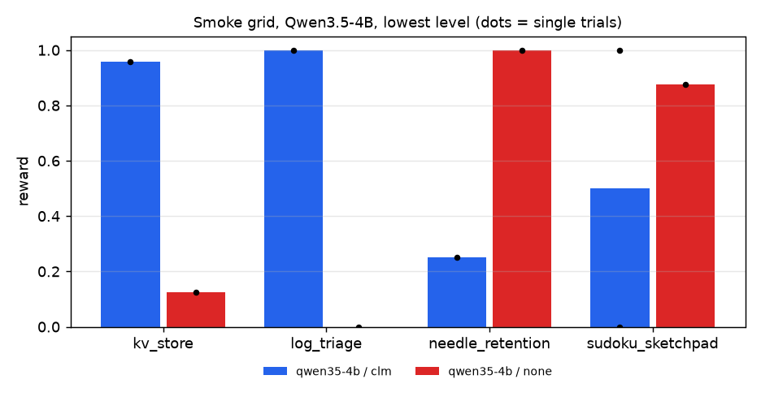

# Smoke grid: model × skill on all four ContextBench families

Date: 2026-11-14. 4B part: 18:46–19:22 UTC (done). 9B part: pending (Phase B).
Raw trials: `runs/smoke-4b-{none,clm}/trials/` (gitignored).

Per-trial table: [`figs/smoke-grid-4b.md`](figs/smoke-grid-4b.md). Plot: [`figs/smoke-grid-4b.png`](figs/smoke-grid-4b.png).

## Setup (control unless marked)

- Serving: vLLM 0.33.0, BF16, one shared server. Sandbox: proot.
- Agent: `ClmStream`, `CB_SETTINGS=paper` (budget 32768 / reserve 2048, no step cap,
  no nudges, T=0.7, max_tokens 8192, thinking on).
- Level: the lowest main rung near 0.5x of each family (everything fits if no tokens are
  wasted): KV R260, LogTriage L320, Needle K4-C4, Sudoku t8. Seed 42 (+ Sudoku seed 43 with clm).
- **Vary:** `skill` none / clm; model 4B (now), 9B (Phase B).
- Differs from M1: M1 used the App. F settings (32000 / 4096 / 240 steps).

## Results: Qwen3.5-4B

| Family | skill=none | skill=clm | none: how it ended | clm: edits |
|---|---|---|---|---|
| KV R260 | 0.125 (3/24 answered) | **0.958** | budget wall at op 7/27 | 3 |
| LogTriage L320 | 0.000 | **1.000** | budget wall at op 17/47 | 23 |
| Needle K4-C4 | **1.000** | 0.250 | finished (fits in context) | 4 (needles deleted) |
| Sudoku t8 | 0.875 | 0.000 (s42) / 1.000 (s43) | finished, one bad version | 8 / 7 |

## Analysis

1. **Where the stream does not fit as delivered, the skill decides everything.** KV and
   LogTriage without the skill hit the budget wall early (op 7/27, 17/47) even at ~0.5x
   pressure: the model keeps raw batches plus its own retyped copies in context. With the
   skill both score ~1.0, and LogTriage makes one offload edit per batch (23).
2. **Where everything fits, the skill can hurt.** Needle K4-C4 and Sudoku t8 fit in the
   window without edits, so `none` scores 1.0 / 0.875. With the skill the 4B must copy a
   more intricate recipe, and one slip is fatal: on Needle it dropped the `t[k:i]` slice
   that keeps the chunk's needles, so each edit deleted the needles (4/16 kept); on Sudoku
   seed 42 it lost one move in the in-place sketchpad (0/8, 255/256 cells right).
3. **Recipe complexity predicts 4B reliability.** KV / LogTriage recipes are "cut block,
   save to disk"; the Needle recipe must cut the filler but keep the lines around it, and
   Sudoku edits a board in place. The 4B executes the first kind every time and the
   second kind inconsistently (see the full Needle run, [`m2c-needle-results.md`](m2c-needle-results.md)).
4. Consequence: at higher pressure only the skill can work (nothing fits), so the full
   runs use `skill=clm`; Needle's score there measures recipe fidelity more than memory.

## Results: Qwen3.5-9B

Pending (Phase B: after all 4B trials finish, swap the server to 9B).
